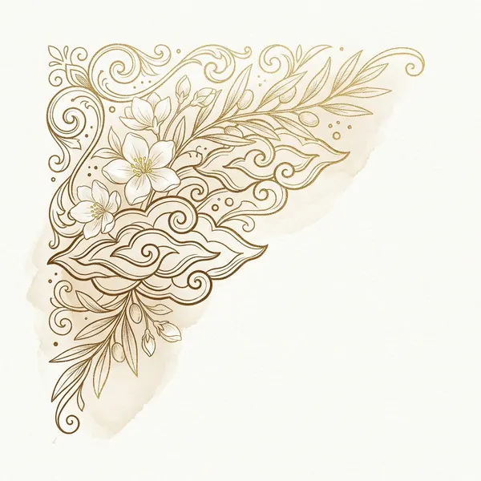
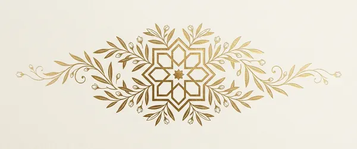

# Kode lengkap file yang berubah

Ganti isi file sesuai path masing-masing. File PNG harus diupload, bukan ditempel sebagai teks.

## index.html

````html
<!doctype html>
<html lang="id">
  <head>
    <meta charset="UTF-8" />
    <meta name="viewport" content="width=device-width, initial-scale=1, viewport-fit=cover, maximum-scale=5" />
    <meta name="theme-color" content="#1b110d" />
    <title>{{title}} — Wedding Quest</title>
    <meta name="description" content="Undangan pernikahan interaktif {{couple.groom.name}} &amp; {{couple.bride.name}}. Jelajahi taman pernikahan kami — {{events.akad.displayDate}}, {{location.name}}, {{location.city}}." />

    <meta property="og:type" content="website" />
    <meta property="og:site_name" content="Wedding Quest" />
    <meta property="og:title" content="{{title}}" />
    <meta property="og:description" content="Yuk jalan-jalan keliling peta pernikahan kami dan sapa pasangan. {{events.akad.displayDate}}." />
    <meta property="og:url" content="%VITE_SITE_URL%/" />
    <meta property="og:image" content="%VITE_SITE_URL%/assets/couple-whimpy-xinxin.png" />
    <meta property="og:image:width" content="1200" />
    <meta property="og:image:height" content="630" />
    <meta property="og:locale" content="id_ID" />

    <meta name="twitter:card" content="summary_large_image" />
    <meta name="twitter:title" content="{{title}}" />
    <meta name="twitter:description" content="Undangan pernikahan interaktif 16-bit. {{events.akad.displayDate}}." />
    <meta name="twitter:image" content="%VITE_SITE_URL%/assets/couple-whimpy-xinxin.png" />

    <link rel="icon" href="/assets/icons/nav_pasangan.svg" />
    <link rel="preconnect" href="https://fonts.googleapis.com" />
    <link rel="preconnect" href="https://fonts.gstatic.com" crossorigin />
    <link
      rel="stylesheet"
      href="https://fonts.googleapis.com/css2?family=Press+Start+2P&family=Playfair+Display:ital,wght@0,600;0,700;1,600;1,700&family=Plus+Jakarta+Sans:wght@400;500;600;700&family=Amiri&display=swap"
    />
    <link rel="preload" as="image" href="/assets/map/world_map_v2.jpg" />
  </head>
  <body>
    <div id="root"></div>
    <script type="module" src="/src/main.tsx"></script>
  </body>
</html>

````

## public/assets/frames/frame_batik_gold.svg

````xml
<svg xmlns="http://www.w3.org/2000/svg" viewBox="0 0 600 800" width="100%" height="100%">
  <defs>
    <style>
      @import url('https://fonts.googleapis.com/css2?family=Playfair+Display:ital,wght@0,700;1,600&amp;family=Plus+Jakarta+Sans:wght@600;700&amp;display=swap');
      .batik-header { font-family: 'Plus Jakarta Sans', sans-serif; font-size: 13px; font-weight: 700; fill: #F4E07B; text-anchor: middle; letter-spacing: 4px; }
      .batik-names { font-family: 'Playfair Display', serif; font-size: 28px; font-weight: 700; fill: #FFFFFF; text-anchor: middle; letter-spacing: 2px; }
      .batik-date { font-family: 'Plus Jakarta Sans', sans-serif; font-size: 12px; font-weight: 700; fill: #D4AF37; text-anchor: middle; letter-spacing: 3px; }
      .batik-sub { font-family: 'Plus Jakarta Sans', sans-serif; font-size: 11px; font-weight: 600; fill: #EAD9BE; text-anchor: middle; font-style: italic; }
    </style>

    <!-- Royal Maroon Gradient -->
    <linearGradient id="maroonGrad" x1="0%" y1="0%" x2="0%" y2="100%">
      <stop offset="0%" stop-color="#3A080E"/>
      <stop offset="50%" stop-color="#240508"/>
      <stop offset="100%" stop-color="#150204"/>
    </linearGradient>

    <!-- Metallic Gold Gradient -->
    <linearGradient id="goldBatik" x1="0%" y1="0%" x2="100%" y2="100%">
      <stop offset="0%" stop-color="#FDF6E2"/>
      <stop offset="35%" stop-color="#D4AF37"/>
      <stop offset="70%" stop-color="#AA8022"/>
      <stop offset="100%" stop-color="#F4E07B"/>
    </linearGradient>

    <!-- Batik Pattern Definition -->
    <pattern id="batikParang" width="40" height="40" patternUnits="userSpaceOnUse">
      <path d="M 0,20 L 20,0 L 40,20 L 20,40 Z" fill="none" stroke="#D4AF37" stroke-width="1.5" stroke-opacity="0.6"/>
      <circle cx="20" cy="20" r="3" fill="#D4AF37" fill-opacity="0.7"/>
      <line x1="0" y1="0" x2="40" y2="40" stroke="#D4AF37" stroke-width="1" stroke-opacity="0.3"/>
    </pattern>
  </defs>

  <!-- Royal Maroon Base -->
  <rect x="0" y="0" width="600" height="800" fill="url(#maroonGrad)" rx="16"/>

  <!-- Ornate Batik Border -->
  <rect x="16" y="16" width="568" height="768" fill="url(#batikParang)" rx="12"/>
  <rect x="24" y="24" width="552" height="752" fill="none" stroke="url(#goldBatik)" stroke-width="3" rx="8"/>
  <rect x="30" y="30" width="540" height="740" fill="none" stroke="#F4E07B" stroke-opacity="0.3" stroke-width="1" rx="6"/>

  <!-- Top Title Header -->
  <g transform="translate(300, 58)">
    <text x="0" y="0" class="batik-header">ROYAL BATIK GOLD</text>
    <!-- Little Floral Flourish -->
    <polygon points="0,12 5,16 0,20 -5,16" fill="url(#goldBatik)"/>
    <line x1="-60" y1="16" x2="-14" y2="16" stroke="url(#goldBatik)" stroke-width="1.5"/>
    <line x1="14" y1="16" x2="60" y2="16" stroke="url(#goldBatik)" stroke-width="1.5"/>
  </g>

  <!-- TRANSPARENT PHOTO VIEWPORT (Webcam Cutout) -->
  <!-- Dimensions: 480x520 at (60, 95) -->
  <rect x="56" y="91" width="488" height="528" fill="#150204"/>
  <rect x="60" y="95" width="480" height="520" fill="#FFFFFF"/>
  <rect x="56" y="91" width="488" height="528" fill="none" stroke="url(#goldBatik)" stroke-width="4" rx="4"/>
  <rect x="52" y="87" width="496" height="536" fill="none" stroke="#D4AF37" stroke-opacity="0.4" stroke-width="1" rx="8"/>

  <!-- CORNER JAVANESE FLORAL SEALS -->
  <!-- Top-Left Corner Seal -->
  <g transform="translate(45, 80)">
    <circle cx="0" cy="0" r="14" fill="#240508" stroke="url(#goldBatik)" stroke-width="2"/>
    <polygon points="0,-8 6,0 0,8 -6,0" fill="url(#goldBatik)"/>
  </g>
  <!-- Top-Right Corner Seal -->
  <g transform="translate(555, 80)">
    <circle cx="0" cy="0" r="14" fill="#240508" stroke="url(#goldBatik)" stroke-width="2"/>
    <polygon points="0,-8 6,0 0,8 -6,0" fill="url(#goldBatik)"/>
  </g>
  <!-- Bottom-Left Corner Seal -->
  <g transform="translate(45, 630)">
    <circle cx="0" cy="0" r="14" fill="#240508" stroke="url(#goldBatik)" stroke-width="2"/>
    <polygon points="0,-8 6,0 0,8 -6,0" fill="url(#goldBatik)"/>
  </g>
  <!-- Bottom-Right Corner Seal -->
  <g transform="translate(555, 630)">
    <circle cx="0" cy="0" r="14" fill="#240508" stroke="url(#goldBatik)" stroke-width="2"/>
    <polygon points="0,-8 6,0 0,8 -6,0" fill="url(#goldBatik)"/>
  </g>

  <!-- DYNAMIC COUPLE FOOTER: names and date from wedding.json -->
  <g transform="translate(300, 680)">
    <rect x="-220" y="-20" width="440" height="95" fill="#240508" stroke="url(#goldBatik)" stroke-width="2" rx="8"/>
    
    <text x="0" y="16" class="batik-names">{{couple.groom.name}} &amp; {{couple.bride.name}}</text>
    <text x="0" y="44" class="batik-date">{{date.long|upper}}</text>
    <text x="0" y="64" class="batik-sub">Walimatul &apos;Ursy • The Beginning of Forever</text>
  </g>
</svg>

````

## public/assets/frames/frame_botanical.svg

````xml
<svg xmlns="http://www.w3.org/2000/svg" viewBox="0 0 600 800" width="100%" height="100%">
  <defs>
    <!-- Dynamic Font Styles -->
    <style>
      @import url('https://fonts.googleapis.com/css2?family=Playfair+Display:ital,wght@0,700;1,600&amp;family=Plus+Jakarta+Sans:wght@500;700&amp;display=swap');
      .title-text { font-family: 'Playfair Display', serif; font-size: 26px; font-weight: 700; fill: #2D4A3E; text-anchor: middle; font-style: italic; }
      .date-text { font-family: 'Plus Jakarta Sans', sans-serif; font-size: 14px; font-weight: 700; fill: #8B6F47; text-anchor: middle; letter-spacing: 2px; }
      .banner-title { font-family: 'Plus Jakarta Sans', sans-serif; font-size: 12px; font-weight: 700; fill: #2D4A3E; text-anchor: middle; letter-spacing: 3px; }
    </style>
    
    <!-- Botanical Leaf Gradient -->
    <linearGradient id="leafGrad" x1="0%" y1="0%" x2="100%" y2="100%">
      <stop offset="0%" stop-color="#4E7D63"/>
      <stop offset="100%" stop-color="#26533A"/>
    </linearGradient>
    <linearGradient id="goldGrad" x1="0%" y1="0%" x2="100%" y2="100%">
      <stop offset="0%" stop-color="#F4E07B"/>
      <stop offset="100%" stop-color="#C5A059"/>
    </linearGradient>
  </defs>

  <!-- Card Background (Cream Linen Texture) -->
  <rect x="0" y="0" width="600" height="800" fill="#FCF9F2" rx="16"/>
  
  <!-- Outer Gold Pinstripe Border -->
  <rect x="20" y="20" width="560" height="760" fill="none" stroke="url(#goldGrad)" stroke-width="3" rx="12"/>
  <rect x="26" y="26" width="548" height="748" fill="none" stroke="#2D4A3E" stroke-opacity="0.2" stroke-width="1" rx="8"/>

  <!-- Top Ribbon Banner -->
  <g transform="translate(300, 48)">
    <path d="M -90 -16 L 90 -16 L 80 12 L -80 12 Z" fill="#F4EDE0" stroke="#C5A059" stroke-width="1.5"/>
    <text x="0" y="3" class="banner-title">BOTANICAL GARDEN</text>
  </g>

  <!-- TRANSPARENT PHOTO CUTOUT (For Webcam Selfie / Image Slot) -->
  <!-- Dimensions: 480x520 at (60, 90) -->
  <rect x="56" y="86" width="488" height="568" fill="none" stroke="url(#goldGrad)" stroke-width="4" rx="8"/>
  <rect x="60" y="90" width="480" height="560" fill="none" stroke="#2D4A3E" stroke-opacity="0.3" stroke-width="2"/>

  <!-- CORNER BOTANICAL ORNAMENTS -->
  <!-- Top Left Leaves & Jasmine -->
  <g transform="translate(25, 25)">
    <path d="M 0 0 C 30 10 50 40 40 80 C 20 60 10 30 0 0 Z" fill="url(#leafGrad)"/>
    <path d="M 15 5 C 45 15 65 50 60 90 C 40 70 25 40 15 5 Z" fill="#3D6B52"/>
    <circle cx="25" cy="40" r="8" fill="#FFFFFF" stroke="#C5A059" stroke-width="1.5"/>
    <circle cx="25" cy="40" r="3" fill="#F4E07B"/>
  </g>

  <!-- Top Right Leaves & Jasmine -->
  <g transform="translate(575, 25) scale(-1, 1)">
    <path d="M 0 0 C 30 10 50 40 40 80 C 20 60 10 30 0 0 Z" fill="url(#leafGrad)"/>
    <path d="M 15 5 C 45 15 65 50 60 90 C 40 70 25 40 15 5 Z" fill="#3D6B52"/>
    <circle cx="25" cy="40" r="8" fill="#FFFFFF" stroke="#C5A059" stroke-width="1.5"/>
    <circle cx="25" cy="40" r="3" fill="#F4E07B"/>
  </g>

  <!-- Bottom Left Botanical Vines -->
  <g transform="translate(25, 775) scale(1, -1)">
    <path d="M 0 0 C 30 10 50 40 40 80 C 20 60 10 30 0 0 Z" fill="url(#leafGrad)"/>
    <path d="M 15 5 C 45 15 65 50 60 90 C 40 70 25 40 15 5 Z" fill="#3D6B52"/>
    <circle cx="25" cy="40" r="8" fill="#FFFFFF" stroke="#C5A059" stroke-width="1.5"/>
    <circle cx="25" cy="40" r="3" fill="#F4E07B"/>
  </g>

  <!-- Bottom Right Botanical Vines -->
  <g transform="translate(575, 775) scale(-1, -1)">
    <path d="M 0 0 C 30 10 50 40 40 80 C 20 60 10 30 0 0 Z" fill="url(#leafGrad)"/>
    <path d="M 15 5 C 45 15 65 50 60 90 C 40 70 25 40 15 5 Z" fill="#3D6B52"/>
    <circle cx="25" cy="40" r="8" fill="#FFFFFF" stroke="#C5A059" stroke-width="1.5"/>
    <circle cx="25" cy="40" r="3" fill="#F4E07B"/>
  </g>

  <!-- DYNAMIC COUPLE FOOTER: names and date from wedding.json -->
  <g transform="translate(300, 700)">
    <text x="0" y="0" class="title-text">{{couple.groom.name}} &amp; {{couple.bride.name}}</text>
    <text x="0" y="32" class="date-text">{{date.long|upper}}</text>
    <!-- Little Gold Diamond Icon -->
    <polygon points="0,48 4,52 0,56 -4,52" fill="#C5A059"/>
    <line x1="-80" y1="52" x2="-16" y2="52" stroke="#C5A059" stroke-width="1"/>
    <line x1="16" y1="52" x2="80" y2="52" stroke="#C5A059" stroke-width="1"/>
  </g>
</svg>

````

## public/assets/frames/frame_retro_rpg.svg

````xml
<svg xmlns="http://www.w3.org/2000/svg" viewBox="0 0 600 800" width="100%" height="100%" shape-rendering="crispEdges">
  <defs>
    <style>
      @import url('https://fonts.googleapis.com/css2?family=Press+Start+2P&amp;family=Plus+Jakarta+Sans:wght@700&amp;display=swap');
      .rpg-title { font-family: 'Press Start 2P', monospace; font-size: 16px; fill: #FDF6E2; text-anchor: middle; }
      .rpg-couple { font-family: 'Press Start 2P', monospace; font-size: 14px; fill: #F4E07B; text-anchor: middle; }
      .rpg-date { font-family: 'Press Start 2P', monospace; font-size: 10px; fill: #FFFFFF; text-anchor: middle; }
      .rpg-sub { font-family: 'Press Start 2P', monospace; font-size: 8px; fill: #C4A482; text-anchor: middle; }
    </style>
  </defs>

  <!-- Wooden Game UI Frame Base -->
  <rect x="0" y="0" width="600" height="800" fill="#2D1E18" rx="8"/>
  <rect x="8" y="8" width="584" height="784" fill="#4A2E18"/>
  <rect x="16" y="16" width="568" height="768" fill="#734D2E"/>
  <rect x="24" y="24" width="552" height="752" fill="#2D1E18"/>

  <!-- Top Blue Banner: WEDDING QUEST -->
  <rect x="140" y="32" width="320" height="40" fill="#1D4ED8"/>
  <rect x="144" y="36" width="312" height="32" fill="#2563EB"/>
  <rect x="140" y="32" width="320" height="4" fill="#60A5FA"/>
  <rect x="140" y="68" width="320" height="4" fill="#1E3A8A"/>
  <!-- Banner Tail Trim -->
  <polygon points="120,52 140,32 140,72" fill="#1E3A8A"/>
  <polygon points="480,52 460,32 460,72" fill="#1E3A8A"/>
  <text x="300" y="58" class="rpg-title">WEDDING QUEST</text>

  <!-- HP Hearts Bar (Top Center) -->
  <g transform="translate(190, 84)">
    <g transform="translate(0, 0)"><rect x="0" y="0" width="16" height="14" fill="#EF4444"/><rect x="2" y="2" width="4" height="4" fill="#FCA5A5"/></g>
    <g transform="translate(24, 0)"><rect x="0" y="0" width="16" height="14" fill="#EF4444"/><rect x="2" y="2" width="4" height="4" fill="#FCA5A5"/></g>
    <g transform="translate(48, 0)"><rect x="0" y="0" width="16" height="14" fill="#EF4444"/><rect x="2" y="2" width="4" height="4" fill="#FCA5A5"/></g>
    <g transform="translate(72, 0)"><rect x="0" y="0" width="16" height="14" fill="#EF4444"/><rect x="2" y="2" width="4" height="4" fill="#FCA5A5"/></g>
    <g transform="translate(96, 0)"><rect x="0" y="0" width="16" height="14" fill="#EF4444"/><rect x="2" y="2" width="4" height="4" fill="#FCA5A5"/></g>
  </g>

  <!-- Left Side RPG Heart Gems -->
  <g transform="translate(36, 120)">
    <rect x="0" y="0" width="16" height="14" fill="#EF4444"/>
    <rect x="0" y="40" width="16" height="14" fill="#EF4444"/>
    <rect x="0" y="80" width="16" height="14" fill="#EF4444"/>
    <rect x="0" y="120" width="16" height="14" fill="#EF4444"/>
    <rect x="0" y="160" width="16" height="14" fill="#D4AF37"/>
    <!-- Gold Coin -->
    <circle cx="8" cy="220" r="10" fill="#F59E0B"/>
    <circle cx="8" cy="220" r="7" fill="#FBBF24"/>
  </g>

  <!-- Right Side RPG Mana & Gems -->
  <g transform="translate(548, 120)">
    <polygon points="8,0 16,12 8,24 0,12" fill="#A855F7"/>
    <polygon points="8,40 16,52 8,64 0,52" fill="#3B82F6"/>
    <polygon points="8,80 16,92 8,104 0,92" fill="#10B981"/>
    <polygon points="8,120 16,132 8,144 0,132" fill="#EC4899"/>
    <polygon points="8,160 16,172 8,184 0,172" fill="#10B981"/>
  </g>

  <!-- TRANSPARENT PHOTO VIEWPORT -->
  <!-- Dimensions: 460x490 at (70, 115) -->
  <rect x="66" y="111" width="468" height="498" fill="#FDF6E2"/>
  <rect x="70" y="115" width="460" height="490" fill="#FFFFFF"/>
  <rect x="66" y="111" width="468" height="498" fill="none" stroke="#2D1E18" stroke-width="4"/>

  <!-- BOTTOM STATS / SAVE GAME FOOTER -->
  <rect x="56" y="625" width="488" height="135" fill="#1E140F" stroke="#D4AF37" stroke-width="2" rx="4"/>
  
  <!-- Player Names & Save Game Header -->
  <text x="300" y="658" class="rpg-sub">PLAYER 1 &amp; PLAYER 2</text>
  <text x="300" y="688" class="rpg-couple">★ {{couple.groom.name|upper}} &amp; {{couple.bride.name|upper}} ★</text>
  
  <!-- Date & Level Info -->
  <text x="300" y="718" class="rpg-date">♥ SAVE DATE: {{date.short|upper}} ♥</text>
  <text x="300" y="742" class="rpg-sub">LEVEL: INFINITY LOVE • STATUS: HAPPILY EVER AFTER</text>

  <!-- Little Mana Bars on Bottom Left -->
  <g transform="translate(70, 645)">
    <rect x="0" y="0" width="30" height="6" fill="#EF4444"/>
    <rect x="0" y="10" width="30" height="6" fill="#3B82F6"/>
    <rect x="0" y="20" width="30" height="6" fill="#10B981"/>
  </g>
</svg>

````

## public/assets/ui/cover_envelope.svg

````xml
<svg xmlns="http://www.w3.org/2000/svg" viewBox="0 0 500 350" width="100%" height="100%">
  <defs>
    <style>
      @import url('https://fonts.googleapis.com/css2?family=Playfair+Display:ital,wght@0,700;1,600&amp;family=Plus+Jakarta+Sans:wght@600;700&amp;display=swap');
      .cover-title { font-family: 'Playfair Display', serif; font-size: 26px; font-weight: 700; fill: #2D1E18; text-anchor: middle; font-style: italic; }
      .cover-sub { font-family: 'Plus Jakarta Sans', sans-serif; font-size: 11px; font-weight: 700; fill: #8B6F47; text-anchor: middle; letter-spacing: 3px; }
      .guest-label { font-family: 'Plus Jakarta Sans', sans-serif; font-size: 12px; font-weight: 600; fill: #8B6F47; text-anchor: middle; }
      .guest-name { font-family: 'Plus Jakarta Sans', sans-serif; font-size: 16px; font-weight: 700; fill: #2D4A3E; text-anchor: middle; }
    </style>

    <linearGradient id="envelopeGrad" x1="0%" y1="0%" x2="0%" y2="100%">
      <stop offset="0%" stop-color="#FFFDF7"/>
      <stop offset="100%" stop-color="#EAD9BE"/>
    </linearGradient>
    <linearGradient id="waxGrad" x1="0%" y1="0%" x2="100%" y2="100%">
      <stop offset="0%" stop-color="#EF4444"/>
      <stop offset="50%" stop-color="#B91C1C"/>
      <stop offset="100%" stop-color="#7F1D1D"/>
    </linearGradient>
    <linearGradient id="goldRibbon" x1="0%" y1="0%" x2="100%" y2="100%">
      <stop offset="0%" stop-color="#FDE68A"/>
      <stop offset="50%" stop-color="#D4AF37"/>
      <stop offset="100%" stop-color="#AA8022"/>
    </linearGradient>
  </defs>

  <!-- Envelope Body Base -->
  <rect x="20" y="20" width="460" height="310" fill="url(#envelopeGrad)" stroke="#4A2E18" stroke-width="4" rx="12"/>
  <rect x="28" y="28" width="444" height="294" fill="none" stroke="#D4AF37" stroke-width="1.5" rx="8"/>

  <!-- Gold Ribbon Vertical & Horizontal -->
  <rect x="240" y="20" width="20" height="310" fill="url(#goldRibbon)"/>
  <rect x="20" y="160" width="460" height="20" fill="url(#goldRibbon)"/>

  <!-- Upper Envelope Flap Triangle -->
  <polygon points="20,20 250,170 480,20" fill="#FDF6E2" stroke="#4A2E18" stroke-width="3"/>
  <polygon points="28,26 250,162 472,26" fill="none" stroke="#D4AF37" stroke-width="1"/>

  <!-- Header Couple Names (Top Flap Area) -->
  <text x="250" y="60" class="cover-sub">THE WEDDING INVITATION</text>
  <text x="250" y="95" class="cover-title">{{couple.groom.name}} &amp; {{couple.bride.name}}</text>
  <text x="250" y="125" class="cover-sub">{{date.long|upper}}</text>

  <!-- Guest Card Slot (Bottom Center) -->
  <g transform="translate(250, 235)">
    <rect x="-140" y="-30" width="280" height="60" fill="#FFFFFF" stroke="#4A2E18" stroke-width="2" rx="8"/>
    <text x="0" y="-8" class="guest-label">Kepada Yth. Bapak/Ibu/Saudara/i:</text>
    <text x="0" y="18" class="guest-name">Tamu Undangan</text>
  </g>

  <!-- Center Wax Seal Button Stamp -->
  <g transform="translate(250, 170)" style="cursor: pointer;">
    <!-- Wax Seal Outer Ring -->
    <circle cx="0" cy="0" r="30" fill="url(#waxGrad)" stroke="#4A2E18" stroke-width="3"/>
    <circle cx="0" cy="0" r="26" fill="url(#waxGrad)" stroke="#FCA5A5" stroke-width="1" stroke-opacity="0.5"/>
    <circle cx="0" cy="0" r="20" fill="none" stroke="#D4AF37" stroke-width="1.5" stroke-dasharray="3,2"/>
    
    <!-- Monogram I & F -->
    <text x="0" y="7" font-family="'Playfair Display', serif" font-size="18px" font-weight="700" fill="#FDF6E2" text-anchor="middle" font-style="italic">{{couple.groom.name|initial}}&amp;{{couple.bride.name|initial}}</text>
  </g>
</svg>

````

## scripts/check-config.mjs

````javascript
/**
 * Validates the wedding JSON in use — wedding.local.json when it exists, else
 * wedding.json — against the shape of the public sample. Run: npm run check
 *
 * tsc only ever sees the sample, so without this a missing field in the real
 * file would build cleanly and render as a blank on the invitation.
 * Messages are in Indonesian: this is the check people editing the JSON meet.
 */
import { existsSync, readFileSync } from 'node:fs';

const FILE = existsSync('wedding.local.json') ? 'wedding.local.json' : 'wedding.json';
const read = (f) => {
  try { return JSON.parse(readFileSync(f, 'utf8')); }
  catch (e) { console.error(`✗ ${f} bukan JSON yang valid: ${e.message}`); process.exit(1); }
};
const sample = read('wedding.json');
const w = read(FILE);
const errors = [];
const kind = (v) => (Array.isArray(v) ? 'array' : v === null ? 'null' : typeof v);

// Every field in the sample must exist with the same type. Extra fields are fine.
(function same(want, got, path) {
  if (kind(want) !== kind(got)) return errors.push(`${path}: harus ${kind(want)}, ternyata ${kind(got)}`);
  if (kind(want) === 'array') {
    if (!got.length) { if (path === 'ngobrol.questions') return; return errors.push(`${path}: tidak boleh kosong`); }
    got.forEach((g, i) => same(want[0], g, `${path}[${i}]`));
  } else if (kind(want) === 'object') {
    for (const k of Object.keys(want)) {
      const at = path ? `${path}.${k}` : k;
      if (!(k in got)) errors.push(`${at}: belum diisi`);
      else same(want[k], got[k], at);
    }
  } else if (kind(want) === 'string' && !got.trim() && !/^(hashtag|couple\.(bride|groom)\.(instagram|bio)|ngobrol\.)/.test(path)) errors.push(`${path}: masih kosong`);
})(sample, w, '');

/** A rule on a field the shape check may already have reported missing: skip it then, it is listed. */
const rule = (path, pass, msg) => {
  try { if (!pass()) errors.push(`${path}: ${msg}`); } catch { /* reported above */ }
};

for (const key of ['akad', 'resepsi']) {
  const e = w.events?.[key];
  rule(`events.${key}.date`, () => /^\d{4}-\d{2}-\d{2}$/.test(e.date) && !isNaN(Date.parse(e.date)), 'format harus YYYY-MM-DD, contoh "2027-06-12"');
  rule(`events.${key}.time`, () => /\d{1,2}[:.]\d{2}/.test(e.time), 'tulis jamnya, contoh "08:00 - 10:00 WIB"');
  rule(`events.${key}.mapsUrl`, () => /^https?:\/\//.test(e.mapsUrl), 'harus link lengkap (https://...)');
}
rule('ceremonyStart', () => /^\d{4}-\d{2}-\d{2}T\d{2}:\d{2}(:\d{2})?[+-]\d{2}:\d{2}$/.test(w.ceremonyStart) && !isNaN(Date.parse(w.ceremonyStart)),
  'format harus "YYYY-MM-DDTHH:MM:SS+07:00" (WIB +07:00, WITA +08:00, WIT +09:00)');
for (const who of ['bride', 'groom']) {
  rule(`couple.${who}.instagram`, () => !w.couple[who].instagram.startsWith('@'), 'tulis tanpa "@"');
}
rule('bgmUrl', () => existsSync(`public${w.bgmUrl}`), `file public${w.bgmUrl} tidak ditemukan`);
if (!existsSync(`public${w.invitationBgm.url}`)) console.warn('Musik undangan belum tersedia: tambahkan public' + w.invitationBgm.url);
(w.ngobrol?.questions ?? []).forEach((q, i) => {
  const at = `ngobrol.questions[${i}]`;
  rule(at, () => q.options.length === 3, `harus tepat 3 pilihan (mempelai wanita, pria, dua-duanya), ada ${q.options?.length}`);
  (q.options ?? []).forEach((o, k) => {
    rule(`${at}.options[${k}].by`, () => o.by === undefined || ['bride', 'groom', 'both'].includes(o.by), 'hanya boleh "bride", "groom", atau "both"');
  });
});

if (errors.length) {
  console.error(`✗ ${FILE} perlu dibenahi:\n${errors.map((e) => `  - ${e}`).join('\n')}`);
  process.exit(1);
}
console.log(`✓ wedding config: ${FILE} valid`);

````

## scripts/check-map.mjs

````javascript
/**
 * Map geometry self-check. Run: npm run check
 *
 * Every one of these caught a real bug during the build:
 *  - landmark centres sat inside their own collision boxes, so half the
 *    destinations were impossible to reach on foot
 *  - the documented spawn point was the middle of the fountain
 *  - a stand point drifted inside the photobox kiosk
 */
import './_register-ts.mjs';
import assert from 'node:assert/strict';
import { LANDMARKS, SPAWN, BOUNDS, blocked, camClamp, nearest, WORLD_W, WORLD_H } from '../src/game/landmarks.ts';

let checks = 0;
const ok = (cond, msg) => { assert.ok(cond, msg); checks++; };

ok(!blocked(SPAWN.x, SPAWN.y), 'spawn point must be walkable');
ok(SPAWN.x > 0 && SPAWN.x < WORLD_W && SPAWN.y > 0 && SPAWN.y < WORLD_H, 'spawn inside the map');

for (const lm of LANDMARKS) {
  ok(!blocked(lm.sx, lm.sy), `${lm.id}: stand point is inside a collision box`);
  ok(lm.sx > 16 && lm.sx < WORLD_W - 16, `${lm.id}: stand point off the map horizontally`);
  ok(lm.sy > 120 && lm.sy < WORLD_H - 26, `${lm.id}: stand point outside the walkable band`);

  // Standing on the spot must actually trigger that landmark, not a neighbour.
  const hit = nearest(lm.sx, lm.sy);
  ok(hit?.lm.id === lm.id, `${lm.id}: standing on its own spot resolves to ${hit?.lm.id ?? 'nothing'}`);

  // Signs are drawn on the canvas at 8px Press Start 2P, which has a 1em
  // advance, plus a "+ " prefix and 16px of padding. Assert the rendered
  // width rather than a character count: the real constraint is fitting the
  // narrowest phone (320px CSS), not an arbitrary cap.
  const signWidth = (lm.label.length + 2) * 8 + 16;
  ok(signWidth <= 180, `${lm.id}: sign "+ ${lm.label}" renders ${signWidth}px — too wide for a 320px phone`);
}

// Two landmarks must never claim the same ground.
for (const a of LANDMARKS) {
  for (const b of LANDMARKS) {
    if (a.id >= b.id) continue;
    const d = Math.hypot(a.sx - b.sx, a.sy - b.sy);
    ok(d > 90, `${a.id} and ${b.id} stand points are ${Math.round(d)}px apart — they overlap`);
  }
}

// Keys 1-7 open LANDMARKS[0..6], so each must be a different destination.
const targets = new Set(LANDMARKS.map((l) => l.target));
ok(LANDMARKS.length === 6 && targets.size === 6 && !targets.has('ngobrol'), 'six unique destinations; quiz removed');
// Desktop locks the camera's x to 144-624: what a guest must see or stand on lives inside it.
{
  const buffet = LANDMARKS.find((l) => l.target === 'buffet');
  const half = ((buffet.label.length + 2) * 8 + 16) / 2;
  ok(buffet.x + half <= 624 && buffet.sx <= 610, 'the buffet sign and stand point are on screen on desktop');
}
ok(LANDMARKS.find((l) => l.target === 'hadiah')?.id === 'meja-hadiah', 'the painted gift table hands out the gifts');
ok(LANDMARKS.find((l) => l.target === 'pasangan')?.id === 'pelaminan', 'gifts are delivered to the couple at the pelaminan');

// The guest roster is fixed at three men and two women.
const { NPC_MALE, NPC_FEMALE, chooseGuests } = await import('../src/game/roster.ts');
ok(NPC_MALE === 3 && NPC_FEMALE === 2, 'roster is three men and two women');

const pool = Array.from({ length: 40 }, (_, i) => ({
  id: `w${i}`, name: `G${i}`, message: 'x', attending: i % 7 !== 3,
  guests: 1, sticker: null, gender: i % 2 === 0 ? 'pria' : 'wanita', at: Date.now() - i,
}));
const cast = chooseGuests(pool);
ok(cast.length === 5, `five guests walk the garden, got ${cast.length}`);
ok(cast.filter((n) => n.gender === 'pria').length === 3, 'three of them are men');
ok(cast.filter((n) => n.gender === 'wanita').length === 2, 'two of them are women');
ok(cast.every((w) => w.attending), 'only guests who said they are coming walk the garden');

// Fewer wishes than seats must not throw or over-fill.
ok(chooseGuests(pool.slice(0, 2)).length <= 2, 'a short guest list yields fewer walkers, not a crash');
ok(chooseGuests([]).length === 0, 'an empty guest list yields an empty garden');

// --- guests must never spawn inside scenery, and must never animate in place
const { freeSpot, spawnNpcs } = await import('../src/game/Npc.ts');

ok(!blocked(freeSpot(179, 1093).x, freeSpot(179, 1093).y), 'freeSpot pushes a point out of the gift table');
ok(!blocked(freeSpot(384, 650).x, freeSpot(384, 650).y), 'freeSpot pushes a point out of the fountain');
const keep = freeSpot(384, 1180);
ok(keep.x === 384 && keep.y === 1180, 'freeSpot leaves an already-walkable point alone');

const walkers = spawnNpcs(pool);
ok(walkers.length === 5, 'five walkers spawn');
walkers.forEach((n, i) => ok(!blocked(n.x, n.y), `walker ${i} spawns on walkable ground`));

// Wedge one against scenery and run it: a guest who cannot move must not play
// the walk cycle. This is the bug that made a stationary guest look glitched.
const stuck = walkers[0];
stuck.x = 262; stuck.y = 470;          // hard against the gamelan gazebo
for (let i = 0; i < 400; i++) stuck.update(16);
const before = { x: stuck.x, y: stuck.y };
let animatedWhileStill = 0;
for (let i = 0; i < 600; i++) {
  const x0 = stuck.x, y0 = stuck.y;
  stuck.update(16);
  const moved = Math.hypot(stuck.x - x0, stuck.y - y0);
  if (moved < 0.01 && stuck.moving) animatedWhileStill++;
}
ok(animatedWhileStill === 0, `a stationary guest never reports moving (saw ${animatedWhileStill} frames)`);
ok(!blocked(stuck.x, stuck.y), 'a wedged guest never ends up inside scenery');
void before;

// Submitting an RSVP must not push the garden over the five-guest cap.
const { admit, NPC_CAP } = await import('../src/game/roster.ts');
ok(NPC_CAP === 5, 'the cap is five');
{
  const garden = spawnNpcs(pool);
  ok(garden.length === NPC_CAP, 'the garden starts at the cap');
  ok(admit(garden, 'newcomer').length === NPC_CAP, 'a new guest keeps it at the cap');
  ok(garden.at(-1) === 'newcomer', 'the new guest is the one who stayed');
  ok(admit(admit(garden, 'a'), 'b').length === NPC_CAP, 'repeated arrivals keep it at the cap');
  ok(admit([], 'first').length === 1, 'an empty garden accepts the first guest');
}

// A focused form field must own the keyboard. The world's key handler calls
// preventDefault on w/a/s/d, so without this every one of those letters was
// swallowed before it reached the RSVP name and message fields.
const { ownsKeyboard } = await import('../src/game/input.ts');
const el = (tagName, extra = {}) => ({ tagName, ...extra });
ok(ownsKeyboard(el('INPUT')), 'an input owns the keyboard');
ok(ownsKeyboard(el('TEXTAREA')), 'a textarea owns the keyboard');
ok(ownsKeyboard(el('SELECT')), 'a select owns the keyboard');
ok(ownsKeyboard(el('input')), 'tag name casing does not matter');
ok(ownsKeyboard(el('DIV', { isContentEditable: true })), 'a contenteditable owns the keyboard');
ok(!ownsKeyboard(el('DIV')), 'a plain div does not');
ok(!ownsKeyboard(el('BUTTON')), 'a button does not — 1-5 must still open destinations');
ok(!ownsKeyboard(el('CANVAS')), 'the map does not');
ok(!ownsKeyboard(null), 'a null target does not throw');
ok(!ownsKeyboard({}), 'a target with no tagName does not throw');

// The photobox window coordinates must still match the frame SVGs. Every frame
// paints its window opaque, so if these drift the photo lands in the wrong
// place — or, as shipped once, behind the frame entirely.
{
  const { readFileSync } = await import('node:fs');
  const { PHOTO_FRAMES, FRAME_W, FRAME_H } = await import('../src/data/photoFrames.ts');
  ok(PHOTO_FRAMES.length === 3, 'three photobox frames');
  for (const f of PHOTO_FRAMES) {
    const svg = readFileSync(`public/assets/frames/${f.id}.svg`, 'utf8');
    ok(svg.includes(`viewBox="0 0 ${FRAME_W} ${FRAME_H}"`), `${f.id}: still ${FRAME_W}x${FRAME_H}`);
    // The window must correspond to a real rect in the art.
    const rects = [...svg.matchAll(/<rect x="(\d+)" y="(\d+)" width="(\d+)" height="(\d+)"/g)]
      .map((m) => ({ x: +m[1], y: +m[2], w: +m[3], h: +m[4] }));
    const hit = rects.some((r) => r.x === f.win.x && r.y === f.win.y && r.w === f.win.w && r.h === f.win.h);
    ok(hit, `${f.id}: window ${f.win.x},${f.win.y} ${f.win.w}x${f.win.h} matches a rect in the SVG`);
    ok(f.win.x > 0 && f.win.y > 0 && f.win.x + f.win.w <= FRAME_W && f.win.y + f.win.h <= FRAME_H,
      `${f.id}: window sits inside the frame`);
  }
}

// Ngobrol: whoever the guest points at answers back, so option order is the
// speaker. A reordered option in the content would put words in the wrong mouth.
{
  const { ngobrol, speakerOf, tug, verdict } = await import('../src/data/ngobrol.ts');
  const v = ngobrol.verdicts;
  const plain = ngobrol.questions.findIndex((q) => q.options.every((o) => !o.by));
  if (plain >= 0) ok(speakerOf(plain, 0) === 'bride' && speakerOf(plain, 1) === 'groom' && speakerOf(plain, 2) === 'both', 'the pick speaks');
  ok(tug([]) === 50 && tug([0, 0]) === 0 && tug([1]) === 100 && tug([0, 1, 2, 2]) === 50, 'the tug-of-war');
  ok(tug([0, 2]) === 25, '"both" pulls the heart back toward the middle');
  ok(verdict([2, 2, 0]) === v.both, 'mostly both: diplomat');
  ok(verdict([0, 0, 1, 2]) === v.bride, 'mostly bride');
  ok(verdict([1, 1, 0, 2]) === v.groom, 'mostly groom');
  ok(verdict([0, 1, 0, 1, 2]) === v.tie, 'bride and groom tied above both: neutral');
  ok(verdict([0, 1, 2]) === v.both, 'a three-way tie goes to the diplomat');
}

// A guest must be reachable by thumb: the tap target is wider than the sprite.
const { DRAW_W } = await import('../src/game/sprites.ts');
const TAP_REACH = 46;
ok(TAP_REACH * 2 > DRAW_W, `tap target (${TAP_REACH * 2}px) is wider than the sprite (${DRAW_W}px)`);
ok(TAP_REACH * 2 >= 88, 'tap target clears the 44px minimum on both sides of centre');

// --- navigation: a guest must be able to walk anywhere, from anywhere
// Walking straight and sliding along whatever it hit left eleven of these
// thirty routes unfinishable, pinned in the corners of the fountain, the gift
// table and the photobox kiosk. This is why there is a pathfinder.
{
  const { Player } = await import('../src/game/Player.ts');
  const starts = [{ id: 'SPAWN', x: SPAWN.x, y: SPAWN.y },
    ...LANDMARKS.map((l) => ({ id: l.label, x: l.sx, y: l.sy }))];

  const walk = (from, to, cap = 2500) => {
    const p = new Player({ x: from.x, y: from.y });
    p.walkTo({ x: to.x, y: to.y });
    for (let i = 0; i < cap; i++) {
      p.update();
      if (Math.hypot(p.x - to.x, p.y - to.y) < 10) return i;
      if (!p.destination) break;
    }
    return Math.hypot(p.x - to.x, p.y - to.y) < 10 ? cap : -1;
  };

  let slowest = 0;
  for (const a of starts) {
    for (const b of starts) {
      if (a.id === b.id) continue;
      const frames = walk(a, b);
      ok(frames >= 0, `${a.id} -> ${b.id}: the walk completes`);
      slowest = Math.max(slowest, frames);
    }
  }
  ok(slowest < 1200, `the longest walk is under 20s (${(slowest / 60).toFixed(1)}s)`);

  // Tapping anywhere walkable must also work, not just the destinations.
  let unreachable = 0;
  for (let y = 160; y <= 1320; y += 96) {
    for (let x = 32; x <= 736; x += 96) {
      if (blocked(x, y)) continue;
      if (walk(starts[0], { x, y }) < 0) unreachable++;
    }
  }
  ok(unreachable === 0, `every walkable tap is reachable from spawn (${unreachable} were not)`);

  // The walk cycle must mean real motion, and the sprite must not flicker.
  const watch = (p, frames, input) => {
    let inPlace = 0, flips = 0, face = p.facing;
    for (let i = 0; i < frames; i++) {
      input?.(p, i);
      const x0 = p.x, y0 = p.y;
      p.update();
      if (p.moving && Math.hypot(p.x - x0, p.y - y0) < 0.05) inPlace++;
      if (p.facing !== face) { flips++; face = p.facing; }
    }
    return { inPlace, flips };
  };
  {
    const p = new Player({ x: 384, y: 830 });
    const r = watch(p, 300, (pl) => { pl.stick = { x: 0, y: -1 }; });
    ok(r.inPlace === 0, `joystick pushed into the fountain does not stride on the spot (${r.inPlace} frames)`);
    ok(p.facing === 'up', 'and the guest faces the fountain they are pushing into');
  }
  {
    const p = new Player({ x: 384, y: 1100 });
    const r = watch(p, 120, (pl, i) => {
      const a = Math.PI / 4 + Math.sin(i * 1.7) * 0.08; // a thumb wobbling on the diagonal
      pl.stick = { x: Math.cos(a) * 0.9, y: -Math.sin(a) * 0.9 };
    });
    ok(r.flips <= 1, `a wobbling diagonal does not flicker the sprite (${r.flips} facing changes in 2s)`);
  }
  {
    const p = new Player({ x: SPAWN.x, y: SPAWN.y });
    p.walkTo({ x: 384, y: 680 }); // the middle of the fountain
    ok(!blocked(p.destination.x, p.destination.y), 'a tap on scenery puts the marker on open ground');
    ok(p.destination.y > 680, 'tapping the fountain from below stops on the near side, not round the back');
    const r = watch(p, 900);
    ok(r.inPlace === 0 && !p.destination, `and the walk ends cleanly (${r.inPlace} frames on the spot)`);
  }
}

// The ring the engine draws is the trigger zone itself, so the prompt can
// never fire while the guest stands visibly outside it.
{
  const { ZONE_SQUASH } = await import('../src/game/landmarks.ts');
  for (const lm of LANDMARKS) {
    const ry = lm.radius * ZONE_SQUASH;
    ok(nearest(lm.sx + lm.radius * 0.98, lm.sy)?.lm.id === lm.id, `${lm.id}: just inside the ring's side triggers`);
    ok(nearest(lm.sx, lm.sy - ry * 0.98)?.lm.id === lm.id, `${lm.id}: just inside the ring's top triggers`);
    ok(nearest(lm.sx, lm.sy - ry * 1.05)?.lm.id !== lm.id, `${lm.id}: just outside the ring's top does not`);
  }
  const { landmarkAt } = await import('../src/game/landmarks.ts');
  for (const lm of LANDMARKS) {
    ok(landmarkAt(lm.x, lm.y)?.id === lm.id, `${lm.id}: tapping its scenery walks to it`);
    ok(landmarkAt(lm.x, lm.y - lm.signOffset - 10)?.id === lm.id, `${lm.id}: so does tapping its sign`);
  }
  ok(landmarkAt(384, 680) === null, 'the fountain is scenery with no landmark — a tap there just walks');
  const acara = LANDMARKS.find((l) => l.target === 'acara');
  ok(acara.sx > 110 && acara.sx < 216 && acara.sy > 610 && acara.sy < 660, 'ACARA stands at the foot of the stage steps');
}

// Outfits: each sheet must be where the code looks, in the base layout the
// renderer slices (8 x 2 cells of 150 x 224), and the picker's strip must hold
// one frame per outfit. A sheet dropped in at the wrong size draws garbage.
{
  const { readFileSync } = await import('node:fs');
  const { OUTFITS, OUTFIT_PREVIEWS, outfitOf, baseRow } = await import('../src/data/outfits.ts');
  const png = (url) => {
    const b = readFileSync(`public${url}`);
    return { w: b.readUInt32BE(16), h: b.readUInt32BE(20) };
  };
  ok(OUTFITS.length === 6 && new Set(OUTFITS.map((o) => o.id)).size === 6, 'six outfits');
  ok(OUTFITS.filter((o) => o.body === 'pria').length === 3, 'three on each body');
  for (const o of OUTFITS.filter((o) => o.sheet)) {
    const { w, h } = png(o.sheet);
    ok(w === 1200 && h === 448, `${o.id}: sheet is 1200x448, got ${w}x${h}`);
  }
  const strip = png(OUTFIT_PREVIEWS);
  ok(strip.w === 150 * OUTFITS.length && strip.h === 224, `previews strip is one 150x224 frame per outfit, got ${strip.w}x${strip.h}`);
  ok(outfitOf('nope').id === 'batik', 'an unknown outfit falls back to the first');
  ok(baseRow('pria') === 0 && baseRow('wanita') === 2, 'base bodies start at rows 0 and 2');
}

// Photobooth and travel crop props and obstacles out of their sheets by hand-
// measured rectangles. A sheet regenerated at another size would crop garbage.
{
  const { readFileSync, existsSync } = await import('node:fs');
  const dims = (url) => { const b = readFileSync(`public${url}`); return [b.readUInt32BE(16), b.readUInt32BE(20)]; };
  const inside = ([x, y, w, h], [W, H]) => x >= 0 && y >= 0 && x + w <= W && y + h <= H;

  const { ACCESSORIES, ACCESSORY_SHEET, ACCESSORY_SHEET_SIZE, BACKGROUNDS } = await import('../src/game/photobooth.ts');
  const acc = dims(ACCESSORY_SHEET);
  ok(acc[0] === ACCESSORY_SHEET_SIZE[0] && acc[1] === ACCESSORY_SHEET_SIZE[1], `accessory sheet is ${ACCESSORY_SHEET_SIZE.join('x')}, got ${acc.join('x')}`);
  ok(ACCESSORIES.filter((a) => a.src).length === 6 && ACCESSORIES.every((a) => !a.src || inside(a.src, acc)), 'six props, each cut from inside the sheet');
  ok(BACKGROUNDS.length === 3 && BACKGROUNDS.every((b) => existsSync(`public${b.src}`)), 'three photobooth backgrounds, all present');

  const { OBSTACLES } = await import('../src/game/travel.ts');
  const obs = dims('/assets/travel/obstacles.png');
  ok(OBSTACLES.every((o) => inside(o.src, obs)), 'every travel obstacle is cut from inside its sheet');
}


// The camera must keep the guest on screen at every stage width. It once
// locked to the centre of the map on anything 768px wide or more, while the
// stage itself caps at 480 — so on a laptop you could walk your own character
// clean off the edge of the box, and the photobox sat outside the view for good.
const STAGE_MAX = 480; // tailwind.config.js: maxWidth.stage
for (const view of [320, 360, 375, 414, 480]) {
  for (const x of [BOUNDS.minX, 144, 384, 624, BOUNDS.maxX]) {
    const cam = camClamp(x - view / 2, view, WORLD_W);
    ok(cam >= 0 && cam <= WORLD_W - view, `camera stays on the map (view ${view}, x ${x})`);
    const screenX = x - cam;
    ok(screenX >= 0 && screenX <= view, `guest at x=${x} stays on screen (view ${view})`);
  }
  for (const lm of LANDMARKS) {
    const cam = camClamp(lm.sx - view / 2, view, WORLD_W);
    ok(lm.sx - cam >= 0 && lm.sx - cam <= view, `${lm.id}: stand point reachable on a ${view}px stage`);
    ok(lm.x - cam >= -45 && lm.x - cam <= view + 45, `${lm.id}: sign readable on a ${view}px stage`);
  }
}
ok(STAGE_MAX < WORLD_W, 'the stage is narrower than the map, so the camera has to follow');

console.log(`✓ map geometry: ${checks} checks passed`);

````

## scripts/check-wishes.mjs

````javascript
/**
 * The browser side of the wishes store, against a fake network and storage:
 * refused vs dropped sends, the retry queue, and the calendar links.
 * Run: node scripts/check-wishes.mjs (part of npm run check)
 */
import './_register-ts.mjs';
import assert from 'node:assert/strict';

const store = new Map();
Object.defineProperty(globalThis, 'localStorage', {
  configurable: true,
  value: {
    getItem: (k) => (store.has(k) ? store.get(k) : null),
    setItem: (k, v) => store.set(k, String(v)),
  },
});

/** Each test sets `net` to decide what the "server" does. */
let net;
let posts = 0;
globalThis.fetch = async (_url, init = {}) => {
  if (init.method === 'POST') posts++;
  const r = net(init.method ?? 'GET', init.body ? JSON.parse(init.body) : null);
  if (r === 'down') throw new TypeError('Failed to fetch');
  return { ok: r.status < 300, status: r.status, json: async () => r.body };
};

const { add, load, isPending } = await import('../src/services/wishes.ts');
const { calendarUrl } = await import('../src/services/calendar.ts');

let n = 0;
const ok = (c, m) => { assert.ok(c, m); n++; };
const local = () => JSON.parse(store.get('wq.wishes.v1') ?? '[]');
const draft = (message) => ({ name: 'Rina', message, attending: true, guests: 2, sticker: null, gender: 'wanita' });
let id = 100;
const accept = (_m, body) => ({ status: 201, body: { wish: { ...body, id: String(id++), at: Date.now() } } });

// --- sending
net = accept;
let r = await add(draft('Barakallah'));
ok(r.saved && r.wish && !isPending(r.wish) && r.wish.mine, 'accepted wish comes back saved and marked mine');
ok(local().length === 1, 'accepted wish is remembered locally');

net = () => ({ status: 400, body: { error: 'Ucapan terlalu panjang' } });
r = await add(draft('x'));
ok(r.wish === null && r.error === 'Ucapan terlalu panjang', 'refused wish returns the server reason and no wish');
ok(local().length === 1, 'refused wish is never stored as if sent');

net = () => ({ status: 429, body: { error: 'Sabar ya' } });
r = await add(draft('cepat'));
ok(r.wish === null && r.error === 'Sabar ya', 'rate-limited send is shown as refused');

net = () => 'down';
r = await add(draft('lewat sinyal jelek'));
ok(!r.saved && r.wish && isPending(r.wish) && !r.error, 'dropped connection queues the wish');
await add(draft('lewat sinyal jelek'));
ok(local().filter(isPending).length === 1, 'retrying the same words does not queue a duplicate');

// --- loading delivers the queue
r = await load();
ok(!r.live && !r.wishes.some((w) => w.id.startsWith('seed-')), 'offline load never invents example guest wishes');

const serverRows = [{ id: '1', name: 'Budi', message: 'Selamat', attending: true, guests: 1, sticker: null, gender: 'pria', at: 1 }];
posts = 0;
net = (m, body) => (m === 'GET' ? { status: 200, body: { wishes: serverRows } } : accept(m, body));
r = await load();
ok(r.live && posts === 1, 'queued wish is re-sent once the server is reachable');
ok(local().filter(isPending).length === 0, 'delivered wish leaves the queue');
ok(r.wishes.some((w) => w.message === 'lewat sinyal jelek' && w.mine && !isPending(w)), 'delivered wish is listed as mine');

// already on the server (the response was lost, not the request): forget, never re-post
net = () => 'down';
await add(draft('sudah sampai'));
posts = 0;
net = (m, body) => (m === 'GET'
  ? { status: 200, body: { wishes: [...serverRows, { ...draft('sudah sampai'), id: '7', at: 2 }] } }
  : accept(m, body));
r = await load();
ok(posts === 0 && local().filter(isPending).length === 0, 'a queued wish the server already has is not sent twice');
ok(r.wishes.filter((w) => w.message === 'sudah sampai').length === 1, 'and is listed once');

// rate-limited during retry: kept for next time; refused for good: dropped
net = () => 'down';
await add(draft('nanti saja'));
net = (m) => (m === 'GET' ? { status: 200, body: { wishes: serverRows } } : { status: 429, body: { error: 'Sabar ya' } });
await load();
ok(local().some((w) => isPending(w) && w.message === 'nanti saja'), 'a 429 on retry keeps the wish queued');
net = (m) => (m === 'GET' ? { status: 200, body: { wishes: serverRows } } : { status: 400, body: { error: 'x' } });
await load();
ok(!local().some(isPending), 'a hard refusal on retry drops the wish instead of retrying forever');

// own wish stays highlighted once the server lists it
const saved = local().find((w) => w.message === 'Barakallah');
net = () => ({ status: 200, body: { wishes: [{ ...saved, mine: undefined }] } });
r = await load();
ok(r.wishes.find((w) => w.id === saved.id)?.mine === true, 'server copy of my own wish is marked mine');

// --- calendar: both ends from the event's own time, converted from WIB
const dates = (e) => new URL(calendarUrl(e)).searchParams.get('dates');
// A fixed event, not wedding.json: the maths is under test, not the couple's date.
const ev = { title: 'Akad', date: '2027-06-12', time: '09:00 - 11:00 WIB', venue: 'v', address: 'a', dresscode: 'd' };
ok(dates(ev) === '20270612T020000Z/20270612T040000Z', 'akad 09:00-11:00 WIB');
ok(dates({ ...ev, time: '12:30 - 17:00 WIB' }) === '20270612T053000Z/20270612T100000Z', 'resepsi 12:30-17:00 WIB, not start + 2h');
ok(dates({ ...ev, time: '19.30 WIB' }) === '20270612T123000Z/20270612T123000Z', 'single start time: no invented end time');

console.log(`✓ wishes client + calendar: ${n} checks passed`);

````

## src/App.tsx

````tsx
import { useCallback, useEffect, useMemo, useRef, useState } from 'react';
import Preloader from './components/Preloader';
import CoverOpening from './components/CoverOpening';
import CharacterSelect from './components/CharacterSelect';
import WelcomeSheet from './components/WelcomeSheet';
import GameCanvas from './components/GameCanvas';
import TravelGame from './components/TravelGame';
import CoupleModal, { type Moment } from './components/modals/CoupleModal';
import EventsModal from './components/modals/EventsModal';
import RsvpModal from './components/modals/RsvpModal';
import PhotoboxModal from './components/modals/PhotoboxModal';
import GreetModal from './components/modals/GreetModal';
import GiftModal from './components/modals/GiftModal';
import BuffetModal from './components/modals/BuffetModal';
import AllStarModal from './components/modals/AllStarModal';
import { useToast } from './hooks/useToast';
import { useVisualViewport } from './hooks/useVisualViewport';
import { preloadAssets, type LoadedAssets } from './services/assets';
import { ownsKeyboard } from './game/input';
import { audio } from './services/audio';
import { add as addWish, load as loadWishes, PENDING_NOTE } from './services/wishes';
import { allCore, award, loadProgress, MILESTONES, saveProgress, type Flag, type Progress } from './services/progress';
import { wedding } from './data/weddingInfo';
import { giftName } from './data/gifts';
import { DEFAULT_OUTFIT, outfitOf, type OutfitId } from './data/outfits';
import type { Destination, GiftItem, Wish } from './game/types';
import type { Npc } from './game/Npc';

type Phase = 'loading' | 'cover' | 'select' | 'travel' | 'play';

/**
 * `?to=Nama+Tamu`. URLSearchParams already decodes both `+` and `%20`; a second
 * decodeURIComponent threw on any name containing "%" and blanked the page,
 * and turned a real "+" (sent as %2B) into a space. Never trusts the length.
 */
function guestFromUrl(): string {
  const name = new URLSearchParams(window.location.search).get('to')?.trim();
  return name ? name.slice(0, 40) : 'Tamu Undangan';
}

export default function App() {
  const guestName = useMemo(guestFromUrl, []);

  // Keeps overlays pinned to what the guest can actually see on iOS Safari.
  useVisualViewport();

  const [phase, setPhase] = useState<Phase>('loading');
  const [pct, setPct] = useState(0);
  const [loadError, setLoadError] = useState<string | null>(null);
  const [assets, setAssets] = useState<LoadedAssets | null>(null);

  const [playerName, setPlayerName] = useState(guestName);
  const [showWelcome, setShowWelcome] = useState(false);

  const [wishes, setWishes] = useState<Wish[]>([]);
  const [modal, setModal] = useState<Destination | null>(null);
  const [greeting, setGreeting] = useState<Wish | null>(null);
  const [musicOn, setMusicOn] = useState(false);
  const [needsAudioTap, setNeedsAudioTap] = useState(false);
  const [moment, setMoment] = useState<Moment | null>(null);
  const [allStar, setAllStar] = useState(false);
  const toast = useToast();

  // Mirrored in a ref so two completions in one tick read each other's result:
  // that is what keeps a milestone from being awarded or celebrated twice.
  const [progress, setProgress] = useState<Progress>(loadProgress);
  const progressRef = useRef(progress);
  const [outfit, setOutfit] = useState<OutfitId>(progress.outfit ?? DEFAULT_OUTFIT);
  const commit = useCallback((next: Progress) => {
    progressRef.current = next;
    setProgress(next);
    saveProgress(next);
  }, []);
  const complete = useCallback((flag: Flag) => {
    const next = award(progressRef.current, flag);
    if (!next) return;
    commit(next);
    // The finale gets its own moment rather than a toast; it waits for
    // whatever modal earned it to close.
    if (flag === 'allstar') {
      setAllStar(true);
      return;
    }
    const m = MILESTONES[flag];
    if (m) {
      audio.play('levelup');
      toast(`${m.name}: ${m.text}`, 'win');
    }
    if (allCore(next)) complete('allstar');
  }, [commit, toast]);

  const load = useCallback(() => {
    setLoadError(null);
    setPct(0);
    const started = performance.now();
    preloadAssets(setPct)
      .then(async (a) => {
        // A preloader that flashes is worse than no preloader.
        const wait = Math.max(0, 900 - (performance.now() - started));
        await new Promise((r) => setTimeout(r, wait));
        setAssets(a);
        setPhase('cover');
      })
      .catch((e: unknown) => setLoadError(e instanceof Error ? e.message : 'gagal'));
  }, []);

  useEffect(load, [load]);

  // Fetched while the guest is still on the envelope, so the garden is
  // populated by the time they walk into it.
  useEffect(() => {
    let alive = true;
    void loadWishes().then((r) => { if (alive) setWishes(r.wishes); });
    return () => { alive = false; };
  }, []);

  useEffect(() => {
    document.body.classList.toggle('is-playing', phase === 'play' || phase === 'travel');
  }, [phase]);

  useEffect(() => {
    const onVis = () => (document.hidden ? audio.pauseForHidden() : audio.resumeFromHidden());
    document.addEventListener('visibilitychange', onVis);
    return () => document.removeEventListener('visibilitychange', onVis);
  }, []);

  useEffect(() => {
    if (phase !== 'play') return;
    const onKey = (e: KeyboardEvent) => {
      if (ownsKeyboard(e.target)) return; // "m" belongs to whoever is typing
      if (e.key.toLowerCase() === 'm') toggleMusic();
      if (e.key === '?') setShowWelcome(true);
    };
    window.addEventListener('keydown', onKey);
    return () => window.removeEventListener('keydown', onKey);
  });

  const onOpened = () => {
    setPhase('select');
    // Music may still be blocked on iOS even after a real gesture.
    window.setTimeout(() => {
      setMusicOn(audio.playing);
      setNeedsAudioTap(!audio.playing && audio.bgmAvailable);
    }, 1200);
  };

  const start = (picked: OutfitId, name: string) => {
    setOutfit(picked);
    commit({ ...progressRef.current, outfit: picked });
    setPlayerName(name);
    // The trip comes every time, so the flow is the same on every visit; it
    // starts on a still screen with a skip, and only moves once a ride is picked.
    setPhase('travel');
  };

  const enterVenue = () => {
    setPhase('play');
    let onboarded = false;
    try { onboarded = !!localStorage.getItem('wq.onboarded'); } catch { /* storage blocked: the getter itself throws */ }
    // Arriving is the first milestone. A first-timer gets it after the welcome
    // sheet, so the celebration is not hidden behind it.
    if (onboarded) complete('welcome');
    else setShowWelcome(true);
  };

  const dismissWelcome = () => {
    setShowWelcome(false);
    try { localStorage.setItem('wq.onboarded', '1'); } catch { /* private mode */ }
    complete('welcome');
  };

  const toggleMusic = () => {
    const on = audio.toggleBgm(wedding.bgmUrl);
    setMusicOn(on);
    if (on) setNeedsAudioTap(false);
  };

  const enableAudio = async () => {
    await audio.unlock();
    await audio.startBgm(wedding.bgmUrl);
    setMusicOn(audio.playing);
    setNeedsAudioTap(!audio.playing && audio.bgmAvailable);
  };

  const open = useCallback((d: Destination) => {
    audio.play('open');
    setModal(d);
  }, []);

  const close = useCallback(() => {
    setModal(null);
    setMoment(null);
  }, []);

  /**
   * The guest met the couple at the pelaminan. A gift in hand is handed over,
   * which completes the gift quest — with no payment anywhere in it. Either
   * way it is a greeting, and the couple's modal opens with their thanks.
   */
  const meetCouple = useCallback(() => {
    const item = progressRef.current.held;
    if (item) {
      commit({ ...progressRef.current, held: null });
      complete('gift');
    }
    complete('greeted');
    setMoment(item ? { kind: 'gift', item } : { kind: 'greet' });
    open('pasangan');
  }, [commit, complete, open]);

  /** Null puts the gift back on the table. */
  const pickGift = (item: GiftItem | null) => {
    commit({ ...progressRef.current, held: item });
    close();
    toast(item ? `${giftName(item)} di tangan. Bawa ke pelaminan, ya!` : 'Hadiah ditaruh kembali di meja', 'info');
  };

  const submitWish = async (w: Omit<Wish, 'id' | 'at' | 'mine'>): Promise<string | null> => {
    const res = await addWish(w);
    // A refused wish (too long, too fast) is not shown as if it were sent.
    const { wish } = res;
    if (wish) setWishes((prev) => [wish, ...prev.filter((p) => p.id !== wish.id)]);
    return res.saved ? null : (res.error ?? PENDING_NOTE);
  };

  const greet = useCallback((npc: Npc) => {
    audio.play('open');
    setGreeting(npc.wish);
  }, []);

  if (phase === 'loading' || !assets) {
    return <Preloader progress={pct} error={loadError} onRetry={load} />;
  }

  return (
    <>
      {phase === 'cover' && <CoverOpening guestName={guestName} onOpened={onOpened} />}

      {phase === 'select' && (
        <CharacterSelect initialName={guestName} initialOutfit={outfit} onStart={start} />
      )}

      {phase === 'travel' && <TravelGame assets={assets} outfit={outfit} onDone={enterVenue} />}

      {phase === 'play' && (
        <>
          <GameCanvas
            assets={assets}
            outfit={outfit}
            guestName={playerName}
            wishes={wishes}
            progress={progress}
            openModal={modal}
            musicOn={musicOn}
            needsAudioTap={needsAudioTap}
            unread={wishes.length}
            onOpen={open}
            onCouple={meetCouple}
            onToggleMusic={toggleMusic}
            onEnableAudio={enableAudio}
            onGreet={greet}
          />

          {showWelcome && <WelcomeSheet onClose={dismissWelcome} />}

          {modal === 'pasangan' && (
            <CoupleModal assets={assets} moment={moment} onPhoto={() => { setMoment(null); open('photobox'); }} onClose={close} />
          )}
          {modal === 'hadiah' && <GiftModal held={progress.held} onPick={pickGift} onClose={close} />}
          {modal === 'buffet' && (
            <BuffetModal
              best={progress.buffetBest}
              onFoodie={() => complete('foodie')}
              onRoundEnd={(total) => {
                if (total > progressRef.current.buffetBest) commit({ ...progressRef.current, buffetBest: total });
              }}
              onClose={close}
            />
          )}
          {modal === 'acara' && <EventsModal onClose={close} />}
          {modal === 'rsvp' && (
            <RsvpModal
              wishes={wishes}
              defaultName={playerName}
              gender={outfitOf(outfit).body}
              onSubmit={submitWish}
              onClose={close}
            />
          )}
          {modal === 'photobox' && (
            <PhotoboxModal assets={assets} outfit={outfit} onSaved={() => complete('photo')} onClose={close} />
          )}

          {greeting && <GreetModal wish={greeting} onClose={() => setGreeting(null)} />}
          {allStar && !modal && !greeting && (
            <AllStarModal onClose={() => { audio.play('close'); setAllStar(false); }} />
          )}
        </>
      )}
    </>
  );
}

````

## src/components/BottomNav.tsx

````tsx
import type { Destination } from '../game/types';
import { audio } from '../services/audio';

interface Props { active: Destination | null; unread: number; onPick: (d: Destination) => void }

/**
 * The invitation's five sections. Galeri, Cerita and Sapa Tamu were removed by
 * decision; Hadiah is a place on the map only, since it is play, not invitation.
 */
const ITEMS: { id: Destination; label: string; icon: string }[] = [
  { id: 'pasangan',  label: 'PASANGAN 新人', icon: 'nav_pasangan' },
  { id: 'acara',     label: 'ACARA 流程',    icon: 'nav_acara' },
  { id: 'rsvp',      label: 'RSVP 回复',     icon: 'nav_rsvp' },
  { id: 'photobox',  label: 'PHOTOBOX 合影', icon: 'nav_photobox' },
];

export default function BottomNav({ active, unread, onPick }: Props) {
  return (
    <nav
      aria-label="Menu undangan"
      className="absolute inset-x-0 bottom-0 z-30 px-3 pb-3"
      style={{ paddingBottom: 'max(12px, env(safe-area-inset-bottom))' }}
    >
      <ul className="flex items-end gap-[2px] overflow-x-auto rounded-sm border-[3px] border-gold-500
                     bg-wood-800 p-[6px] shadow-modal [scrollbar-width:none] [&::-webkit-scrollbar]:hidden">
        {ITEMS.map((it) => {
          const on = active === it.id;
          const cta = it.id === 'rsvp';
          return (
            <li key={it.id} className="min-w-0 flex-1">
              <button
                type="button"
                aria-current={on ? 'page' : undefined}
                onClick={() => { audio.play('click'); onPick(it.id); }}
                className={`relative grid min-h-tap min-w-[50px] flex-1 justify-items-center gap-1 rounded-sm
                            px-[2px] py-2 active:bg-wood-700 ${
                  cta ? '-mt-[18px] border-[3px] border-wood-800 bg-gold-500 pt-[10px] shadow-raised-gold active:translate-y-[3px] active:shadow-pressed' : ''
                }`}
              >
                {cta && unread > 0 && (
                  <span className="absolute -top-2 right-[2px] grid h-5 min-w-[20px] place-items-center rounded-full
                                   border-2 border-wood-800 bg-wax-500 px-1 text-[10px] font-bold text-parchment-100">
                    {unread > 99 ? '99+' : unread}
                  </span>
                )}
                
                <span className={`text-center font-pixel text-[6px] leading-[10px] tracking-0 ${
                  cta ? 'text-wood-800' : on ? 'text-gold-400' : 'text-parchment-300'
                }`}>
                  {it.label}
                </span>
                {on && !cta && (
                  <span aria-hidden className="absolute inset-x-[22%] bottom-0 h-[3px] rounded-[2px] bg-gold-500" />
                )}
              </button>
            </li>
          );
        })}
      </ul>
    </nav>
  );
}

````

## src/components/CharacterSelect.tsx

````tsx
import { useState } from 'react';
import { audio } from '../services/audio';
import { OUTFITS, OUTFIT_PREVIEWS, type OutfitId } from '../data/outfits';

interface Props { initialName: string; initialOutfit: OutfitId; onStart: (outfit: OutfitId, name: string) => void }

/** One front frame from the previews strip: 150 x 224 cells, in OUTFITS order. */
const PREVIEW_W = 60;
const PREVIEW_H = Math.round((224 / 150) * PREVIEW_W);

export default function CharacterSelect({ initialName, initialOutfit, onStart }: Props) {
  const [outfit, setOutfit] = useState<OutfitId>(initialOutfit);
  const [name, setName] = useState(initialName);

  const start = () => {
    audio.play('levelup');
    onStart(outfit, name.trim() || 'Tamu Undangan');
  };

  return (
    <div className="relative grid h-full place-items-center overflow-hidden bg-wood-900 p-5">
      <div
        aria-hidden
        className="absolute inset-0 bg-[url('/assets/map/world_map_v2.jpg')] bg-cover bg-top brightness-[.42]"
      />
      <div
        className="relative w-full max-w-[360px] rounded-lg border-4 border-gold-500 bg-parchment-200
                   px-5 py-6 text-center shadow-modal"
        style={{ animation: 'wq-rise 320ms ease-out' }}
      >
        <h1 className="mb-2 font-display text-[26px] font-bold text-ink-900">Pilih baju kamu · 选择服装</h1>
        <p className="mb-4 text-sm leading-[22px] text-ink-600">
          Semua baju gratis. Yuk jalan-jalan keliling peta pernikahan kami dan sapa pasangan.
        </p>

        {/* Every outfit is free and open to everyone; nothing is picked for the guest from their name. */}
        <div className="mb-5 grid grid-cols-3 gap-2" role="group" aria-label="Pilih baju">
          {OUTFITS.map((o, i) => {
            const on = outfit === o.id;
            return (
              <button
                key={o.id}
                type="button"
                aria-pressed={on}
                aria-label={o.sub}
                onClick={() => { audio.play('click'); setOutfit(o.id); }}
                className={`relative flex flex-col items-center rounded-md bg-parchment-100 px-1 pb-2 pt-3 ${
                  on ? 'border-[3px] border-gold-500 opacity-100 shadow-raised-gold' : 'border-2 border-wood-400 opacity-80'
                }`}
              >
                {on && (
                  <span className="absolute -right-[8px] -top-[8px] grid h-5 w-5 place-items-center rounded-full
                                   border-2 border-wood-800 bg-wax-500 text-[10px] text-parchment-100">✓</span>
                )}
                <span
                  aria-hidden
                  className="mx-auto mb-1 block"
                  style={{
                    width: PREVIEW_W,
                    height: PREVIEW_H,
                    background: `url(${OUTFIT_PREVIEWS}) ${-i * PREVIEW_W}px 0 / ${PREVIEW_W * OUTFITS.length}px ${PREVIEW_H}px no-repeat`,
                  }}
                />
                <b className="block font-pixel text-[8px] text-ink-900">{o.label}</b>
                <span className="mt-1 block text-[10px] leading-3 text-ink-muted">{o.sub}</span>
              </button>
            );
          })}
        </div>

        <label htmlFor="wq-name" className="label-cap mb-2 block text-left">NAMA KAMU · 您的姓名</label>
        <input
          id="wq-name"
          className="field mb-5"
          value={name}
          maxLength={40}
          onChange={(e) => setName(e.target.value)}
          onKeyDown={(e) => { if (e.key === 'Enter') start(); }}
        />
        <button type="button" onClick={start} className="btn-primary w-full">MASUK · 进入花园</button>
        {/* The whole invitation without the game, for anyone who would rather just read it. */}
        <a
          href={`/undangan/${window.location.search}`}
          className="mt-4 inline-flex min-h-tap items-center text-[13px] font-semibold text-ink-600 underline underline-offset-4"
        >
          Lihat undangan biasa, tanpa game
        </a>
      </div>
    </div>
  );
}

````

## src/components/modals/CoupleModal.tsx

````tsx
import Modal from '../ui/Modal';
import { GiftIcon } from './GiftModal';
import { coupleNames, wedding, type Person } from '../../data/weddingInfo';
import { giftName } from '../../data/gifts';
import type { LoadedAssets } from '../../services/assets';
import type { GiftItem } from '../../game/types';

/** Why the modal opened at the pelaminan: a greeting, or a gift handed over. Absent from the nav. */
export type Moment = { kind: 'greet' } | { kind: 'gift'; item: GiftItem };

/**
 * The couple's thanks. Warm, and about the guest being there — never about
 * money. Then what happens next at a real resepsi: a photo with the couple.
 */
function MomentCard({ moment, onPhoto, onDone }: { moment: Moment; onPhoto: () => void; onDone: () => void }) {
  const gift = moment.kind === 'gift';
  return (
    <section className="mb-5 rounded-md border-[3px] border-gold-500 bg-parchment-100 p-4 text-center shadow-raised-gold">
      <span className="label-cap">{gift ? 'HADIAH SAMPAI' : 'SALAM DARI PELAMINAN'}</span>
      {gift && <div className="mt-3 flex justify-center"><GiftIcon item={moment.item} size={64} /></div>}
      <h3 className="mb-2 mt-2 font-display text-[21px] font-bold leading-7 text-ink-900">
        {gift ? `${giftName(moment.item)} sudah sampai 🤍` : 'Terima kasih atas doanya! 谢谢你的祝福！'}
      </h3>
      <p className="m-0 text-[13px] leading-[21px] text-ink-600">
        {gift
          ? 'Makasih ya sudah datang dan berbagi kebahagiaan bareng kami! Doa dan kehadiranmu sudah berarti banget.'
          : 'Senang kamu hadir di hari bahagia kami. Yuk, foto bersama! 感谢你见证我们的幸福，来合影吧！'}
      </p>
      <p className="mb-4 mt-2 font-display text-[15px] italic text-ink-900">— {coupleNames}</p>
      <div className="grid gap-2">
        <button type="button" onClick={onPhoto} className="btn-primary w-full">📸 FOTO BARENG PENGANTIN</button>
        <button type="button" onClick={onDone} className="btn-secondary w-full">LANJUT JELAJAH</button>
      </div>
    </section>
  );
}

function Portrait({ assets: _assets }: { assets: LoadedAssets }) {
  return ;
}

function PersonCard({ p, role }: { p: Person; role: string }) {
  return (
    <div className="doc-card">
      <span className="label-cap">{role}</span>
      <h3 className="mb-1 mt-1 font-display text-[19px] font-bold text-ink-900">{p.fullName}</h3>
      <dl className="m-0 grid gap-1 rounded-md bg-parchment-300 p-3 text-[13px]">
        <div className="flex gap-2">
          <dt className="label-cap w-10 shrink-0 pt-[2px]">AYAH 父亲</dt>
          <dd className="m-0 font-semibold text-ink-900">{p.fatherName}</dd>
        </div>
        <div className="flex gap-2">
          <dt className="label-cap w-10 shrink-0 pt-[2px]">IBU 母亲</dt>
          <dd className="m-0 font-semibold text-ink-900">{p.motherName}</dd>
        </div>
      </dl>
      {p.instagram && <a
        href={`https://instagram.com/${p.instagram}`}
        target="_blank"
        rel="noopener noreferrer"
        className="mt-3 inline-flex min-h-tap items-center gap-2 rounded-full border-2 border-wood-400
                   bg-parchment-200 px-4 text-[13px] font-semibold text-ink-900"
      >
        <span aria-hidden>📷</span> @{p.instagram}
      </a>}
    </div>
  );
}

export default function CoupleModal({ assets, moment, onPhoto, onClose }: {
  assets: LoadedAssets; moment?: Moment | null; onPhoto: () => void; onClose: () => void;
}) {
  const { groom, bride } = wedding.couple;
  return (
    <Modal title="Pasangan bahagia" icon="💑" onClose={onClose}>
      {moment && <MomentCard moment={moment} onPhoto={onPhoto} onDone={onClose} />}
      <Portrait assets={assets} />
      <p className="mb-5 text-center font-display text-[26px] font-bold italic text-ink-900">
        {groom.name} &amp; {bride.name}
      </p>

      <div className="grid gap-3">
        <PersonCard p={groom} role={groom.orderInFamily.toUpperCase()} />
        <PersonCard p={bride} role={bride.orderInFamily.toUpperCase()} />
      </div>

      <section className="mt-6 rounded-md border-2 border-wood-400 bg-parchment-100 p-4 text-center shadow-card">
        <p dir="ltr" lang="zh-Hans" className="m-0 font-sans text-[27px] leading-[56px] text-ink-900">
          {wedding.quote.arabic}
        </p>
        <hr className="mx-auto my-4 w-16 border-0 border-t border-wood-400" />
        <p className="m-0 text-[13px] leading-[21px] text-ink-600">{wedding.quote.translation}</p>
        <span className="label-cap mt-3 block">{wedding.quote.source}</span>
      </section>

      <section className="mt-3 rounded-md border-2 border-wood-400 bg-parchment-100 p-4 text-center shadow-card">
        <p dir="ltr" lang="zh-Hans" className="m-0 font-sans text-[21px] leading-[44px] text-ink-900">
          {wedding.blessing.text}
        </p>
        <p className="mb-0 mt-3 text-[13px] leading-[21px] text-ink-600">{wedding.blessing.meaning}</p>
        <span className="label-cap mt-3 block">{wedding.blessing.source}</span>
      </section>
    </Modal>
  );
}

````

## src/components/modals/EventsModal.tsx

````tsx
import Modal from '../ui/Modal';
import { wedding, type WeddingEvent } from '../../data/weddingInfo';
import { useCountdown } from '../../hooks/useCountdown';
import { calendarUrl } from '../../services/calendar';

function Tile({ n, unit }: { n: number; unit: string }) {
  return (
    <div className="min-w-[66px] rounded-sm border-[3px] border-gold-500 bg-wood-800 px-2 py-3 text-center shadow-raised">
      <span className="block font-pixel text-[19px] leading-7 text-gold-400">{String(n).padStart(2, '0')}</span>
      <span className="mt-[5px] block font-pixel text-[7px] tracking-[1px] text-parchment-300">{unit}</span>
    </div>
  );
}

function Row({ icon, label, value, extra }: { icon: string; label: string; value: string; extra?: string }) {
  return (
    <div className="flex gap-3">
      <span aria-hidden className="grid h-[30px] w-[30px] shrink-0 place-items-center rounded-sm
                                   border-[1.5px] border-wood-400 bg-parchment-300 text-[13px]">{icon}</span>
      <div>
        <span className="label-cap mb-[2px] block">{label}</span>
        <span className="block text-[15px] font-bold leading-6 text-ink-900">{value}</span>
        {extra && <span className="block text-[13px] leading-[21px] text-ink-600">{extra}</span>}
      </div>
    </div>
  );
}

function EventCard({ e, kind }: { e: WeddingEvent; kind: 'AKAD' | 'RESEPSI' }) {
  const akad = kind === 'AKAD';
  return (
    <article className="overflow-hidden rounded-md border-2 border-wood-400 bg-parchment-100 shadow-card">
      <header className="flex flex-wrap items-center gap-3 bg-parchment-300 p-4">
        <span className={`rounded-full border-[1.5px] px-[11px] py-[5px] text-[11px] font-bold tracking-[1.4px] ${
          akad ? 'border-emerald-500 bg-emerald-100 text-emerald-500' : 'border-rose-700 bg-rose-100 text-rose-700'
        }`}>{akad ? 'PEMBERKATAN · 仪式' : 'RESEPSI · 婚宴'}</span>
        <span className="font-display text-[19px] font-bold text-ink-900">{e.title}</span>
      </header>
      <div className="grid gap-4 p-4">
        <Row icon="📅" label="TANGGAL" value={e.displayDate} />
        <Row icon="🕘" label="WAKTU" value={e.time} />
        <Row icon="📍" label="ALAMAT" value={e.venue} extra={e.address} />
        <Row icon="👔" label="DRESSCODE" value={e.dresscode} />
      </div>
      <div className="flex gap-2 px-4 pb-4">
        <a href={e.mapsUrl} target="_blank" rel="noopener noreferrer"
           className="btn-primary flex-1 text-center">MAPS · 查看地图</a>
        <a href={calendarUrl(e)} target="_blank" rel="noopener noreferrer"
           className="btn-secondary flex-1 text-center">+ KALENDER · 日历</a>
      </div>
    </article>
  );
}

export default function EventsModal({ onClose }: { onClose: () => void }) {
  const rem = useCountdown(wedding.ceremonyStart);
  return (
    <Modal title="Waktu & Tempat · 时间与地点" icon="🗓️" onClose={onClose}>
      <div className="mb-6 grid justify-items-center gap-4">
        <span className="label-cap">MENUJU HARI BAHAGIA · 婚礼倒计时</span>
        {rem.past ? (
          <p className="m-0 text-center font-display text-[19px] font-bold text-ink-900">
            Acara telah berlangsung · 婚礼已举行<br />
            <span className="text-[15px] font-normal text-ink-600">{wedding.events.akad.displayDate}</span>
          </p>
        ) : (
          <>
            <div className="flex gap-2">
              <Tile n={rem.days} unit="HARI" />
              <Tile n={rem.hours} unit="JAM" />
              <Tile n={rem.mins} unit="MENIT" />
              <Tile n={rem.secs} unit="DETIK" />
            </div>
            <p className="m-0 font-display text-[19px] font-bold text-ink-900">{wedding.events.akad.displayDate}</p>
          </>
        )}
      </div>
      <div className="grid gap-4">
        <EventCard e={wedding.events.akad} kind="AKAD" />
        <EventCard e={wedding.events.resepsi} kind="RESEPSI" />
      </div>
    </Modal>
  );
}

````

## src/data/seedWishes.ts

````typescript
import type { Wish } from '../game/types';
export const SEED_WISHES: Wish[] = [];

````

## src/data/weddingInfo.ts

````typescript
/**
 * The couple's details, from wedding.json at the repo root — or from
 * wedding.local.json when that file exists (vite.config.ts picks). Edit the
 * JSON, not this file. `npm run check` validates whichever one is in use,
 * since tsc only ever sees the public sample.
 */
import data from '@wedding' with { type: 'json' };

export interface Person {
  name: string;
  fullName: string;
  orderInFamily: string;
  fatherName: string;
  motherName: string;
  instagram: string;
  bio: string;
  attire: string;
}

export interface WeddingEvent {
  title: string;
  date: string;
  displayDate: string;
  time: string;
  venue: string;
  address: string;
  mapsUrl: string;
  dresscode: string;
}

/** Whoever answers in Ngobrol. Option 0 is the bride, 1 the groom, 2 both — unless `by` says otherwise. */
export type Speaker = 'bride' | 'groom' | 'both';
export interface NgobrolOption { label: string; response: string; by?: Speaker }
export interface Verdict { title: string; body: string }

export interface WeddingConfig {
  title: string;
  hashtag: string;
  location: { name: string; city: string };
  couple: { bride: Person; groom: Person };
  events: { akad: WeddingEvent; resepsi: WeddingEvent };
  /** Akad start with an explicit offset, so overseas guests count down to the right hour. */
  ceremonyStart: string;
  quote: { arabic: string; translation: string; source: string };
  blessing: { text: string; meaning: string; source: string };
  /** /assets/* is cached as immutable for a year: a new track needs a new file name. */
  bgmUrl: string;
  invitationBgm: { url: string; credit: string };
  ngobrol: {
    names: { bride: string; groom: string };
    title: string;
    subtitle: string;
    questions: { question: string; options: NgobrolOption[] }[];
    verdicts: { both: Verdict; tie: Verdict; bride: Verdict; groom: Verdict };
  };
}

export const wedding = data as WeddingConfig;

/** "Nadia & Raka" */
export const coupleNames = `${wedding.couple.groom.name} & ${wedding.couple.bride.name}`;

````

## src/game/Engine.ts

````typescript
import { LANDMARKS, SPAWN, WORLD_W, WORLD_H, ZONE_SQUASH, camClamp, landmarkAt, nearest } from './landmarks';
import { Player } from './Player';
import { Npc, spawnNpcs, freeSpot, admit } from './Npc';
import { Particles, detectProfile } from './Particles';
import { drawSprite, drawShadow, drawNameplate, drawPlayerRing, drawPlayerTag, DRAW_H, DRAW_W } from './sprites';
import type { Destination, Facing, Gender, GiftItem, Landmark, Vec2, Wish } from './types';
import { beatOf, gestureFor, startMeet, stepMeet, type Beat, type Gesture, type Meet, type Who } from './meet';
import type { LoadedAssets } from '../services/assets';
import { GIFTS, GIFT_CELL, GIFT_SHEET, giftIndex } from '../data/gifts';
import { baseRow, outfitLook, type Look, type OutfitId } from '../data/outfits';
import { wrap } from './text';

const LERP = 0.08;

export interface EngineHooks {
  onProximity: (lm: Landmark | null) => void;
  onNpcTap: (npc: Npc) => void;
  /** Each beat of the meeting on the pelaminan; null when it is called off. */
  onMeet: (beat: Beat | null) => void;
  onFps?: (fps: number) => void;
}

interface FloatingWish { wish: Wish; x: number; y: number; life: number }
// Ucapan & RSVP lives at the tree, so guests now stand where the bubbles rise.
// Fewer and further apart keeps two cards from stacking on each other.
const WISH_LIFE = 9000;
const WISH_MAX = 2;
/** Half-width of a guest's tap target, in world px. */
const TAP_REACH = 46;

/** Where the couple sit, painted into the map. */
const PELAMINAN = LANDMARKS.find((l) => l.id === 'pelaminan')!;
const HOP_MS = 420;
const FLIGHT_MS = 520;
interface Heart { x: number; y: number; vx: number; vy: number; life: number; max: number; color: string }
const HEART = ['.X.X.', 'XXXXX', 'XXXXX', '.XXX.', '..X..'];

/**
 * The couple as painted into the map, measured off it: each one's centre, and
 * the spot beside them where a guest stands to greet them — beside, not in
 * front, because characters draw over the painting and would cover their faces.
 */
const COUPLE: Record<Who, { x: number; spot: Vec2; face: Facing }> = {
  groom: { x: 370, spot: { x: 336, y: 304 }, face: 'right' },
  bride: { x: 402, spot: { x: 436, y: 304 }, face: 'left' },
};
/** From the groom to the bride the guest steps down and round, not across the couple. */
const DIP: Vec2 = { x: 386, y: 334 };
const HEAD_Y = 212;
const MEET_SPEED = 0.11; // px/ms: an unhurried step
interface Bubble { text: string; x: number; y: number; delay: number; life: number; max: number }
const SALAMAN_ICONS = '/assets/game/salaman_icons.png';
const GESTURE_CELL: Record<Gesture | 'doa', number> = { jabat: 0, salam: 1, doa: 2 };
const GESTURE_EMOJI: Record<Gesture | 'doa', string> = { jabat: '🤝', salam: '🙏', doa: '🤲' };

/**
 * The couple as standing sprites — public/assets/photobooth/couple.png,
 * 2 cols × 4 rows of 150 × 224. Row 0 standing, 1 peace, 2 finger heart, 3 wave.
 * Col 0 groom, col 1 bride.
 */
type CouplePose = 0 | 1 | 2 | 3;
const REACT_POSES: CouplePose[] = [1, 2, 3]; // peace, finger heart, wave

/** Camera zoom during salaman: eases to 1.6× and back. */
const ZOOM_TARGET = 1.6;
const ZOOM_IN_MS = 600;
const ZOOM_OUT_MS = 500;
type ZoomPhase = 'in' | 'hold' | 'out' | null;

/** Confetti particle for the celebration burst. */
interface Confetti {
  x: number; y: number; vx: number; vy: number;
  life: number; max: number; size: number; color: string; rot: number; vr: number;
}
const CONFETTI_COLORS = ['#f4e07b', '#e8687f', '#7ec8e3', '#f7c8d8', '#d4af37', '#fdf6e2'];

/** A golden sparkle during the hold. */
interface MeetSparkle { x: number; y: number; vx: number; vy: number; life: number; max: number }

/** Light ray during the doa. */
interface LightRay { x: number; w: number; a: number; speed: number }

export class Engine {
  private ctx: CanvasRenderingContext2D;
  private raf = 0;
  private last = 0;
  private clock = 0;
  private camX = 0;
  private camY = 0;
  private vw = 0;
  private vh = 0;
  private dpr = 1;
  private profile = detectProfile();
  private particles: Particles;
  private npcs: Npc[];
  private floats: FloatingWish[] = [];
  private nextFloat = 2000;
  private wishes: Wish[];
  private inRange: Landmark | null = null;
  private frames = 0;
  private fpsAt = 0;
  /** Modals pause ambience but never the world — it keeps breathing behind them. */
  quiet = false;
  /** The virtual gift in the guest's hands. The app owns it; the engine only draws it. */
  held: GiftItem | null = null;
  private giftSheet = Object.assign(new Image(), { src: GIFT_SHEET });
  private hearts: Heart[] = [];
  /** A gift on its way from the guest's hands to the couple, in world px. */
  private flight: { item: GiftItem; t: number; x: number; y: number } | null = null;
  private hop = 0;
  private look: Look;
  /** The meeting on the pelaminan, while it lasts. */
  private meet: { m: Meet; body: Gender; name: string; path: Vec2[] } | null = null;
  /** The action button is held down: the handshake itself. */
  holding = false;
  private bubbles: Bubble[] = [];
  private gesture: { kind: Gesture | 'doa'; x: number; y: number; life: number } | null = null;
  private icons = Object.assign(new Image(), { src: SALAMAN_ICONS });

  // --- Option C: Hybrid salaman VFX ---
  /** Camera zoom state during salaman. */
  private zoom: { phase: ZoomPhase; t: number; scale: number } = { phase: null, t: 0, scale: 1 };
  /** Couple pose for each (changes on react beats). */
  private couplePose: Record<Who, CouplePose> = { groom: 0, bride: 0 };
  /** Confetti burst at the celebration. */
  private confetti: Confetti[] = [];
  /** Golden sparkles during the hold mechanic. */
  private meetSparkles: MeetSparkle[] = [];
  /** Light rays during the doa. */
  private lightRays: LightRay[] = [];
  /** Warm tint overlay: 0 = none, 1 = full. */
  private warmth = 0;
  /** Dim overlay for the doa: 0 = none, 1 = full. */
  private doaDim = 0;

  readonly player: Player;

  constructor(
    private canvas: HTMLCanvasElement,
    private assets: LoadedAssets,
    outfit: OutfitId,
    wishes: Wish[],
    private hooks: EngineHooks,
  ) {
    const ctx = canvas.getContext('2d', { alpha: false });
    if (!ctx) throw new Error('2D canvas unavailable');
    this.ctx = ctx;
    this.player = new Player(SPAWN);
    this.look = outfitLook(outfit, assets.sprites, (look) => { this.look = look; });
    this.wishes = wishes;
    this.particles = new Particles(this.profile);
    this.npcs = spawnNpcs(wishes);
    this.resize();
    this.camX = this.clampCamX(this.player.x - this.vw / 2);
    this.camY = this.clampCamY(this.player.y - this.vh / 2);
  }

  get deviceProfile() { return this.profile; }

  /**
   * The wishes arrive over the network, so they may land after the guest has
   * already walked into the garden. Seat the walkers when they do.
   */
  setGuests(wishes: Wish[]): void {
    this.wishes = wishes;
    this.npcs = spawnNpcs(wishes);
  }

  /**
   * A guest who just sent their RSVP walks in through the garden gate.
   * This exists so a new wish never forces the engine to be rebuilt — doing
   * that would reset the camera and teleport the player back to the spawn.
   */
  addGuest(wish: Wish): void {
    this.wishes = [wish, ...this.wishes];
    const gate = freeSpot(384 + (Math.random() - 0.5) * 60, 1300);
    // Five is a hard cap, so someone leaves as the new guest arrives.
    admit(this.npcs, new Npc(wish, gate.x, gate.y, wish.gender));
  }

  resize = (): void => {
    const rect = this.canvas.getBoundingClientRect();
    this.dpr = Math.min(window.devicePixelRatio || 1, 2);
    this.vw = rect.width;
    this.vh = rect.height;
    this.canvas.width = Math.round(this.vw * this.dpr);
    this.canvas.height = Math.round(this.vh * this.dpr);
    this.ctx.setTransform(this.dpr, 0, 0, this.dpr, 0, 0);
    this.ctx.imageSmoothingEnabled = false;
  };

  private clampCamX(x: number): number {
    // X used to lock to the centre of the map above 768px wide. The stage caps
    // at 480 while the map is 768, so a third of the garden sat outside the
    // view: walk left on a laptop and your own character left the box, and the
    // photobox could not be reached at all. Following is right at every width.
    return camClamp(x, this.vw, WORLD_W);
  }

  private clampCamY(y: number): number {
    return camClamp(y, this.vh, WORLD_H);
  }

  /**
   * How far the player will sit from the bottom of the screen once the camera
   * settles. Near the bottom of the map the camera stops at the edge, so the
   * player drops low on screen — down where the HUD's open prompt sits.
   */
  playerFromBottom(): number {
    return this.vh - (this.player.y - this.clampCamY(this.player.y - this.vh / 2));
  }

  /** Screen point → world point, for tap-to-move and NPC hit tests. */
  toWorld(clientX: number, clientY: number): { x: number; y: number } {
    const r = this.canvas.getBoundingClientRect();
    return { x: clientX - r.left + this.camX, y: clientY - r.top + this.camY };
  }

  /**
   * A tap either greets a guest or becomes a walk order.
   *
   * Nearest-within-reach rather than a strict box around each sprite. The box
   * was 56px wide on a target that walks, on a phone, with a thumb — missing
   * was the normal outcome, and a miss sends you walking away from the very
   * guest you were trying to read.
   */
  handleTap(clientX: number, clientY: number): void {
    const p = this.toWorld(clientX, clientY);
    let best: { npc: Npc; d: number } | null = null;
    for (const npc of this.npcs) {
      if (p.y < npc.y - DRAW_H - 18 || p.y > npc.y + 18) continue;
      const d = Math.abs(npc.x - p.x);
      if (d <= TAP_REACH && (!best || d < best.d)) best = { npc, d };
    }
    if (best) {
      this.hooks.onNpcTap(best.npc);
      return;
    }
    const lm = landmarkAt(p.x, p.y);
    this.player.walkTo(lm ? { x: lm.sx, y: lm.sy } : p);
  }

  /**
   * Meeting the couple: the guest turns to them and hops, and hearts rise off
   * the pelaminan — after the gift, if one is in hand, has flown up to them.
   * The app opens its modal once this has played; reduced motion skips it.
   */
  celebrate(item: GiftItem | null): void {
    this.player.facing = 'up';
    this.held = null;
    if (this.profile.reduced) return;
    this.hop = HOP_MS;
    if (item) this.flight = { item, t: 0, x: this.player.x, y: this.player.y - DRAW_H * 0.4 };
    else this.burst();
    // Option C: confetti, couple waves, zoom out
    this.couplePose = { groom: 3, bride: 3 }; // wave
    this.spawnConfetti();
    this.warmth = 0;
    this.doaDim = 0;
    this.lightRays = [];
    if (this.zoom.phase) this.zoom = { phase: 'out', t: 0, scale: this.zoom.scale };
  }

  private burst(): void {
    for (let i = 0; i < 14; i++) {
      this.hearts.push({
        x: PELAMINAN.x + (Math.random() - 0.5) * 70,
        y: PELAMINAN.y - 6 + (Math.random() - 0.5) * 24,
        vx: (Math.random() - 0.5) * 0.08,
        vy: -0.04 - Math.random() * 0.06,
        life: 0,
        max: 900 + Math.random() * 600,
        color: i % 3 ? '#e8687f' : '#f4e07b',
      });
    }
  }

  /** Option C: scatter confetti for the celebration. */
  private spawnConfetti(): void {
    for (let i = 0; i < 40; i++) {
      this.confetti.push({
        x: PELAMINAN.x + (Math.random() - 0.5) * 120,
        y: PELAMINAN.y - 20 + (Math.random() - 0.5) * 40,
        vx: (Math.random() - 0.5) * 0.18,
        vy: -0.08 - Math.random() * 0.14,
        life: 0,
        max: 1400 + Math.random() * 800,
        size: 3 + Math.random() * 3,
        color: CONFETTI_COLORS[Math.floor(Math.random() * CONFETTI_COLORS.length)],
        rot: Math.random() * Math.PI * 2,
        vr: (Math.random() - 0.5) * 0.01,
      });
    }
  }

  /** Option C: descending light rays for the doa blessing. */
  private spawnLightRays(): void {
    this.lightRays = [];
    for (let i = 0; i < 5; i++) {
      this.lightRays.push({
        x: PELAMINAN.x - 60 + i * 30 + (Math.random() - 0.5) * 20,
        w: 8 + Math.random() * 12,
        a: 0.08 + Math.random() * 0.12,
        speed: 0.0004 + Math.random() * 0.0003,
      });
    }
  }

  get meeting(): boolean { return this.meet !== null; }

  /**
   * Up onto the pelaminan: walk to the groom, greet him, then the bride, say
   * the doa. `body` decides handshake or salam (see meet.ts); `name` is the
   * guest's own, for the couple to answer them by.
   */
  startMeet(body: Gender, name: string): void {
    this.player.halt();
    this.holding = false;
    this.meet = { m: startMeet(), body, name: name.split(' ')[0].slice(0, 12) || 'kamu', path: [COUPLE.groom.spot] };
    this.hooks.onMeet(beatOf(this.meet.m));
    // Option C: zoom the camera in toward the pelaminan
    if (!this.profile.reduced) {
      this.zoom = { phase: 'in', t: 0, scale: 1 };
      this.couplePose = { groom: 0, bride: 0 };
      this.meetSparkles = [];
      this.warmth = 0;
      this.doaDim = 0;
    }
  }

  cancelMeet(): void {
    if (!this.meet) return;
    this.meet = null;
    this.holding = false;
    this.player.moving = false;
    this.hooks.onMeet(null);
    // Option C: zoom back out and clear VFX
    if (this.zoom.phase) this.zoom = { phase: 'out', t: 0, scale: this.zoom.scale };
    this.meetSparkles = [];
    this.lightRays = [];
    this.warmth = 0;
    this.doaDim = 0;
  }

  gestureFor(who: Who): Gesture {
    return gestureFor(this.meet?.body ?? 'pria', who);
  }

  /** One line at a time, like a conversation: a new line replaces whatever is showing. */
  private say(text: string, x: number, y: number, delay = 0, max = 2600): void {
    if (delay <= 0) this.bubbles = this.bubbles.filter((b) => b.delay > 0);
    this.bubbles.push({ text, x, y, delay, life: 0, max });
  }

  private updateMeet(dt: number): void {
    const meet = this.meet!;
    const p = this.player;
    // Walking off with the stick or the keys calls the meeting off.
    if (p.keys.size || p.stick.x || p.stick.y) {
      this.cancelMeet();
      p.update(dt);
      return;
    }
    const beat = beatOf(meet.m);
    let arrived = false;
    if (beat.kind === 'walk') {
      const to = meet.path[0];
      const dx = to.x - p.x, dy = to.y - p.y;
      const d = Math.hypot(dx, dy);
      const step = Math.min(d, MEET_SPEED * dt);
      if (d > 0.5) {
        p.x += (dx / d) * step;
        p.y += (dy / d) * step;
        p.facing = Math.abs(dx) > Math.abs(dy) ? (dx > 0 ? 'right' : 'left') : (dy > 0 ? 'down' : 'up');
        p.moving = true;
      }
      if (d - step <= 0.5) meet.path.shift();
      arrived = meet.path.length === 0;
    } else {
      p.moving = false;
      if (beat.kind === 'hold' || beat.kind === 'react') p.facing = COUPLE[beat.who].face;
    }

    if (beat.kind === 'hold') {
      const c = COUPLE[beat.who];
      const gx = (c.x + c.spot.x) / 2;
      const gy = 268;
      if (this.holding) {
        this.warmth = Math.min(1, this.warmth + dt / 250);
        if (!this.profile.reduced && Math.random() < 0.45) {
          this.meetSparkles.push({
            x: gx + (Math.random() - 0.5) * 24,
            y: gy + (Math.random() - 0.5) * 16,
            vx: (Math.random() - 0.5) * 0.05,
            vy: -0.04 - Math.random() * 0.04,
            life: 0,
            max: 350 + Math.random() * 250,
          });
        }
      } else {
        this.warmth = Math.max(0, this.warmth - dt / 250);
      }
    }

    const before = meet.m.i;
    meet.m = stepMeet(meet.m, dt, { holding: this.holding, arrived });
    if (meet.m.i === before) return;

    const next = beatOf(meet.m);
    if (next.kind === 'walk') {
      meet.path = next.to === 'bride' ? [DIP, COUPLE.bride.spot] : [COUPLE.groom.spot];
      this.warmth = 0;
      this.doaDim = 0;
      this.lightRays = [];
      if (next.to === 'bride') this.couplePose.groom = 0;
    }
    if (next.kind === 'react') {
      const c = COUPLE[next.who];
      const kind = this.gestureFor(next.who);
      this.gesture = { kind, x: (c.x + c.spot.x) / 2, y: 268, life: 0 };
      this.say(next.who === 'groom' ? `Makasih sudah datang, ${meet.name}!` : 'Senang banget kamu ke sini 🤍', c.x, HEAD_Y);
      // Couple reacts with peace sign (1) or finger heart (2)
      this.couplePose[next.who] = REACT_POSES[Math.floor(Math.random() * (REACT_POSES.length - 1))];
      this.warmth = 0.9;
    }
    if (next.kind === 'doa') {
      this.holding = false;
      p.facing = 'up';
      this.couplePose = { groom: 0, bride: 0 };
      this.gesture = { kind: 'doa', x: p.x, y: p.y - DRAW_H - 26, life: 0 };
      this.say('Barakallahu lakuma 🤲', p.x, p.y - DRAW_H - 10, 0, 2000);
      this.say('Terima kasih! 谢谢你的祝福', PELAMINAN.x, HEAD_Y, 900, 2400);
      if (!this.profile.reduced) {
        this.doaDim = 0.45;
        this.spawnLightRays();
      }
    }
    if (next.kind === 'done') this.meet = null;
    this.hooks.onMeet(next);
  }

  start(): void {
    this.last = performance.now();
    this.fpsAt = this.last;
    this.raf = requestAnimationFrame(this.frame);
  }

  stop(): void {
    cancelAnimationFrame(this.raf);
  }

  private frame = (t: number): void => {
    const dt = Math.min(48, t - this.last); // a backgrounded tab must not teleport anyone
    this.last = t;
    this.clock += dt;
    this.update(dt);
    this.draw();

    this.frames++;
    if (t - this.fpsAt >= 1000) {
      this.hooks.onFps?.(this.frames);
      this.frames = 0;
      this.fpsAt = t;
    }
    this.raf = requestAnimationFrame(this.frame);
  };

  private update(dt: number): void {
    if (this.meet) this.updateMeet(dt);
    else this.player.update(dt);

    const target = nearest(this.player.x, this.player.y);
    const lm = target?.lm ?? null;
    if (lm?.id !== this.inRange?.id) {
      this.inRange = lm;
      this.hooks.onProximity(lm);
    }

    // LERP is per 60Hz frame; this keeps the camera's ease the same at any refresh rate.
    const ease = 1 - Math.pow(1 - LERP, dt / (1000 / 60));
    this.camX += (this.clampCamX(this.player.x - this.vw / 2) - this.camX) * ease;
    this.camY += (this.clampCamY(this.player.y - this.vh / 2) - this.camY) * ease;

    for (const n of this.npcs) n.update(dt);

    // Before the quiet check: the couple's modal opens while the hearts are
    // still rising, and they should finish behind it rather than wait for it.
    this.hop = Math.max(0, this.hop - dt);
    if (this.flight && (this.flight.t += dt) >= FLIGHT_MS) {
      this.flight = null;
      this.burst();
    }
    for (let i = this.hearts.length - 1; i >= 0; i--) {
      const h = this.hearts[i];
      h.life += dt;
      h.x += h.vx * dt;
      h.y += h.vy * dt;
      if (h.life >= h.max) this.hearts.splice(i, 1);
    }

    // Option C: update zoom, sparkles, confetti and light rays
    if (!this.profile.reduced) {
      if (this.zoom.phase === 'in') {
        this.zoom.t += dt;
        const k = Math.min(1, this.zoom.t / ZOOM_IN_MS);
        const e = k * k * (3 - 2 * k);
        this.zoom.scale = 1 + (ZOOM_TARGET - 1) * e;
        if (k >= 1) this.zoom.phase = 'hold';
      } else if (this.zoom.phase === 'out') {
        this.zoom.t += dt;
        const k = Math.min(1, this.zoom.t / ZOOM_OUT_MS);
        const e = k * k * (3 - 2 * k);
        this.zoom.scale = ZOOM_TARGET - (ZOOM_TARGET - 1) * e;
        if (k >= 1) {
          this.zoom.phase = null;
          this.zoom.scale = 1;
        }
      }
    }
    for (let i = this.meetSparkles.length - 1; i >= 0; i--) {
      const s = this.meetSparkles[i];
      s.life += dt;
      s.x += s.vx * dt;
      s.y += s.vy * dt;
      if (s.life >= s.max) this.meetSparkles.splice(i, 1);
    }
    for (let i = this.confetti.length - 1; i >= 0; i--) {
      const c = this.confetti[i];
      c.life += dt;
      c.x += c.vx * dt;
      c.y += c.vy * dt;
      c.vy += 0.00012 * dt;
      c.rot += c.vr * dt;
      if (c.life >= c.max) this.confetti.splice(i, 1);
    }
    for (const r of this.lightRays) {
      r.x += Math.sin(this.clock * r.speed) * 0.25;
    }
    if (this.meet) {
      const b = beatOf(this.meet.m);
      if (b.kind !== 'hold' && b.kind !== 'react') this.warmth = Math.max(0, this.warmth - dt / 350);
      if (b.kind !== 'doa') this.doaDim = Math.max(0, this.doaDim - dt / 400);
    } else {
      this.warmth = Math.max(0, this.warmth - dt / 350);
      this.doaDim = Math.max(0, this.doaDim - dt / 400);
    }

    for (let i = this.bubbles.length - 1; i >= 0; i--) {
      const b = this.bubbles[i];
      if (b.delay > 0 && (b.delay -= dt) <= 0) {
        // A reply that has waited its turn takes the floor.
        this.bubbles = this.bubbles.filter((o) => o === b || o.delay > 0);
        i = this.bubbles.length;
      } else if (b.delay <= 0 && (b.life += dt) >= b.max) {
        this.bubbles.splice(i, 1);
      }
    }
    if (this.gesture && (this.gesture.life += dt) > 1400) this.gesture = null;

    if (this.quiet) return;
    this.particles.update(dt);

    this.nextFloat -= dt;
    if (this.nextFloat <= 0 && this.floats.length < WISH_MAX && this.wishes.length) {
      this.nextFloat = 6000 + Math.random() * 4000;
      const w = this.wishes[Math.floor(Math.random() * Math.min(24, this.wishes.length))];
      this.floats.push({ wish: w, x: 600 + (Math.random() - 0.5) * 70, y: 880, life: 0 });
    }
    for (let i = this.floats.length - 1; i >= 0; i--) {
      const f = this.floats[i];
      f.life += dt;
      f.y -= (200 / WISH_LIFE) * dt;
      if (f.life >= WISH_LIFE) this.floats.splice(i, 1);
    }
  }

  private draw(): void {
    const { ctx, camX, camY, vw, vh } = this;
    const cx = Math.round(camX);
    const cy = Math.round(camY);

    ctx.save();
    const scale = this.zoom.scale;
    if (scale !== 1) {
      const fx = Math.round(PELAMINAN.x - cx);
      const fy = Math.round(PELAMINAN.y + 40 - cy);
      ctx.translate(fx, fy);
      ctx.scale(scale, scale);
      ctx.translate(-fx, -fy);
    }

    ctx.drawImage(this.assets.map, cx, cy, Math.ceil(vw), Math.ceil(vh), 0, 0, Math.ceil(vw), Math.ceil(vh));

    if (!this.quiet) this.particles.draw(ctx, cx, cy, vw, vh);

    if (this.inRange) this.drawProximityRing(this.inRange, cx, cy);

    // y-sorted so a guest lower on the map overlaps one standing behind them
    const cast: { y: number; paint: () => void }[] = [];
    for (const n of this.npcs) {
      const sx = n.x - cx;
      const sy = n.y - cy;
      if (sx < -80 || sy < -140 || sx > vw + 80 || sy > vh + 80) continue;
      cast.push({
        y: n.y,
        paint: () => {
          if (this.profile.shadows) drawShadow(ctx, sx, sy);
          drawSprite(ctx, this.assets.sprites, baseRow(n.gender), n.facing, n.moving, this.clock + n.x * 7, sx, sy);
          drawNameplate(ctx, n.wish.name, sx, sy);
        },
      });
    }

    // Option C: Animated couple standing characters on the pelaminan
    const showCouple = this.meet !== null || this.zoom.scale > 1 || this.confetti.length > 0;
    if (showCouple) {
      cast.push({
        y: 286,
        paint: () => this.drawCouple(ctx, cx, cy),
      });
    }

    const px = this.player.x - cx;
    const py = this.player.y - cy;
    const lift = this.hop > 0 ? Math.sin((1 - this.hop / HOP_MS) * Math.PI) * 7 : 0;
    cast.push({
      y: this.player.y,
      paint: () => {
        drawPlayerRing(ctx, px, py);
        drawSprite(ctx, this.look.sheet, this.look.base, this.player.facing, this.player.moving, this.clock, px, py - lift);
        if (this.held) this.drawGift(this.held, px + DRAW_W * 0.32, py - lift - DRAW_H * 0.36, 22);
      },
    });
    cast.sort((a, b) => a.y - b.y).forEach((c) => c.paint());

    // Option C: Salaman VFX layers
    this.drawDoa(cx, cy);
    this.drawWarmthAura(cx, cy);
    this.drawMeetSparkles(cx, cy);
    this.drawConfetti(cx, cy);

    this.drawSigns(cx, cy, vw, vh);
    if (!this.quiet) this.drawFloats(cx, cy);
    this.drawDestination(cx, cy);
    if (!this.meet) drawPlayerTag(ctx, px, py, this.clock, !!this.inRange);

    if (this.flight) {
      const f = this.flight;
      const k = f.t / FLIGHT_MS;
      const e = k * k * (3 - 2 * k); // smoothstep
      const x = f.x + (PELAMINAN.x - f.x) * e + Math.sin(k * Math.PI) * 46;
      const y = f.y + (PELAMINAN.y - f.y) * e - Math.sin(k * Math.PI) * 24;
      this.drawGift(f.item, x - cx, y - cy, 26);
    }
    this.drawHearts(cx, cy);
    this.drawMeet(cx, cy);

    ctx.restore();
  }

  /** Option C: Draw the animated bride and groom sprites with dynamic poses. */
  private drawCouple(ctx: CanvasRenderingContext2D, cx: number, cy: number): void {
    const sheet = this.assets.coupleStand;
    if (!sheet) return;

    const groomX = COUPLE.groom.x - cx;
    const groomY = 286 - cy;
    const brideX = COUPLE.bride.x - cx;
    const brideY = 286 - cy;

    if (this.profile.shadows) {
      drawShadow(ctx, groomX, groomY);
      drawShadow(ctx, brideX, brideY);
    }

    // Groom: col 0, row = couplePose.groom
    const COUPLE_CELL_W = sheet.width / 2;
    const COUPLE_CELL_H = sheet.height / 4;
    const gRow = this.couplePose.groom;
    ctx.drawImage(
      sheet,
      0, gRow * COUPLE_CELL_H, COUPLE_CELL_W, COUPLE_CELL_H,
      Math.round(groomX - DRAW_W / 2), Math.round(groomY - DRAW_H), DRAW_W, DRAW_H,
    );

    // Bride: col 1, row = couplePose.bride
    const bRow = this.couplePose.bride;
    ctx.drawImage(
      sheet,
      COUPLE_CELL_W, bRow * COUPLE_CELL_H, COUPLE_CELL_W, COUPLE_CELL_H,
      Math.round(brideX - DRAW_W / 2), Math.round(brideY - DRAW_H), DRAW_W, DRAW_H,
    );
  }

  /** Option C: Ethereal illumination and descending light rays during doa. */
  private drawDoa(cx: number, cy: number): void {
    if (this.doaDim <= 0.01) return;
    const { ctx } = this;
    const px = PELAMINAN.x - cx;
    const py = PELAMINAN.y + 40 - cy;
    ctx.save();
    const spot = ctx.createRadialGradient(px, py, 45, px, py, 260);
    spot.addColorStop(0, `rgba(254, 243, 199, ${0.14 * this.doaDim})`);
    spot.addColorStop(0.55, `rgba(30, 18, 10, ${0.25 * this.doaDim})`);
    spot.addColorStop(1, `rgba(18, 9, 5, ${0.52 * this.doaDim})`);
    ctx.fillStyle = spot;
    ctx.fillRect(0, 0, this.vw, this.vh);

    for (const r of this.lightRays) {
      const rx = r.x - cx;
      const ray = ctx.createLinearGradient(rx, PELAMINAN.y - 120 - cy, rx, PELAMINAN.y + 100 - cy);
      ray.addColorStop(0, `rgba(254, 240, 138, ${r.a * this.doaDim * 1.6})`);
      ray.addColorStop(1, 'rgba(254, 240, 138, 0)');
      ctx.fillStyle = ray;
      ctx.beginPath();
      ctx.moveTo(rx - r.w * 0.4, PELAMINAN.y - 120 - cy);
      ctx.lineTo(rx + r.w * 0.4, PELAMINAN.y - 120 - cy);
      ctx.lineTo(rx + r.w * 1.3, PELAMINAN.y + 100 - cy);
      ctx.lineTo(rx - r.w * 1.3, PELAMINAN.y + 100 - cy);
      ctx.closePath();
      ctx.fill();
    }
    ctx.restore();
  }

  /** Option C: Warm golden aura glowing at the handshake or salam clasp point. */
  private drawWarmthAura(cx: number, cy: number): void {
    if (this.warmth <= 0.02 || !this.meet) return;
    const { ctx } = this;
    const beat = beatOf(this.meet.m);
    if (beat.kind === 'hold' || beat.kind === 'react') {
      const c = COUPLE[beat.who];
      const gx = (c.x + c.spot.x) / 2 - cx;
      const gy = 268 - cy;
      const pulse = 0.88 + 0.12 * Math.sin(this.clock / 130);
      const rad = ctx.createRadialGradient(gx, gy, 4, gx, gy, 50 * pulse);
      rad.addColorStop(0, `rgba(254, 224, 123, ${0.48 * this.warmth})`);
      rad.addColorStop(0.6, `rgba(244, 180, 70, ${0.2 * this.warmth})`);
      rad.addColorStop(1, 'rgba(244, 180, 70, 0)');
      ctx.save();
      ctx.fillStyle = rad;
      ctx.beginPath();
      ctx.arc(gx, gy, 50 * pulse, 0, Math.PI * 2);
      ctx.fill();
      ctx.restore();
    }
  }

  /** Option C: Pixel sparkles orbiting the handshake during hold. */
  private drawMeetSparkles(cx: number, cy: number): void {
    const { ctx } = this;
    for (const s of this.meetSparkles) {
      const k = s.life / s.max;
      const a = Math.min(1, k / 0.15) * (1 - k);
      const sx = Math.round(s.x - cx);
      const sy = Math.round(s.y - cy);
      ctx.save();
      ctx.globalAlpha = a;
      ctx.fillStyle = '#fde68a';
      ctx.fillRect(sx - 1, sy - 1, 3, 3);
      ctx.fillStyle = '#ffffff';
      ctx.fillRect(sx, sy, 1, 1);
      ctx.restore();
    }
  }

  /** Option C: Confetti burst particles fluttering down at celebration. */
  private drawConfetti(cx: number, cy: number): void {
    const { ctx } = this;
    for (const c of this.confetti) {
      const k = c.life / c.max;
      const a = Math.min(1, k / 0.1) * Math.min(1, (1 - k) / 0.3);
      const sx = c.x - cx;
      const sy = c.y - cy;
      ctx.save();
      ctx.globalAlpha = a;
      ctx.translate(sx, sy);
      ctx.rotate(c.rot);
      ctx.fillStyle = c.color;
      ctx.fillRect(-c.size / 2, -c.size * 0.3, c.size, c.size * 0.6);
      ctx.restore();
    }
  }

  /** The gesture as pixel art, or the emoji until the art arrives. */
  private drawGesture(kind: Gesture | 'doa', x: number, y: number, size: number): void {
    const { ctx } = this;
    const img = this.icons;
    if (img.complete && img.naturalWidth) {
      const cw = img.naturalWidth / 3;
      ctx.imageSmoothingEnabled = true;
      ctx.drawImage(img, GESTURE_CELL[kind] * cw, 0, cw, img.naturalHeight, x - size / 2, y - size / 2, size, size);
      ctx.imageSmoothingEnabled = false;
    } else {
      ctx.font = `${size * 0.8}px "Apple Color Emoji", "Segoe UI Emoji", "Noto Color Emoji", sans-serif`;
      ctx.textAlign = 'center';
      ctx.textBaseline = 'middle';
      ctx.fillText(GESTURE_EMOJI[kind], x, y);
    }
  }

  /**
   * The meeting: a ring between the guest's hand and the person's that fills
   * while A is held, the gesture popping when it completes, and what everyone says.
   */
  private drawMeet(cx: number, cy: number): void {
    const { ctx } = this;
    const beat = this.meet ? beatOf(this.meet.m) : null;
    if (beat?.kind === 'hold') {
      const c = COUPLE[beat.who];
      const x = (c.x + c.spot.x) / 2 - cx;
      const y = 268 - cy;
      const pulse = 0.5 + 0.5 * Math.sin(this.clock / 160);
      ctx.save();
      ctx.lineWidth = 4;
      ctx.strokeStyle = 'rgba(27, 17, 13, 0.55)';
      ctx.beginPath();
      ctx.arc(x, y, 19, 0, Math.PI * 2);
      ctx.stroke();
      ctx.strokeStyle = '#f4e07b';
      ctx.beginPath();
      ctx.arc(x, y, 19, -Math.PI / 2, -Math.PI / 2 + Math.PI * 2 * this.meet!.m.hold);
      ctx.stroke();
      ctx.globalAlpha = 0.55 + 0.45 * (this.meet!.m.hold > 0 ? 1 : pulse);
      this.drawGesture(this.gestureFor(beat.who), x, y, 24);
      ctx.restore();
    }

    if (this.gesture) {
      const g = this.gesture;
      const k = g.life < 220 ? 0.6 + (g.life / 220) * 0.6 : 1.2 - Math.min(0.2, (g.life - 220) / 1000);
      ctx.save();
      ctx.globalAlpha = Math.min(1, (1400 - g.life) / 300);
      this.drawGesture(g.kind, g.x - cx, g.y - cy - Math.min(10, g.life / 40), 30 * k);
      ctx.restore();
    }

    ctx.save();
    ctx.font = '600 11px "Plus Jakarta Sans", system-ui, sans-serif';
    ctx.textAlign = 'center';
    ctx.textBaseline = 'middle';
    for (const b of this.bubbles) {
      if (b.delay > 0) continue;
      const w = Math.ceil(ctx.measureText(b.text).width) + 18;
      const h = 24;
      const tipX = b.x - cx;
      const x = Math.round(Math.max(6, Math.min(this.vw - w - 6, tipX - w / 2)));
      const y = Math.round(b.y - cy - h - 8);
      ctx.globalAlpha = Math.min(1, b.life / 160, (b.max - b.life) / 300);
      ctx.fillStyle = '#fdf6e2';
      ctx.strokeStyle = '#4a2e18';
      ctx.lineWidth = 2;
      ctx.fillRect(x, y, w, h);
      ctx.strokeRect(x + 1, y + 1, w - 2, h - 2);
      ctx.beginPath();
      ctx.moveTo(tipX - 5, y + h - 1);
      ctx.lineTo(tipX + 5, y + h - 1);
      ctx.lineTo(tipX, y + h + 7);
      ctx.closePath();
      ctx.fill();
      ctx.stroke();
      ctx.fillStyle = '#2d1e18';
      ctx.fillText(b.text, x + w / 2, y + h / 2 + 1);
    }
    ctx.restore();
  }

  /** Exactly the trigger zone from `nearest` — the guest is inside it whenever it shows. */
  private drawProximityRing(lm: Landmark, cx: number, cy: number): void {
    const { ctx } = this;
    const pulse = 0.5 + 0.5 * Math.sin(this.clock / 190);
    ctx.save();
    ctx.beginPath();
    ctx.ellipse(Math.round(lm.sx - cx), Math.round(lm.sy - cy), lm.radius, lm.radius * ZONE_SQUASH, 0, 0, Math.PI * 2);
    ctx.globalAlpha = 0.16;
    ctx.fillStyle = '#f4e07b';
    ctx.fill();
    ctx.globalAlpha = 0.55 + pulse * 0.4;
    ctx.strokeStyle = '#d4af37';
    ctx.lineWidth = 3;
    ctx.stroke();
    ctx.restore();
  }

  private drawSigns(cx: number, cy: number, vw: number, vh: number): void {
    const { ctx } = this;
    ctx.font = '8px "Press Start 2P", monospace';
    ctx.textAlign = 'center';
    ctx.textBaseline = 'middle';
    for (const lm of LANDMARKS) {
      // Mid-meeting the couple's own words sit where their sign is.
      if (this.meet && lm.id === 'pelaminan') continue;
      const sx = lm.x - cx;
      const sy = lm.y - cy - lm.signOffset;
      if (sx < -90 || sy < -40 || sx > vw + 90 || sy > vh + 40) continue;

      const near = this.inRange?.id === lm.id;
      const text = `+ ${lm.label}`;
      const w = Math.ceil(ctx.measureText(text).width) + 16;
      const h = 20;
      const x = Math.round(sx - w / 2);
      const y = Math.round(sy - h);

      ctx.fillStyle = '#4a2e18';
      ctx.fillRect(Math.round(sx) - 2, y + h, 4, 12);

      ctx.fillStyle = near ? '#734d2e' : '#2d1e18';
      ctx.fillRect(x, y, w, h);
      ctx.strokeStyle = near ? '#fde68a' : '#d4af37';
      ctx.lineWidth = 2;
      ctx.strokeRect(x + 1, y + 1, w - 2, h - 2);
      ctx.fillStyle = '#fdf6e2';
      ctx.fillText(text, x + w / 2, y + h / 2 + 1);
    }
  }

  private drawFloats(cx: number, cy: number): void {
    const { ctx } = this;
    ctx.font = '11px "Plus Jakarta Sans", system-ui, sans-serif';
    ctx.textAlign = 'left';
    ctx.textBaseline = 'top';
    for (const f of this.floats) {
      const k = f.life / WISH_LIFE;
      const a = Math.min(1, k / 0.15) * Math.min(1, (1 - k) / 0.2);
      const msg = f.wish.message.length > 52 ? `${f.wish.message.slice(0, 51)}…` : f.wish.message;
      const w = Math.min(190, Math.max(110, ctx.measureText(msg).width * 0.62 + 20));
      // Clamp into the viewport — a bubble half off the edge reads as a bug.
      const x = Math.round(Math.max(6, Math.min(this.vw - w - 6, f.x - cx - w / 2)));
      const y = Math.round(f.y - cy);

      ctx.save();
      ctx.globalAlpha = a;
      ctx.fillStyle = '#fdf6e2';
      ctx.fillRect(x, y, w, 46);
      ctx.strokeStyle = '#4a2e18';
      ctx.lineWidth = 2;
      ctx.strokeRect(x + 1, y + 1, w - 2, 44);
      ctx.fillStyle = '#7a5f3a';
      ctx.font = 'bold 8px "Plus Jakarta Sans", system-ui, sans-serif';
      ctx.fillText(f.wish.name.toUpperCase().slice(0, 18), x + 7, y + 6);
      ctx.fillStyle = '#2d1e18';
      ctx.font = '10px "Plus Jakarta Sans", system-ui, sans-serif';
      wrap(ctx, msg, x + 7, y + 19, w - 14, 11, 2);
      ctx.restore();
    }
  }

  /** Smoothed, unlike the sprites: at this size nearest-neighbour turns the gifts to noise. */
  private drawGift(item: GiftItem, x: number, y: number, size: number): void {
    const { ctx } = this;
    const sheet = this.giftSheet;
    ctx.save();
    if (sheet.complete && sheet.naturalWidth) {
      ctx.imageSmoothingEnabled = true;
      ctx.drawImage(sheet, giftIndex(item) * GIFT_CELL, 0, GIFT_CELL, GIFT_CELL,
        Math.round(x - size / 2), Math.round(y - size / 2), size, size);
    } else {
      ctx.font = `${size - 4}px system-ui, sans-serif`;
      ctx.textAlign = 'center';
      ctx.textBaseline = 'middle';
      ctx.fillText(GIFTS[giftIndex(item)].emoji, x, y);
    }
    ctx.restore();
  }

  private drawHearts(cx: number, cy: number): void {
    const { ctx } = this;
    for (const h of this.hearts) {
      const k = h.life / h.max;
      ctx.globalAlpha = Math.min(1, k / 0.1) * Math.min(1, (1 - k) / 0.4);
      ctx.fillStyle = h.color;
      const x = Math.round(h.x - cx) - 5;
      const y = Math.round(h.y - cy) - 5;
      HEART.forEach((row, r) => [...row].forEach((c, i) => { if (c === 'X') ctx.fillRect(x + i * 2, y + r * 2, 2, 2); }));
    }
    ctx.globalAlpha = 1;
  }

  private drawDestination(cx: number, cy: number): void {
    const d = this.player.destination;
    if (!d) return;
    const { ctx } = this;
    ctx.save();
    ctx.globalAlpha = 0.6 + 0.3 * Math.sin(this.clock / 150);
    ctx.strokeStyle = '#f4e07b';
    ctx.lineWidth = 2;
    ctx.beginPath();
    ctx.ellipse(d.x - cx, d.y - cy, 14, 6, 0, 0, Math.PI * 2);
    ctx.stroke();
    ctx.restore();
  }
}

export type { Landmark, Destination };

````

## src/game/landmarks.ts

````typescript
import type { Landmark, Vec2 } from './types';

export const WORLD_W = 768;
export const WORLD_H = 1376;

/**
 * Measured off public/assets/map/world_map_base.jpg (world_map_v2.jpg is the
 * same painting with the buffet in the tent), not copied from prd.md —
 * six of the eight coordinates documented there do not match the painting.
 */
// The couple are painted into the map at the pelaminan now, so the stand point
// sits down on the red carpet: characters draw over the map, and anyone standing
// on the dais would hide the bride and groom.
export const LANDMARKS: Landmark[] = [
  { id: 'pelaminan',     label: 'PASANGAN', target: 'pasangan',  x: 384, y: 255,  sx: 384, sy: 342,  radius: 78, signOffset: 46 },
  // At the foot of the stage steps. It used to be 292,470 — off to the side,
  // round the speaker — so the ring lit up somewhere nobody would stand.
  { id: 'panggung',      label: 'ACARA',    target: 'acara',     x: 125, y: 465,  sx: 165, sy: 640,  radius: 78, signOffset: 42 },
  // The wishing tree already holds paper wishes in the art, so it is where
  // ucapan and RSVP belong. The fountain is scenery — it has no modal of its
  // own since Sapa Tamu was dropped, but it still blocks and still sprays.
  { id: 'pohon-harapan', label: 'UCAPAN & RSVP', target: 'rsvp',      x: 600, y: 930,  sx: 520, sy: 958,  radius: 78, signOffset: 44 },
  // The lovestory gazebo is a place to sit and talk. Keys 1-6 follow this order.
  { id: 'kios-photobox', label: 'PHOTOBOX', target: 'photobox',  x: 650, y: 1065, sx: 628, sy: 1175, radius: 78, signOffset: 52 },
  // The painted gift table, with its chests and wrapped box, hands out the
  // virtual gift a guest carries up to the pelaminan.
  { id: 'meja-hadiah',   label: 'HADIAH',   target: 'hadiah',    x: 140, y: 1055, sx: 200, sy: 1160, radius: 78, signOffset: 40 },
  // The gallery tent, repainted as the buffet (world_map_v2.jpg). Desktop locks
  // the camera to x 144-624, so the sign and the stand point keep to the
  // tent's left side rather than its centre, which is off that screen.
  { id: 'prasmanan',     label: 'PRASMANAN', target: 'buffet',   x: 572, y: 500,  sx: 600, sy: 640,  radius: 78, signOffset: 70 },
];

/**
 * The stone path just inside the flower arch. The PRD spawned at 384,650 —
 * the exact centre of the fountain — so the guest started standing in water.
 * Arriving at the gate and walking up the garden is the journey the map was painted for.
 */
export const SPAWN: Vec2 = { x: 384, y: 1230 };

/** Coarse blockers. Per-pixel collision buys nothing here and costs a mask. */
export const BLOCKERS: readonly [number, number, number, number][] = [
  [96, 60, 576, 200],   // pelaminan platform + carved backdrop
  [20, 370, 230, 190],  // gamelan gazebo floor
  [278, 572, 212, 220], // fountain basin, extended down so a 76px sprite stops clear of the water
  [545, 360, 223, 242], // buffet tent, down to the table's gold skirt
  [58, 745, 210, 185],  // lovestory gazebo
  [566, 880, 70, 80],   // wishing tree trunk — the canopy is walk-behind
  [20, 990, 250, 130],  // gift table, chests and all
  [588, 1000, 130, 128], // photobox kiosk
  [0, 1290, 260, 30],   // garden wall, left of the arch
  [508, 1290, 260, 30], // garden wall, right of the arch
];

/**
 * Where a body may stand. The pathfinder needs these as much as the player
 * does: routed through a gap the player is clamped out of, it aims at a
 * waypoint that can never be reached and the guest stops dead.
 */
/**
 * Where the camera sits on one axis: follow `want`, but never past the edge of
 * the painting, so the stage is always full of map.
 */
export function camClamp(want: number, view: number, world: number): number {
  return Math.max(0, Math.min(want, world - view));
}

export const BOUNDS = { minX: 16, maxX: WORLD_W - 16, minY: 120, maxY: WORLD_H - 26 };

export function inBounds(x: number, y: number): boolean {
  return x >= BOUNDS.minX && x <= BOUNDS.maxX && y >= BOUNDS.minY && y <= BOUNDS.maxY;
}

export function blocked(x: number, y: number): boolean {
  for (const [bx, by, bw, bh] of BLOCKERS) {
    if (x > bx && x < bx + bw && y > by && y < by + bh) return true;
  }
  return false;
}

/**
 * The trigger zone is an ellipse flattened to the map's three-quarter view,
 * and it is exactly the ring the engine draws. It used to be a circle twice
 * the height of the drawn ring, so the prompt fired while the guest was
 * visibly standing outside it.
 */
export const ZONE_SQUASH = 0.5;

/**
 * The landmark whose scenery is at this point, if any. A tap on the stage or
 * the chests means "go there": walking to the open ground nearest the tap
 * stopped the guest just outside the ring, and the prompt never came up.
 */
export function landmarkAt(x: number, y: number): Landmark | null {
  // The floating sign boards read as buttons, so they act like them. Sized as
  // the engine draws them: 8px glyphs, a "+ " prefix, 16px padding, 20px tall,
  // on a 12px post.
  for (const l of LANDMARKS) {
    const half = ((l.label.length + 2) * 8 + 16) / 2;
    const base = l.y - l.signOffset;
    if (Math.abs(x - l.x) <= half && y >= base - 20 && y <= base + 12) return l;
  }
  const box = BLOCKERS.find(([bx, by, bw, bh]) => x > bx && x < bx + bw && y > by && y < by + bh);
  if (!box) return null;
  const [bx, by, bw, bh] = box;
  return LANDMARKS.find((l) => l.x > bx && l.x < bx + bw && l.y > by && l.y < by + bh) ?? null;
}

export function nearest(x: number, y: number): { lm: Landmark; dist: number } | null {
  let best: { lm: Landmark; dist: number } | null = null;
  for (const lm of LANDMARKS) {
    // 0 at the stand point, 1 on the ring.
    const d = Math.hypot((lm.sx - x) / lm.radius, (lm.sy - y) / (lm.radius * ZONE_SQUASH));
    if (d <= 1 && (!best || d < best.dist)) best = { lm, dist: d };
  }
  return best;
}

````

## src/game/photobooth.ts

````typescript
import { CELL_W, CELL_H } from '../services/assets';
import type { Look } from '../data/outfits';
import type { Gender } from './types';

/**
 * The character photobooth: the guest's own outfit in front of a backdrop,
 * with a pose and a prop. Drawn here onto a plain canvas, which the photobox
 * then frames and saves exactly like a camera photo, so the preview and the
 * saved image are the same picture. Nothing is uploaded.
 *
 * There is no pose art, so poses are made from what exists: a tilt, a peace
 * sign, a little rain of hearts.
 */
export const SCENE_W = 960;
export const SCENE_H = 1040; // the frames' photo windows are close to this 12:13
const FLOOR = 1000;
/**
 * Whole-number scales keep the pixel art crisp: a 150 x 224 cell is drawn at
 * 4x alone, and at 3x when the couple stand either side of the guest.
 */
const SOLO_K = 4;
const GROUP_K = 3;
/** Groom and bride stand this far either side of the guest. */
const GROUP_GAP = 262;

/**
 * Who stands where when the couple are in the shot.
 *
 * A guest stands beside their own — a man next to the groom, a woman next to
 * the bride — and never between the bride and groom. Putting the guest in the
 * middle separates the couple in their own wedding photo, which is exactly
 * what nobody does at a real resepsi. Same etiquette the salaman follows.
 *
 * Offsets from the centre of the scene, in scene pixels.
 */
export function groupLayout(body: Gender): { guest: number; groom: number; bride: number } {
  return body === 'pria'
    ? { guest: -GROUP_GAP, groom: 0, bride: GROUP_GAP }
    : { groom: -GROUP_GAP, bride: 0, guest: GROUP_GAP };
}

/**
 * public/assets/photobooth/couple-whimpy-xinxin.png (built by scripts/prep-art.swift): the
 * couple standing on the guests' own body scale, groom in column 0, bride in
 * column 1, one row per pose — so they join whatever pose the guest strikes.
 */
export const COUPLE_SHEET = '/assets/photobooth/couple-whimpy-xinxin.png';
const COUPLE_ROW: Record<PoseId, number> = { formal: 0, peace: 1, heart: 2, funny: 3 }; // funny: they wave
const COUPLE_FEET_Y = 200;

export type BackgroundId = 'pelaminan' | 'garden' | 'booth';
export const BACKGROUNDS: { id: BackgroundId; name: string; src: string }[] = [
  { id: 'pelaminan', name: 'Pelaminan', src: '/assets/photobooth/bg_pelaminan.jpg' },
  { id: 'garden', name: 'Taman bunga', src: '/assets/photobooth/bg_garden.jpg' },
  { id: 'booth', name: 'Photobooth', src: '/assets/photobooth/bg_booth.jpg' },
];

export type PoseId = 'formal' | 'peace' | 'heart' | 'funny';
export const POSES: { id: PoseId; name: string; icon: string }[] = [
  { id: 'formal', name: 'Formal', icon: '🤵' },
  { id: 'peace', name: 'Peace', icon: '✌️' },
  { id: 'heart', name: 'Finger heart', icon: '💕' },
  { id: 'funny', name: 'Kocak', icon: '🤪' },
];

export type AccessoryId = 'none' | 'glasses' | 'crown' | 'moustache' | 'bowtie' | 'bouquet' | 'sign';
export const ACCESSORY_SHEET = '/assets/photobooth/accessories.png';
export const ACCESSORY_SHEET_SIZE = [688, 384] as const;
/** `src` is the prop's opaque bounds in the sheet. */
export const ACCESSORIES: { id: AccessoryId; name: string; src?: [number, number, number, number] }[] = [
  { id: 'none', name: 'Tanpa' },
  { id: 'glasses', name: 'Kacamata hati', src: [23, 56, 183, 80] },
  { id: 'crown', name: 'Mahkota bunga', src: [244, 53, 199, 80] },
  { id: 'moustache', name: 'Kumis', src: [493, 45, 160, 131] },
  { id: 'bowtie', name: 'Dasi kupu', src: [29, 245, 171, 85] },
  { id: 'bouquet', name: 'Buket', src: [287, 222, 113, 131] },
  { id: 'sign', name: 'Papan "Ciee"', src: [499, 205, 145, 165] },
];

/**
 * Landmarks on the front idle frame, in cell pixels, measured off the base
 * sheet. Outfit sheets are built to the same body, so they share these.
 */
const ANCHORS: Record<Gender, { cx: number; headTop: number; eyeY: number; mouthY: number; neckY: number; handY: number; feetY: number }> = {
  pria: { cx: 78, headTop: 30, eyeY: 71, mouthY: 83, neckY: 95, handY: 147, feetY: 200 },
  wanita: { cx: 78, headTop: 33, eyeY: 72, mouthY: 84, neckY: 95, handY: 152, feetY: 211 },
};

const HEART = ['.X.X.', 'XXXXX', 'XXXXX', '.XXX.', '..X..'];

const ready = (img: HTMLImageElement | null): img is HTMLImageElement => !!img && img.complete && img.naturalWidth > 0;

export interface Scene {
  background: HTMLImageElement | null;
  accessories: HTMLImageElement | null;
  /** The couple's sheet, when they are in the picture. */
  couple: HTMLImageElement | null;
  look: Look;
  body: Gender;
  pose: PoseId;
  accessory: AccessoryId;
}

export function renderScene(ctx: CanvasRenderingContext2D, s: Scene): void {
  if (ready(s.background)) {
    const k = Math.max(SCENE_W / s.background.naturalWidth, SCENE_H / s.background.naturalHeight);
    const w = s.background.naturalWidth * k;
    const h = s.background.naturalHeight * k;
    ctx.drawImage(s.background, (SCENE_W - w) / 2, (SCENE_H - h) / 2, w, h);
  } else {
    ctx.fillStyle = '#f4e9ce';
    ctx.fillRect(0, 0, SCENE_W, SCENE_H);
  }

  const a = ANCHORS[s.body];
  const group = ready(s.couple);
  const K = group ? GROUP_K : SOLO_K;
  const spots = groupLayout(s.body);
  // Alone, the guest is centred; with the couple they step to their own side.
  const guestX = SCENE_W / 2 + (group ? spots.guest : 0);
  // Cell point -> scene point, with the feet on the floor and the body centred.
  const X = (x: number) => guestX + (x - a.cx) * K;
  const Y = (y: number) => FLOOR - (a.feetY - y) * K;

  const shadow = (x: number) => {
    ctx.fillStyle = 'rgba(27, 17, 13, 0.28)';
    ctx.beginPath();
    ctx.ellipse(x, FLOOR - 4, 38 * K, 6 * K, 0, 0, Math.PI * 2);
    ctx.fill();
  };

  // The couple first, standing together, with the guest to one side of them.
  if (group) {
    ctx.imageSmoothingEnabled = false;
    for (const [col, x] of [
      [0, SCENE_W / 2 + spots.groom],
      [1, SCENE_W / 2 + spots.bride],
    ] as const) {
      shadow(x);
      ctx.drawImage(s.couple!, col * s.couple!.naturalWidth / 2, COUPLE_ROW[s.pose] * s.couple!.naturalHeight / 4, s.couple!.naturalWidth / 2, s.couple!.naturalHeight / 4,
        x - (CELL_W / 2) * K, FLOOR - COUPLE_FEET_Y * K, CELL_W * K, CELL_H * K);
    }
  }

  ctx.save();
  shadow(guestX);
  if (s.pose === 'funny') {
    // Leaning off one foot, the whole body and its prop together.
    ctx.translate(guestX, FLOOR);
    ctx.rotate(-0.16);
    ctx.translate(-guestX, -FLOOR - 24);
  }

  ctx.imageSmoothingEnabled = false;
  ctx.drawImage(s.look.sheet, 0, s.look.base * CELL_H, CELL_W, CELL_H, X(0), Y(0), CELL_W * K, CELL_H * K);

  ctx.imageSmoothingEnabled = true;
  const prop = ACCESSORIES.find((p) => p.id === s.accessory)?.src;
  if (prop && ready(s.accessories)) {
    const [sx, sy, sw, sh] = prop;
    // Width in cell pixels, and where the prop's centre (cx, cy) or edge goes.
    const put = (w: number, cx: number, cy: number) => {
      const dw = w * K;
      const dh = (sh / sw) * dw;
      ctx.drawImage(s.accessories!, sx, sy, sw, sh, X(cx) - dw / 2, Y(cy) - dh / 2, dw, dh);
      return { x: X(cx) - dw / 2, y: Y(cy) - dh / 2, w: dw, h: dh };
    };
    const ratio = sh / sw;
    switch (s.accessory) {
      case 'glasses': put(46, a.cx, a.eyeY + 1); break;
      case 'crown': put(58, a.cx, a.headTop + 12 - (58 * ratio) / 2); break;
      case 'moustache': put(38, a.cx, a.mouthY - 8 + (38 * ratio) / 2); break;
      case 'bowtie': put(30, a.cx, a.neckY + 3); break;
      case 'bouquet': put(38, a.cx + 2, a.handY - 14); break;
      case 'sign': {
        // Held up beside the head — or overhead in a group photo, where the
        // bride stands on that side. The board is left blank in the art and
        // lettered here, because image models misspell text.
        const r = group
          ? put(60, a.cx, a.headTop - 4 - (60 * ratio) / 2)
          : put(66, a.cx + 26 + 33, a.eyeY - 40 + (66 * ratio) / 2);
        ctx.fillStyle = '#2d1e18';
        ctx.font = `${Math.round(r.w * 0.17)}px "Press Start 2P", monospace`;
        ctx.textAlign = 'center';
        ctx.textBaseline = 'middle';
        ctx.fillText('CIEE', r.x + r.w / 2, r.y + r.h * 0.3);
        break;
      }
    }
  }

  if (s.pose === 'peace') {
    ctx.font = `${26 * K}px "Apple Color Emoji", "Segoe UI Emoji", "Noto Color Emoji", sans-serif`;
    ctx.textAlign = 'center';
    ctx.textBaseline = 'middle';
    ctx.fillText('✌️', X(a.cx - 40), Y(a.eyeY - 6));
  }
  if (s.pose === 'heart') {
    // On the left, like the peace sign: the right is where the "Ciee" board is held.
    const hearts: [number, number, number, string][] = [
      [a.cx - 30, a.neckY + 6, 3, '#e8687f'], [a.cx - 44, a.eyeY - 4, 4, '#e8687f'], [a.cx - 26, a.eyeY - 22, 2.5, '#f4e07b'],
    ];
    for (const [cx, cy, px, color] of hearts) {
      ctx.fillStyle = color;
      const p = px * K;
      HEART.forEach((row, r) => [...row].forEach((c, i) => {
        if (c === 'X') ctx.fillRect(X(cx) + (i - 2.5) * p, Y(cy) + (r - 2.5) * p, p, p);
      }));
    }
  }
  ctx.restore();
}

````

## src/services/assets.ts

````typescript
/**
 * Asset preloading, with the checkerboard fix.
 *
 * guest_characters_spritesheet.jpg is a JPEG with the grey/white
 * "transparency" checkerboard painted into the pixels — there is no alpha
 * channel. Drawn straight to canvas, every character sits on a grid.
 *
 * We chroma-key it once, here, while the preloader is already on screen: a
 * flood fill inward from the border removes connected background only. The
 * couple's portrait is not keyed here: this loose test also took the bride's
 * hijab and veil, so it is cut properly offline (couple_pelaminan.png).
 */

export interface LoadedAssets {
  map: ImageBitmap;
  sprites: ImageBitmap;
  couple: ImageBitmap;
  /** The couple as standing chibi characters, 2 cols × 4 rows of 150×224 cells.
   *  Rows: 0 standing, 1 peace, 2 finger heart, 3 waving. Col 0 groom, col 1 bride. */
  coupleStand: ImageBitmap;
}

const BG_MAX_SAT = 26;  // checkerboard greys are neutral; skin and cloth are not
const BG_MIN_LUM = 168; // ...and light

function isBackgroundPixel(d: Uint8ClampedArray, i: number): boolean {
  const r = d[i], g = d[i + 1], b = d[i + 2];
  const max = Math.max(r, g, b);
  const min = Math.min(r, g, b);
  return max - min <= BG_MAX_SAT && (r * 0.299 + g * 0.587 + b * 0.114) >= BG_MIN_LUM;
}

/**
 * Flood fill from every border pixel, 4-connected. Anything reachable from
 * outside and matching the background test becomes transparent.
 */
function keyOutCheckerboard(img: ImageBitmap): ImageBitmap | HTMLCanvasElement {
  const { width: w, height: h } = img;
  const cv = document.createElement('canvas');
  cv.width = w;
  cv.height = h;
  const ctx = cv.getContext('2d', { willReadFrequently: true });
  if (!ctx) return img;
  ctx.drawImage(img, 0, 0);

  const image = ctx.getImageData(0, 0, w, h);
  const d = image.data;
  const seen = new Uint8Array(w * h);
  // Int32Array as a ring-free stack: ~1M pixels worst case, still only 4MB.
  const stack = new Int32Array(w * h);
  let sp = 0;

  const push = (p: number) => {
    if (seen[p]) return;
    if (!isBackgroundPixel(d, p * 4)) return;
    seen[p] = 1;
    stack[sp++] = p;
  };

  for (let x = 0; x < w; x++) { push(x); push((h - 1) * w + x); }
  for (let y = 0; y < h; y++) { push(y * w); push(y * w + w - 1); }

  while (sp > 0) {
    const p = stack[--sp];
    d[p * 4 + 3] = 0;
    const x = p % w;
    if (x > 0) push(p - 1);
    if (x < w - 1) push(p + 1);
    if (p >= w) push(p - w);
    if (p < (h - 1) * w) push(p + w);
  }

  ctx.putImageData(image, 0, 0);
  return cv;
}

async function loadBitmap(url: string, onBytes: (n: number) => void): Promise<ImageBitmap> {
  const res = await fetch(url);
  if (!res.ok) throw new Error(`${url} → ${res.status}`);
  const blob = await res.blob();
  onBytes(blob.size);
  return createImageBitmap(blob);
}

export async function preloadAssets(onProgress: (pct: number) => void): Promise<LoadedAssets> {
  // Rough weights so the bar moves proportionally to real work, not file count.
  const total = 560_568 + 743_810 + 627_321 + 211_900;
  let done = 0;
  const bump = (n: number) => {
    done += n;
    onProgress(Math.min(0.92, done / total));
  };

  // The couple comes pre-cut (scripts/prep-art.swift). Keyed here like the
  // sprites, the bride's white hijab and veil were cut away with the background.
  const [map, rawSprites, couple, coupleStand] = await Promise.all([
    loadBitmap('/assets/map/world_map_v2.jpg', bump),
    loadBitmap('/assets/characters/guest_characters_spritesheet.jpg', bump),
    loadBitmap('/assets/characters/couple_pelaminan.png', bump),
    loadBitmap('/assets/photobooth/couple-whimpy-xinxin.png', bump),
  ]);

  // Yield a frame so the bar paints before the (blocking) pixel pass.
  await new Promise(requestAnimationFrame);
  const sprites = await createImageBitmap(keyOutCheckerboard(rawSprites));

  await document.fonts.ready.catch(() => undefined);
  onProgress(1);
  return { map, sprites, couple, coupleStand };
}

/**
 * An outfit's own sheet, loaded once the guest has picked it. These already
 * carry real transparency, so there is no keying. Null on any failure: the
 * guest keeps the base body rather than losing their character.
 */
export async function loadSheet(url: string): Promise<ImageBitmap | null> {
  try {
    const res = await fetch(url);
    return res.ok ? await createImageBitmap(await res.blob()) : null;
  } catch {
    return null;
  }
}

/** Spritesheet is 8 columns x 4 rows at 150x224 — NOT the 8x8/150x112 in prd.md. */
export const CELL_W = 150;
export const CELL_H = 224;
export const COLS = 8;

````

## src/services/calendar.ts

````typescript
import { coupleNames, type WeddingEvent } from '../data/weddingInfo';

const HOUR = 3_600_000;

/** "20261031T020000Z" — Google Calendar's UTC form. */
const stamp = (ms: number): string => new Date(ms).toISOString().replace(/[-:]|\.\d{3}/g, '');

/**
 * Google Calendar link for one event, shared by the game and /undangan.
 *
 * Both ends are read from the event's own "09:00 - 11:00 WIB". The game used
 * to assume every event lasted two hours, so the four-hour resepsi was saved
 * to guests' calendars as ending halfway through. Times are WIB, converted to UTC so
 * a guest abroad gets the right hour.
 */
export function calendarUrl(e: Pick<WeddingEvent, 'title' | 'date' | 'time' | 'venue' | 'address' | 'dresscode'>): string {
  const [from, to] = (e.time.match(/\d{1,2}[:.]\d{2}/g) ?? ['09:00']).map((t) => t.replace('.', ':').padStart(5, '0'));
  const start = Date.parse(`${e.date}T${from}:00+07:00`);
  const end = to ? Date.parse(`${e.date}T${to}:00+07:00`) : start + 2 * HOUR;
  const q = new URLSearchParams({
    action: 'TEMPLATE',
    text: `${e.title} — ${coupleNames}`,
    dates: to ? `${stamp(start)}/${stamp(end > start ? end : start + 2 * HOUR)}` : `${stamp(start)}/${stamp(start)}`,
    details: `Dresscode: ${e.dresscode}${to ? "" : "\nJam selesai belum ditentukan / 结束时间待定"}`,
    location: `${e.venue}, ${e.address}`,
  });
  return `https://calendar.google.com/calendar/render?${q}`;
}

````

## src/undangan/style.css

````css
/* Undangan — Warm Ivory Botanical. Phone first; desktop adds a sticky photo panel. */
:root {
  color-scheme: light;
  --paper: #FAF7F0;      /* Warm Ivory Paper */
  --card: #FFFDF8;
  --ink: #1F3329;        /* emerald ink for text */
  --body: #4E5B53;
  --muted: #7A847E;
  --gold: #D4AF37;       /* lines & ornaments */
  --gold-ink: #8A6714;   /* gold that passes contrast on ivory */
  --champagne: #FAE082;
  --emerald: #1B3227;
  --emerald-deep: #102019;
  --line: rgba(138, 103, 20, .22);
  --ease: cubic-bezier(.16, 1, .3, 1);
  --ease-io: cubic-bezier(.65, 0, .35, 1);
  --f-display: 'Cormorant Garamond', Georgia, serif;
  --f-caps: 'Marcellus', Georgia, serif;
  --f-body: 'Jost', system-ui, sans-serif;
  --f-arab: 'Amiri', serif;
  --grain: url("data:image/svg+xml,%3Csvg xmlns='http://www.w3.org/2000/svg' width='180' height='180'%3E%3Cfilter id='n'%3E%3CfeTurbulence type='fractalNoise' baseFrequency='.85' numOctaves='2' stitchTiles='stitch'/%3E%3CfeColorMatrix values='0 0 0 0 .42 0 0 0 0 .36 0 0 0 0 .24 0 0 0 .1 0'/%3E%3C/filter%3E%3Crect width='100%25' height='100%25' filter='url(%23n)'/%3E%3C/svg%3E");
}

* { box-sizing: border-box; margin: 0; padding: 0; }
[hidden] { display: none !important; }
html { -webkit-text-size-adjust: 100%; scrollbar-gutter: stable; }
main:focus { outline: none; }
body {
  background: var(--paper);
  color: var(--body);
  font: 400 15px/1.75 var(--f-body);
  -webkit-font-smoothing: antialiased;
  -webkit-tap-highlight-color: transparent;
  overflow-x: hidden;
}
body:not(.opened) { overflow: hidden; }
body::after { content: ""; position: fixed; inset: 0; z-index: 60; pointer-events: none; background: var(--grain); }
img { display: block; max-width: 100%; }
button { font: inherit; color: inherit; background: none; border: 0; cursor: pointer; touch-action: manipulation; }
a { color: inherit; touch-action: manipulation; }
:focus-visible { outline: 2px solid var(--gold); outline-offset: 3px; border-radius: 6px; }
.muted { color: var(--muted); }

/* ---------- Type ---------- */
.eyebrow { font: 400 11px/1.5 var(--f-caps); letter-spacing: .32em; text-transform: uppercase; color: var(--gold-ink); }
.h2 { font: italic 300 46px/1.02 var(--f-display); color: var(--ink); letter-spacing: -.01em; margin-top: 10px; }
.lead { max-width: 34ch; margin: 18px auto 0; }
.amp {
  font-family: var(--f-display); font-style: italic; font-weight: 400;
  background: linear-gradient(110deg, #8A6714 0%, #D4AF37 35%, #F6E3A1 50%, #C79A2E 65%, #8A6714 100%);
  background-size: 250% 100%;
  -webkit-background-clip: text; background-clip: text; color: transparent;
  animation: foil 7s ease-in-out infinite;
}
@keyframes foil { 0%, 100% { background-position: 100% 0; } 50% { background-position: 0 0; } }

/* Ornament art sits on cream paper: tint-match + feather the edges so it prints onto the page */
.ink-on-paper {
  mix-blend-mode: multiply;
  filter: brightness(1.12) contrast(1.22);
  -webkit-mask-image: radial-gradient(closest-side, #000 60%, transparent);
          mask-image: radial-gradient(closest-side, #000 60%, transparent);
}
.corner {
  position: absolute; width: min(44vw, 260px); pointer-events: none; mix-blend-mode: multiply;
  -webkit-mask-image: radial-gradient(circle at 0 0, #000 46%, transparent 74%);
          mask-image: radial-gradient(circle at 0 0, #000 46%, transparent 74%);
}
.corner.tl { top: 0; left: 0; }
.corner.br { bottom: 0; right: 0; rotate: 180deg; }

/* ---------- Buttons ---------- */
.btn {
  display: inline-flex; align-items: center; justify-content: center; gap: 8px;
  min-height: 48px; padding: 0 22px; border-radius: 999px;
  font: 500 13px/1 var(--f-body); letter-spacing: .05em; text-decoration: none;
  transition: background .3s, color .3s, border-color .3s, translate .4s var(--ease), box-shadow .3s, opacity .3s;
}
.btn svg { width: 16px; height: 16px; flex: none; }
.btn:active { scale: .98; }
.btn-primary { background: var(--emerald); color: #F6EFDD; box-shadow: 0 12px 26px -14px rgba(16, 32, 25, .8); }
.btn-ghost { border: 1px solid rgba(31, 51, 41, .25); color: var(--ink); }
.btn[disabled] { opacity: .6; pointer-events: none; }
@media (hover: hover) {
  .btn-primary:hover { background: #26473A; translate: 0 -2px; }
  .btn-ghost:hover { border-color: var(--gold-ink); background: rgba(212, 175, 55, .08); }
}
.block { width: 100%; }

/* =========================================================
   GATE — envelope + wax seal
   ========================================================= */
.gate {
  position: fixed; inset: 0; z-index: 50; overflow: hidden auto; overscroll-behavior: contain;
  display: flex; padding: 32px 24px; text-align: center;
  background: radial-gradient(120% 80% at 50% 42%, #FFFDF8 0%, var(--paper) 45%, #EFE7D6 100%);
  transition: opacity 1s var(--ease), visibility 0s 1.1s;
}
.gate::before { content: ""; position: absolute; inset: 14px; border: 1px solid var(--line); pointer-events: none; }
.opened .gate { opacity: 0; visibility: hidden; pointer-events: none; }
/* margin:auto centres when there is room and falls back to the top when there is not —
   place-items:center pushed the button off both ends of a short screen, unreachable. */
.gate-inner { position: relative; width: 100%; max-width: 420px; margin: auto; }
/* Short phones (iPhone SE): the full-size corner ornament ran into the eyebrow text */
@media (max-height: 680px) { .gate .corner { width: min(30vw, 200px); } }
@media (max-height: 560px) {
  .gate-names { font-size: 38px; }
  .env-stage { width: min(56vw, 250px); }
  .guest { font-size: 22px; margin-bottom: 14px; }
}
.gate-head, .gate-foot { transition: opacity .6s ease; }
.opening .gate-head, .opening .gate-foot { opacity: 0; }
.gate-names { font: italic 300 clamp(42px, 13vw, 52px)/1 var(--f-display); color: var(--ink); margin-top: 10px; letter-spacing: -.01em; }
.gate-names .amp { font-size: .8em; padding: 0 .08em; }
.g-in { animation: gIn 1.3s var(--ease) both; animation-delay: var(--d, 0s); animation-play-state: paused; }
.ready .g-in { animation-play-state: running; }
@keyframes gIn { from { opacity: 0; transform: translateY(18px); filter: blur(6px); } }

.depth { translate: calc(var(--mx, 0) * var(--z, 0) * 1px) calc(var(--my, 0) * var(--z, 0) * 1px); transition: translate 1s var(--ease); }

.env-stage { margin: clamp(22px, 5svh, 36px) auto clamp(20px, 4svh, 30px); width: min(82vw, 340px); }
.env-stage.g-in { animation: gIn 1.3s var(--ease) var(--d, 0s) both, envFloat 6s ease-in-out calc(var(--d, 0s) + 1.3s) infinite; animation-play-state: paused; }
.ready .env-stage.g-in { animation-play-state: running; }
.opening .env-stage.g-in { animation-play-state: paused; } /* after .ready: same specificity, order decides */
@keyframes envFloat { 0%, 100% { transform: translateY(0) rotate(-.4deg); } 50% { transform: translateY(-9px) rotate(.4deg); } }

.env { position: relative; aspect-ratio: 340 / 230; transition: translate 1.1s var(--ease-io) .3s, scale 1.2s var(--ease), opacity .9s ease; }
.opening .env { translate: 0 22%; }
.opened .env { scale: 1.35; opacity: 0; }
.env-back {
  position: absolute; inset: 0; border-radius: 4px;
  background: linear-gradient(#E3E8DB, #D9E0D0);
  box-shadow: 0 34px 60px -24px rgba(31, 51, 41, .45), 0 10px 18px -10px rgba(31, 51, 41, .3);
}
.env-letter {
  position: absolute; left: 6%; right: 6%; top: 5%; height: 90%; z-index: 2;
  background: var(--card); border-radius: 2px; outline: 1px solid var(--line); outline-offset: -7px;
  padding-top: 7%; display: flex; flex-direction: column; align-items: center; gap: 2px;
  transition: translate 1.1s var(--ease) 1.1s;
}
.opening .env-letter { translate: 0 -58%; }
.env-letter b { font: italic 300 30px/1.1 var(--f-display); color: var(--ink); }
.env-letter .eyebrow { font-size: 9px; }
.env-letter small { font: 400 10px/1 var(--f-caps); letter-spacing: .3em; color: var(--gold-ink); margin-top: 4px; }
.env-pocket { position: absolute; inset: 0; width: 100%; height: 100%; z-index: 3; }
.env-flap {
  position: absolute; left: 0; top: 0; width: 100%; height: 56.5%; z-index: 4; transform-origin: 50% 0;
  filter: drop-shadow(0 5px 6px rgba(31, 51, 41, .16));
  transition: transform .9s var(--ease-io) .35s, z-index 0s .8s;
}
.opening .env-flap { transform: perspective(900px) rotateX(180deg); z-index: 1; }

.seal {
  position: absolute; left: 50%; top: 55.6%; z-index: 5;
  width: clamp(62px, 22%, 80px); aspect-ratio: 1; border-radius: 50%; translate: -50% -50%;
  box-shadow: 0 8px 16px -4px rgba(70, 45, 8, .45);
  animation: breathe 2.8s ease-in-out infinite;
}
@media (hover: hover) { .seal:hover { animation-play-state: paused; scale: 1.06; } }
@keyframes breathe { 0%, 100% { scale: 1; } 50% { scale: 1.06; box-shadow: 0 10px 26px -2px rgba(212, 175, 55, .55); } }
.seal-half { position: absolute; inset: 0; border-radius: 50%; overflow: hidden; transition: translate .8s var(--ease) .15s, rotate .8s var(--ease) .15s, opacity .5s ease .35s; }
.seal-half img { width: 100%; height: 100%; object-fit: cover; }
.seal-half.l { clip-path: polygon(0 0, 54% 0, 47% 28%, 55% 52%, 46% 76%, 52% 100%, 0 100%); }
.seal-half.r { clip-path: polygon(54% 0, 100% 0, 100% 100%, 52% 100%, 46% 76%, 55% 52%, 47% 28%); }
.seal::after {
  content: ""; position: absolute; inset: -40%; border-radius: 50%; pointer-events: none;
  background: radial-gradient(circle, rgba(250, 224, 130, .95), rgba(250, 224, 130, 0) 62%);
  opacity: 0; scale: .4;
}
.opening .seal { animation: press .45s var(--ease) forwards; box-shadow: none; pointer-events: none; }
.opening .seal::after { animation: flash .9s var(--ease) .1s; }
.opening .seal-half.l { translate: -20px 30px; rotate: -26deg; opacity: 0; }
.opening .seal-half.r { translate: 20px 30px; rotate: 24deg; opacity: 0; }
@keyframes press { 30% { scale: .9; } 100% { scale: 1.04; } }
@keyframes flash { 30% { opacity: 1; } 100% { opacity: 0; scale: 1.7; } }

.to { font-size: 13px; color: var(--muted); }
.guest { font: 500 26px/1.3 var(--f-display); color: var(--ink); margin: 2px 0 22px; overflow-wrap: anywhere; }

/* ---------- Petals ---------- */
.petals { position: fixed; inset: 0; z-index: 55; pointer-events: none; overflow: hidden; opacity: .75; }
.petal { position: absolute; top: 0; width: var(--w); animation: fall var(--t) linear var(--dl) infinite; will-change: transform; opacity: 0; }
.petal i { display: block; aspect-ratio: 1 / 1.55; border-radius: 50% 50% 50% 50% / 62% 62% 38% 38%; background: linear-gradient(160deg, #fff, #F1E9D7); box-shadow: 0 1px 2px rgba(0, 0, 0, .06); animation: sway 4.4s ease-in-out infinite alternate; }
.petal i.leaf { aspect-ratio: 1 / 2.1; border-radius: 0 100% 0 100%; background: linear-gradient(160deg, #B9C7AE, #8FA38B); }
.p1 { left: 8%;  --w: 20px; --t: 14s; --dl: 0s; }
.p2 { left: 26%; --w: 14px; --t: 18s; --dl: 3s; }
.p3 { left: 47%; --w: 22px; --t: 12s; --dl: 1.5s; }
.p4 { left: 69%; --w: 15px; --t: 16s; --dl: 4.5s; }
.p5 { left: 88%; --w: 20px; --t: 13s; --dl: 2s; }
@keyframes fall {
  0% { transform: translate3d(0, -40px, 0) rotate(0); opacity: 0; }
  12%, 85% { opacity: .85; }
  50% { transform: translate3d(50px, 50vh, 0) rotate(180deg); }
  100% { transform: translate3d(-30px, 105vh, 0) rotate(360deg); opacity: 0; }
}
@keyframes sway { from { rotate: -8deg; translate: -6px 0; } to { rotate: 8deg; translate: 8px 0; } }

/* =========================================================
   LAYOUT
   ========================================================= */
.layout { overflow-x: clip; }
.side { display: none; }
@media (min-width: 960px) {
  .layout { display: grid; grid-template-columns: minmax(0, 1fr) 480px; }
  main { border-left: 1px solid var(--line); min-width: 0; }
  .side { display: block; position: sticky; top: 0; height: 100vh; height: 100dvh; overflow: hidden; }
  .side-img { position: absolute; inset: -3%; }
  .side-img img { width: 100%; height: 100%; object-fit: cover; animation: kenburns 26s ease-in-out infinite alternate; }
  .side::after { content: ""; position: absolute; inset: 0; background: linear-gradient(to top, var(--paper) 4%, rgba(250, 247, 240, .82) 26%, rgba(250, 247, 240, 0) 58%); }
  .side-copy { position: absolute; left: 64px; right: 64px; bottom: 64px; z-index: 2; }
  .side-names { font: italic 300 clamp(64px, 7vw, 104px)/.95 var(--f-display); color: var(--ink); margin: 12px 0 16px; letter-spacing: -.02em; }
  .side-names .amp { font-size: .7em; }
  .side-date { font: 400 13px/1.4 var(--f-caps); letter-spacing: .3em; text-transform: uppercase; color: var(--ink); }
}
@keyframes kenburns { from { scale: 1.08; } to { scale: 1; } }

.sec { position: relative; padding: 104px 24px; text-align: center; }
.sec.tight { padding-top: 40px; }

/* ---------- Scroll reveal ---------- */
.rv { opacity: 0; transform: translateY(26px); transition: opacity 1.1s var(--ease), transform 1.1s var(--ease), filter 1.1s var(--ease); transition-delay: var(--d, 0ms); }
.rv.blur { filter: blur(8px); }
.rv.from-l { transform: translateX(-40px); }
.rv.from-r { transform: translateX(40px); }
.rv.split, .rv.portrait { opacity: 1; transform: none; transition: none; }
.rv.in { opacity: 1; transform: none; }
.rv.blur.in { filter: none; }

.split .ch { display: inline-block; opacity: 0; transform: translateY(.42em) rotate(5deg); filter: blur(8px); transition: opacity 1s var(--ease), transform 1.2s var(--ease), filter 1s var(--ease); transition-delay: calc(var(--d, 0ms) + var(--i) * 70ms); }
.split.in .ch { opacity: 1; transform: none; filter: none; }

[data-speed] { translate: 0 var(--py, 0px); will-change: translate; }

/* =========================================================
   HERO
   ========================================================= */
.hero { padding-top: 56px; padding-bottom: 80px; }
.bismillah { width: min(80%, 300px); margin: 0 auto 6px; }
.names { display: grid; font: italic 300 clamp(68px, 21vw, 96px)/.9 var(--f-display); color: var(--ink); letter-spacing: -.02em; margin: 26px 0; }
.names .n1 { translate: -16% 0; }
.names .n2 { translate: 14% 0; }
.names .amp { font-size: .6em; line-height: 1.1; }
.date { display: flex; align-items: center; justify-content: center; gap: 14px; font: 400 12px/1 var(--f-caps); letter-spacing: .3em; text-transform: uppercase; color: var(--ink); }
.date::before, .date::after { content: ""; width: 26px; height: 1px; background: var(--gold); flex: none; }

.portrait { position: relative; width: min(74vw, 300px); aspect-ratio: 3 / 4; margin: 50px auto 0; }
.portrait::before {
  content: ""; position: absolute; inset: -10px; pointer-events: none;
  border: 1px solid rgba(138, 103, 20, .42); border-radius: 50% 50% 14px 14px / 44% 44% 14px 14px;
  opacity: 0; scale: .96;
  transition: opacity 1.2s var(--ease) calc(var(--d, 0ms) + 900ms), scale 1.4s var(--ease) calc(var(--d, 0ms) + 900ms);
}
.arch {
  position: absolute; inset: 0; overflow: hidden;
  border-radius: 50% 50% 6px 6px / 42% 42% 6px 6px;
  clip-path: inset(100% 0 0 0);
  transition: clip-path 1.7s var(--ease-io) var(--d, 0ms);
  box-shadow: 0 30px 50px -30px rgba(31, 51, 41, .5);
}
.arch img { position: absolute; left: 0; top: -10%; width: 100%; height: 120%; object-fit: cover; scale: 1.15; transition: scale 2.6s var(--ease) var(--d, 0ms); }
.portrait.in .arch { clip-path: inset(0); }
.portrait.in .arch img { scale: 1; }
.portrait.in::before { opacity: 1; scale: 1; }

.countdown { display: flex; justify-content: center; margin-top: 44px; }
.countdown div { padding: 0 clamp(10px, 4vw, 16px); }
.countdown div + div { border-left: 1px solid var(--line); }
.countdown b { display: block; font: 400 34px/1 var(--f-display); color: var(--ink); font-variant-numeric: tabular-nums; }
.countdown span { font: 400 10px/1 var(--f-caps); letter-spacing: .24em; text-transform: uppercase; color: var(--muted); }
.countdown-done { font: italic 400 22px/1.4 var(--f-display); color: var(--ink); }
.cue { margin-top: 44px; font: 400 10px/1 var(--f-caps); letter-spacing: .32em; text-transform: uppercase; color: var(--muted); }
.cue i { display: block; width: 1px; height: 46px; margin: 12px auto 0; background: linear-gradient(var(--gold-ink), transparent); transform-origin: top; animation: cue 2.6s var(--ease-io) infinite; }
@keyframes cue { 0% { scale: 1 0; opacity: 1; } 55% { scale: 1 1; opacity: 1; } 100% { scale: 1 1; opacity: 0; } }

/* =========================================================
   NIGHT — the verse inside the mihrab
   ========================================================= */
.night { isolation: isolate; overflow: hidden; color: #EFE6D2; background: var(--emerald-deep); border-radius: 50% 50% 0 0 / 130px 130px 0 0; padding: 160px 30px 130px; }
.night .bg { position: absolute; inset: -14% 0; z-index: -2; }
.night .bg img { width: 100%; height: 100%; object-fit: cover; }
.night .veil { position: absolute; inset: 0; z-index: -1; background: radial-gradient(70% 55% at 50% 50%, rgba(16, 32, 25, .35), rgba(16, 32, 25, .82)); }
.stars { position: absolute; inset: 0; z-index: -1; }
.stars i { position: absolute; width: var(--s); height: var(--s); border-radius: 50%; background: radial-gradient(circle, #FFF7D6 20%, #D4AF37 80%, transparent); animation: twinkle var(--t) ease-in-out var(--dl, 0s) infinite; }
@keyframes twinkle { 0%, 100% { opacity: .15; scale: .75; } 50% { opacity: .95; scale: 1.3; } }
.night .eyebrow { color: var(--champagne); }
.ayat { font: 400 22px/2.15 var(--f-arab); color: #F1DFA3; margin-top: 26px; }
.arti { font: italic 300 20px/1.55 var(--f-display); color: #EDE4CF; max-width: 30ch; margin: 22px auto 0; }
.surah { margin-top: 24px; color: var(--champagne); }

/* =========================================================
   MEMPELAI
   ========================================================= */
.divider { width: min(70%, 240px); margin: 34px auto; }
.wreath { width: min(64vw, 250px); aspect-ratio: 1; margin: 0 auto; object-fit: cover; filter: none;
  -webkit-mask-image: radial-gradient(closest-side, #000 84%, transparent); mask-image: radial-gradient(closest-side, #000 84%, transparent); }
.pname { font: 400 34px/1.15 var(--f-display); color: var(--ink); margin-top: 10px; }
.prole { margin-top: 10px; }
.parents { margin-top: 6px; }
.ig { display: inline-flex; align-items: center; gap: 6px; min-height: 44px; margin-top: 6px; font-size: 13px; color: var(--gold-ink); text-decoration: none; }
.ig svg { width: 15px; height: 15px; }
.amp.big { display: block; font-size: 84px; line-height: 1; margin: 30px 0 26px; }

/* =========================================================
   ACARA + ADVENTURE — arch cards
   ========================================================= */
.event {
  position: relative; max-width: 380px; margin: 40px auto 0; padding: 40px 22px 28px;
  background: var(--card); border: 1px solid var(--line);
  border-radius: 50% 50% 16px 16px / 190px 190px 16px 16px;
  box-shadow: 0 34px 60px -44px rgba(31, 51, 41, .5);
}
.event::before {
  content: ""; position: absolute; inset: 7px; pointer-events: none;
  border: 1px solid rgba(138, 103, 20, .14); border-radius: 50% 50% 11px 11px / 184px 184px 11px 11px;
}
.badge { width: 116px; aspect-ratio: 1; border-radius: 50%; object-fit: cover; margin: 0 auto 18px; box-shadow: 0 12px 26px -12px rgba(31, 51, 41, .45); }
.ev-title { font: 400 36px/1.1 var(--f-display); color: var(--ink); }
.ev-date { margin-top: 10px; }
.ev-time { font: 500 18px/1.4 var(--f-body); color: var(--ink); font-variant-numeric: tabular-nums; margin-top: 4px; }
.hair { width: 44px; height: 1px; border: 0; background: var(--gold); margin: 20px auto; }
.ev-venue { font-weight: 500; color: var(--ink); }
.ev-addr { font-size: 14px; color: var(--muted); max-width: 32ch; margin: 4px auto 0; }
.ev-dress { font-size: 13px; color: var(--muted); margin-top: 10px; }
.ev-dress span { color: var(--ink); }
.actions { display: flex; flex-wrap: wrap; gap: 10px; justify-content: center; margin-top: 24px; }

.quest { padding-top: 54px; }
.star8 { width: 58px; height: 58px; margin: 0 auto 18px; display: block; overflow: visible; }
.star8 * { fill: none; stroke: var(--gold); stroke-width: 1.2; stroke-dasharray: 1; stroke-dashoffset: 1; transition: stroke-dashoffset 1.8s var(--ease-io); }
.star8 rect + rect { transition-delay: .35s; }
.star8 circle { transition-delay: .9s; }
.quest.in .star8 * { stroke-dashoffset: 0; }
.quest.in .star8 { animation: spin 40s linear 2s infinite; }
@keyframes spin { to { rotate: 360deg; } }
.quest-copy { max-width: 28ch; margin: 16px auto 26px; }
.btn-gold {
  position: relative; overflow: hidden; isolation: isolate;
  background: linear-gradient(135deg, #B8912F, #D4AF37 50%, #B8912F); color: var(--emerald-deep); font-weight: 500;
  box-shadow: 0 14px 28px -14px rgba(138, 103, 20, .8);
}
.btn-gold::after { /* a slow sheen, so the one invitation-within-an-invitation is findable */
  content: ""; position: absolute; inset: 0; z-index: -1;
  background: linear-gradient(105deg, transparent 35%, rgba(255, 248, 220, .75) 50%, transparent 65%);
  translate: -100% 0; animation: sheen 4.5s var(--ease-io) 1.5s infinite;
}
@keyframes sheen { 0% { translate: -100% 0; } 35%, 100% { translate: 100% 0; } }
@media (hover: hover) { .btn-gold:hover { translate: 0 -2px; } }
.quest .divider { margin: 30px auto 0; width: 160px; }

/* =========================================================
   UCAPAN & RSVP
   ========================================================= */
.form { max-width: 420px; margin: 34px auto 0; text-align: left; display: grid; gap: 20px; }
.field { display: grid; gap: 8px; border: 0; min-width: 0; }
.field > span:first-child, .field legend, .field-label { font: 400 11px/1.4 var(--f-caps); letter-spacing: .24em; text-transform: uppercase; color: var(--gold-ink); }
.field legend { margin-bottom: 8px; }
.field input:not([type=radio]), .field textarea {
  width: 100%; font: 400 16px/1.5 var(--f-body); color: var(--ink);
  background: var(--card); border: 1px solid var(--line); border-radius: 12px; padding: 12px 14px;
  transition: border-color .3s, box-shadow .3s; resize: vertical;
}
.field input:focus, .field textarea:focus { outline: none; border-color: var(--gold-ink); box-shadow: 0 0 0 4px rgba(212, 175, 55, .16); }
.field.bad input, .field.bad textarea, .field.bad .seg span { border-color: #A4553F; }
.err { display: none; font: normal 500 12px/1.3 var(--f-body); color: #A4553F; }
.field.bad .err { display: block; }
.field-foot { display: flex; justify-content: space-between; align-items: baseline; gap: 12px; }
.field-foot small { margin-left: auto; font-size: 12px; color: var(--muted); font-variant-numeric: tabular-nums; }
.field-foot small.low { color: #A4553F; font-weight: 500; }
.form-note { margin: -8px 0 0; font-size: 12px; line-height: 1.5; color: var(--muted); text-align: center; }

.seg { display: grid; grid-template-columns: 1fr 1fr; gap: 8px; }
.seg label { position: relative; }
.seg input { position: absolute; opacity: 0; pointer-events: none; }
.seg span { display: grid; place-items: center; min-height: 48px; border: 1px solid var(--line); border-radius: 999px; background: var(--card); font: 500 14px/1 var(--f-body); color: var(--body); cursor: pointer; transition: background .3s, color .3s, border-color .3s, scale .3s var(--ease); }
.seg span:active { scale: .97; }
.seg input:checked + span { background: var(--emerald); border-color: var(--emerald); color: #F6EFDD; }
.seg input:focus-visible + span { outline: 2px solid var(--gold); outline-offset: 3px; }

/* Rows that slide open: 0fr -> 1fr animates real height without measuring it */
.reveal { display: grid; grid-template-rows: 0fr; opacity: 0; transition: grid-template-rows .6s var(--ease), opacity .4s ease, margin .6s var(--ease); margin-top: -20px; }
.reveal > * { overflow: hidden; min-height: 0; }
.reveal.open { grid-template-rows: 1fr; opacity: 1; margin-top: 0; }
.field .reveal { margin-top: -8px; }
.field .reveal.open { margin-top: 0; }

.stepper { display: flex; align-items: center; gap: 0; width: max-content; border: 1px solid var(--line); border-radius: 999px; background: var(--card); }
.stepper button { width: 48px; height: 48px; font: 300 22px/1 var(--f-body); color: var(--ink); border-radius: 50%; }
.stepper button:active { background: rgba(212, 175, 55, .14); }
.stepper output { min-width: 32px; text-align: center; font: 500 18px/1 var(--f-body); color: var(--ink); font-variant-numeric: tabular-nums; }
.stepper small { padding-right: 18px; font-size: 13px; color: var(--muted); }

.sticker-btn { display: inline-flex; align-items: center; gap: 10px; min-height: 48px; width: max-content; padding: 0 18px; border: 1px dashed rgba(138, 103, 20, .45); border-radius: 999px; background: var(--card); font-size: 14px; color: var(--body); }
.sticker-pick img { width: 30px; height: 30px; object-fit: contain; }
.tray { display: grid; grid-template-columns: repeat(auto-fill, minmax(56px, 1fr)); gap: 8px; padding: 12px; margin-top: 4px; border: 1px solid var(--line); border-radius: 16px; background: var(--card); }
.tray button { aspect-ratio: 1; display: grid; place-items: center; padding: 6px; border-radius: 12px; border: 1.5px solid transparent; transition: scale .3s var(--ease), border-color .2s, background .2s; }
.tray button:active { scale: .92; }
.tray button[aria-pressed=true] { border-color: var(--gold); background: rgba(212, 175, 55, .1); }
.tray img { max-width: 100%; max-height: 100%; object-fit: contain; }

.wishes-head { max-width: 420px; margin: 56px auto 0; display: flex; justify-content: space-between; }
.wishes { max-width: 420px; margin: 16px auto 0; text-align: left; display: grid; gap: 12px; }
.empty { text-align: center; color: var(--muted); font: italic 400 18px/1.5 var(--f-display); padding: 12px 0; }
.wish { position: relative; display: grid; gap: 6px; padding: 16px 18px; background: var(--card); border: 1px solid var(--line); border-left: 2px solid var(--gold); border-radius: 4px 14px 14px 4px; animation: wishIn .8s var(--ease) both; animation-delay: calc(var(--i, 0) * 60ms); }
.wish.mine { border-color: var(--gold); box-shadow: 0 14px 30px -22px rgba(138, 103, 20, .8); }
@keyframes wishIn { from { opacity: 0; transform: translateY(14px); } }
.w-top { display: flex; justify-content: space-between; align-items: baseline; gap: 12px; }
.w-name { font: 500 20px/1.25 var(--f-display); color: var(--ink); overflow-wrap: anywhere; }
.w-time { flex: none; font-size: 11px; color: var(--muted); }
.w-msg { font-size: 14px; line-height: 1.65; overflow-wrap: anywhere; }
.w-pending { font-size: 12px; color: #A4553F; }
.w-foot { display: flex; align-items: flex-end; justify-content: space-between; gap: 12px; }
.w-chip { font: 400 10px/1 var(--f-caps); letter-spacing: .2em; text-transform: uppercase; padding: 7px 10px; border-radius: 999px; color: var(--emerald); background: rgba(27, 50, 39, .07); }
.w-chip.no { color: var(--muted); background: rgba(122, 132, 126, .1); }
.w-sticker { width: 56px; height: 56px; object-fit: contain; }
.more { margin-top: 18px; }

/* =========================================================
   PENUTUP
   ========================================================= */
.closing { overflow: hidden; padding-top: 180px; padding-bottom: 140px; }
.closing .corner { width: min(42vw, 220px); }
.closing .ayat { color: var(--gold-ink); margin-top: 28px; }
.closing .arti { color: var(--body); font-size: 19px; }
.closing .surah { color: var(--gold-ink); }
.families { color: var(--ink); margin-top: 12px; }
.names.end { display: block; font-size: clamp(56px, 16vw, 72px); margin: 28px 0 18px; }
.tag { font: 400 11px/1 var(--f-caps); letter-spacing: .3em; color: var(--muted); }

/* ---------- Floating UI ---------- */
.music {
  position: fixed; z-index: 58; right: 18px; bottom: calc(18px + env(safe-area-inset-bottom));
  width: 50px; height: 50px; border-radius: 50%; display: grid; place-items: center;
  background: linear-gradient(135deg, var(--emerald), var(--emerald-deep)); color: var(--champagne);
  border: 1.5px solid var(--gold); box-shadow: 0 10px 24px -8px rgba(16, 32, 25, .6);
  transition: opacity .6s, scale .4s var(--ease);
}
body:not(.opened) .music { opacity: 0; pointer-events: none; scale: .6; }
.music svg { width: 22px; height: 22px; }
.music[aria-pressed=true] svg { animation: spin 6s linear infinite; }
.credit {
  position: fixed; z-index: 58; right: 78px; bottom: calc(29px + env(safe-area-inset-bottom));
  max-width: calc(100vw - 100px); padding: 7px 14px; border-radius: 999px; pointer-events: none;
  background: rgba(255, 253, 248, .94); border: 1px solid var(--line); box-shadow: 0 8px 20px -12px rgba(31, 51, 41, .5);
  font: italic 400 14px/1.3 var(--f-display); color: var(--ink); white-space: nowrap; overflow: hidden; text-overflow: ellipsis;
  opacity: 0; translate: 10px 0; transition: opacity .6s var(--ease), translate .8s var(--ease);
}
.credit.show { opacity: 1; translate: 0 0; }
.toast {
  position: fixed; left: 50%; bottom: calc(86px + env(safe-area-inset-bottom)); z-index: 70;
  width: max-content; max-width: calc(100vw - 32px); translate: -50% 16px; opacity: 0; pointer-events: none;
  background: var(--emerald); color: #F6EFDD; font: 500 13px/1.45 var(--f-body); text-align: center;
  padding: 12px 20px; border-radius: 22px; box-shadow: 0 16px 30px -12px rgba(16, 32, 25, .6);
  transition: opacity .4s var(--ease), translate .5s var(--ease);
}
.toast.show { opacity: 1; translate: -50% 0; }

@media (prefers-reduced-motion: reduce) {
  *, *::before, *::after { animation-duration: .01ms !important; animation-iteration-count: 1 !important; transition-duration: .01ms !important; transition-delay: 0ms !important; }
  .petals { display: none; }
}

/* Mandarin text uses readable local system fonts. */
[lang="zh-Hans"], .ayat { font-family: "PingFang SC", "Microsoft YaHei", sans-serif; direction:ltr; font-size:clamp(18px,4vw,25px); line-height:1.9; }

.seal-monogram { display:grid; place-items:center; width:100%; height:100%; border-radius:50%; background:#8b3439; color:#f8df9c; font:italic 24px Georgia,serif; }

.couple-profile { object-fit:cover; object-position:25% 15%; aspect-ratio:1; }
.person.from-r .couple-profile { object-position:75% 15%; }

````

## undangan/index.html

````html
<!doctype html>
<html lang="id">
<head>
  <meta charset="UTF-8" />
  <meta name="viewport" content="width=device-width, initial-scale=1, viewport-fit=cover, maximum-scale=5" />
  <meta name="theme-color" content="#FAF7F0" />
  <title>Undangan Pernikahan · 婚礼邀请 {{couple.groom.name}} &amp; {{couple.bride.name}}</title>
  <meta name="description" content="Undangan pernikahan {{couple.groom.name}} &amp; {{couple.bride.name}} — {{events.akad.displayDate}}, {{location.name}}, {{location.city}}." />

  <meta property="og:type" content="website" />
  <meta property="og:site_name" content="{{couple.groom.name}} &amp; {{couple.bride.name}}" />
  <meta property="og:title" content="Undangan Pernikahan · 婚礼邀请 {{couple.groom.name}} &amp; {{couple.bride.name}}" />
  <meta property="og:description" content="{{events.akad.displayDate}} · {{location.name}}, {{location.city}}." />
  <meta property="og:url" content="%VITE_SITE_URL%/undangan/" />
  <meta property="og:image" content="%VITE_SITE_URL%/assets/couple-whimpy-xinxin.png" />
  <meta property="og:image:width" content="1200" />
  <meta property="og:image:height" content="630" />
  <meta property="og:locale" content="id_ID" />
  <meta name="twitter:card" content="summary_large_image" />
  <meta name="twitter:title" content="Undangan Pernikahan · 婚礼邀请 {{couple.groom.name}} &amp; {{couple.bride.name}}" />
  <meta name="twitter:image" content="%VITE_SITE_URL%/assets/couple-whimpy-xinxin.png" />

  <link rel="icon" href="/assets/icons/nav_pasangan.svg" />
  <link rel="preconnect" href="https://fonts.googleapis.com" />
  <link rel="preconnect" href="https://fonts.gstatic.com" crossorigin />
  <link rel="stylesheet" href="https://fonts.googleapis.com/css2?family=Amiri:wght@400;700&family=Cormorant+Garamond:ital,wght@0,300;0,400;0,500;1,300;1,400&family=Jost:wght@300;400;500&family=Marcellus&display=swap" />
  <link rel="stylesheet" href="/src/undangan/style.css" />
</head>
<body>

<!-- ====================== GATE ====================== -->
<section class="gate" id="gate" aria-label="Sampul undangan">
  
  

  <div class="gate-inner">
    <div class="gate-head">
      <p class="eyebrow g-in" style="--d:.15s">Undangan Pernikahan · 婚礼邀请</p>
      <p class="gate-names g-in" style="--d:.3s">{{couple.groom.name}} <span class="amp">&amp;</span> {{couple.bride.name}}</p>
    </div>

    <div class="env-stage depth g-in" style="--z:8; --d:.5s">
      <div class="env">
        <div class="env-back"></div>
        <div class="env-letter" aria-hidden="true">
          <span class="eyebrow">Undangan Pernikahan · 婚礼邀请</span>
          <b>{{couple.groom.name}} &amp; {{couple.bride.name}}</b>
          <small>{{date.dots}}</small>
        </div>
        <svg class="env-pocket" viewBox="0 0 340 230" preserveAspectRatio="none" aria-hidden="true">
          <path d="M0 0 L170 118 L340 0 V230 H0 Z" fill="#EDF0E5" />
          <path d="M0 230 L170 134 L340 230 Z" fill="#F3F5EC" stroke="#A9BBA8" stroke-opacity=".6" />
          <path d="M0 0 L170 118 L340 0" fill="none" stroke="#A9BBA8" stroke-opacity=".7" />
        </svg>
        <svg class="env-flap" viewBox="0 0 340 130" preserveAspectRatio="none" aria-hidden="true">
          <path d="M0 0 H340 L170 128 Z" fill="#E6EADD" stroke="#A9BBA8" stroke-width="1.5" />
          <path d="M18 0 L170 114 L322 0" fill="none" stroke="#D4AF37" stroke-opacity=".55" />
        </svg>
        <button class="seal" id="seal" aria-label="Buka undangan">
          <span class="seal-half l"><b class="seal-monogram">W &amp; X</b></span>
          <span class="seal-half r"><b class="seal-monogram">W &amp; X</b></span>
        </button>
      </div>
    </div>

    <div class="gate-foot g-in" style="--d:.75s">
      <p class="to">Kepada tamu terhormat · 致亲爱的来宾</p>
      <p class="guest" id="guest">Tamu Undangan</p>
      <button class="btn btn-primary" id="openBtn">Buka Undangan · 开启邀请</button>
    </div>
  </div>
</section>

<div class="petals" aria-hidden="true">
  <div class="petal p1"><i></i></div>
  <div class="petal p2"><i class="leaf"></i></div>
  <div class="petal p3"><i></i></div>
  <div class="petal p4"><i class="leaf"></i></div>
  <div class="petal p5"><i></i></div>
</div>

<div class="layout">
  <!-- Desktop-only sticky panel -->
  <aside class="side" aria-hidden="true">
    <div class="side-img depth" style="--z:-14"></div>
    <div class="side-copy">
      <p class="eyebrow">Undangan Pernikahan · 婚礼邀请</p>
      <p class="side-names">{{couple.groom.name}} <span class="amp">&amp;</span> {{couple.bride.name}}</p>
      <p class="side-date">{{events.akad.displayDate}} · {{location.city}}</p>
    </div>
  </aside>

  <main tabindex="-1">
    <!-- ====================== HERO ====================== -->
    <section class="sec hero">
      <p class="eyebrow rv" style="--d:150ms">Dengan cinta dan kebahagiaan · 满怀爱与喜悦</p>
      <h1 class="names" aria-label="{{couple.groom.name}} dan {{couple.bride.name}}">
        <span class="n1 rv split" data-split style="--d:300ms" aria-hidden="true">{{couple.groom.name}}</span>
        <span class="amp rv" style="--d:700ms" aria-hidden="true">&amp;</span>
        <span class="n2 rv split" data-split style="--d:800ms" aria-hidden="true">{{couple.bride.name}}</span>
      </h1>
      <p class="date rv" style="--d:1200ms" data-w="events.akad.displayDate"></p>

      <div class="portrait rv" style="--d:1300ms">
        <div class="arch"></div>
      </div>

      <div class="countdown rv" style="--d:300ms" aria-label="Hitung mundur menuju pemberkatan · 婚礼倒计时">
        <div><b id="cdD">--</b><span>Hari 天</span></div>
        <div><b id="cdH">--</b><span>Jam 时</span></div>
        <div><b id="cdM">--</b><span>Menit 分</span></div>
        <div><b id="cdS">--</b><span>Detik 秒</span></div>
      </div>
      <p class="cue rv" style="--d:500ms">Gulir<i></i></p>
    </section>

    <!-- ====================== AYAT ====================== -->
    <section class="sec night">
      <div class="veil"></div>
      <div class="stars" aria-hidden="true">
        <i style="top:12%;left:18%;--s:4px;--t:2.6s"></i>
        <i style="top:20%;right:16%;--s:5px;--t:3.4s;--dl:.6s"></i>
        <i style="top:38%;left:9%;--s:3px;--t:2.2s;--dl:1.1s"></i>
        <i style="top:46%;right:10%;--s:4px;--t:3s;--dl:.3s"></i>
        <i style="top:66%;left:22%;--s:3px;--t:3.8s;--dl:1.6s"></i>
        <i style="top:78%;right:24%;--s:5px;--t:2.8s;--dl:.9s"></i>
        <i style="top:88%;left:50%;--s:3px;--t:3.2s;--dl:2s"></i>
      </div>
      <p class="eyebrow rv">Tentang Cinta · 关于爱</p>
      <p class="ayat rv blur" dir="ltr" lang="zh-Hans" style="--d:150ms" data-w="quote.arabic"></p>
      <p class="arti rv" style="--d:350ms" data-w="quote.translation" data-quote></p>
      <p class="eyebrow surah rv" style="--d:500ms" data-w="quote.source"></p>
    </section>

    <!-- ====================== MEMPELAI ====================== -->
    <section class="sec" id="mempelai">
      <p class="eyebrow rv">Salam hangat · 诚挚邀请</p>
      <p class="lead rv" style="--d:120ms">Dengan penuh kebahagiaan, kami mengundang Anda untuk merayakan pernikahan kami. 我们诚挚邀请您，一同见证并分享我们的新婚喜悦。</p>
      

      <div class="person rv from-l">
        <h3 class="pname" data-w="couple.groom.fullName"></h3>
        <p class="eyebrow prole" data-w="couple.groom.orderInFamily"></p>
        <p class="parents"><span data-w="couple.groom.fatherName"></span><br />&amp; <span data-w="couple.groom.motherName"></span></p>
      </div>

      <span class="amp big rv blur" aria-hidden="true">&amp;</span>

      <div class="person rv from-r">
        <h3 class="pname" data-w="couple.bride.fullName"></h3>
        <p class="eyebrow prole" data-w="couple.bride.orderInFamily"></p>
        <p class="parents"><span data-w="couple.bride.fatherName"></span><br />&amp; <span data-w="couple.bride.motherName"></span></p>
      </div>
    </section>

    <!-- ====================== ACARA ====================== -->
    <section class="sec tight" id="acara">
      <p class="eyebrow rv">Waktu &amp; Tempat · 时间与地点</p>
      <h2 class="h2 rv blur" style="--d:100ms">Rangkaian Acara · 婚礼流程</h2>
      <article class="event rv" data-event="akad">
        <h3 class="ev-title" data-w="events.akad.title"></h3>
        <p class="eyebrow ev-date" data-w="events.akad.displayDate"></p>
        <p class="ev-time" data-w="events.akad.time"></p>
        <hr class="hair" />
        <p class="ev-venue" data-w="events.akad.venue"></p>
        <p class="ev-addr" data-w="events.akad.address"></p>
        <p class="ev-dress">Dresscode: <span data-w="events.akad.dresscode"></span></p>
        <div class="actions">
          <a class="btn btn-primary" data-maps target="_blank" rel="noopener">
            <svg viewBox="0 0 24 24" fill="none" stroke="currentColor" stroke-width="1.6" stroke-linecap="round" stroke-linejoin="round"><path d="M12 21s-7-6.2-7-11.5a7 7 0 0 1 14 0C19 14.8 12 21 12 21z" /><circle cx="12" cy="9.5" r="2.5" /></svg>Buka Peta · 查看地图</a>
          <a class="btn btn-ghost" data-cal target="_blank" rel="noopener">
            <svg viewBox="0 0 24 24" fill="none" stroke="currentColor" stroke-width="1.6" stroke-linecap="round"><rect x="3.5" y="5" width="17" height="15.5" rx="2" /><path d="M3.5 10h17M8 3v4M16 3v4" /></svg>Simpan ke Kalender · 加入日历</a>
        </div>
      </article>
      <article class="event rv" data-event="resepsi">
        <h3 class="ev-title" data-w="events.resepsi.title"></h3>
        <p class="eyebrow ev-date" data-w="events.resepsi.displayDate"></p>
        <p class="ev-time" data-w="events.resepsi.time"></p>
        <hr class="hair" />
        <p class="ev-venue" data-w="events.resepsi.venue"></p>
        <p class="ev-addr" data-w="events.resepsi.address"></p>
        <p class="ev-dress">Dresscode: <span data-w="events.resepsi.dresscode"></span></p>
        <div class="actions">
          <a class="btn btn-primary" data-maps target="_blank" rel="noopener">
            <svg viewBox="0 0 24 24" fill="none" stroke="currentColor" stroke-width="1.6" stroke-linecap="round" stroke-linejoin="round"><path d="M12 21s-7-6.2-7-11.5a7 7 0 0 1 14 0C19 14.8 12 21 12 21z" /><circle cx="12" cy="9.5" r="2.5" /></svg>Buka Peta · 查看地图</a>
          <a class="btn btn-ghost" data-cal target="_blank" rel="noopener">
            <svg viewBox="0 0 24 24" fill="none" stroke="currentColor" stroke-width="1.6" stroke-linecap="round"><rect x="3.5" y="5" width="17" height="15.5" rx="2" /><path d="M3.5 10h17M8 3v4M16 3v4" /></svg>Simpan ke Kalender · 加入日历</a>
        </div>
      </article>
    </section>

    <!-- ====================== ADVENTURE OF US ====================== -->
    <section class="sec tight" id="adventure">
      <article class="event quest rv">
        <svg class="star8" viewBox="0 0 64 64" aria-hidden="true">
          <rect x="14" y="14" width="36" height="36" pathLength="1" />
          <rect x="14" y="14" width="36" height="36" pathLength="1" transform="rotate(45 32 32)" />
          <circle cx="32" cy="32" r="5" pathLength="1" />
        </svg>
        <p class="eyebrow">Satu kejutan kecil</p>
        <h2 class="h2">Adventure of Us</h2>
        <p class="quest-copy">Kami menyiapkan sebuah taman kecil untukmu. Jalan-jalan, sapa kami di pelaminan, dan tinggalkan jejakmu di sana.</p>
        <a class="btn btn-gold" id="questLink" href="/">Masuk ke Wedding Quest · 进入婚礼花园
          <svg viewBox="0 0 24 24" fill="none" stroke="currentColor" stroke-width="1.6" stroke-linecap="round" stroke-linejoin="round"><path d="M5 12h14M13 6l6 6-6 6" /></svg></a>
        
      </article>
    </section>

    <!-- ====================== UCAPAN & RSVP ====================== -->
    <section class="sec tight" id="rsvp">
      <p class="eyebrow rv">Kehadiran &amp; Doa</p>
      <h2 class="h2 rv blur" style="--d:100ms">Kirim Ucapan · 留下祝福</h2>
      <p class="lead rv" style="--d:200ms">Mohon konfirmasi kehadiran Anda dan tinggalkan ucapan untuk kami. 请确认您的出席情况，并留下对我们的祝福。</p>

      <form class="form rv" id="rsvpForm" novalidate>
        <label class="field">
          <span>Nama · 姓名</span>
          <input name="name" maxlength="40" autocomplete="name" />
          <em class="err" data-err="name">Nama belum diisi · 请填写姓名</em>
        </label>

        <fieldset class="field">
          <legend>Kehadiran · 出席情况</legend>
          <div class="seg">
            <label><input type="radio" name="attending" value="yes" /><span>Hadir · 出席</span></label>
            <label><input type="radio" name="attending" value="no" /><span>Tidak hadir · 无法出席</span></label>
          </div>
          <em class="err" data-err="attending">Pilih salah satu · 请选择</em>
        </fieldset>

        <div class="reveal" id="guestsRow">
          <div class="field">
            <span class="field-label">Jumlah tamu · 出席人数</span>
            <div class="stepper">
              <button type="button" data-step="-1" aria-label="Kurangi tamu">−</button>
              <output id="guests" aria-live="polite">1</output>
              <button type="button" data-step="1" aria-label="Tambah tamu">+</button>
              <small>orang</small>
            </div>
          </div>
        </div>

        <label class="field">
          <span>Doa &amp; ucapan · 新婚祝福</span>
          <textarea name="message" rows="4" maxlength="200"></textarea>
          <span class="field-foot"><em class="err" data-err="message">Ucapan belum diisi · 请填写祝福</em><small id="count">0 / 200</small></span>
        </label>

        <div class="field">
          <button type="button" class="sticker-btn" id="stickerBtn" aria-expanded="false" aria-controls="stickerTray">
            <span id="stickerPick" class="sticker-pick" hidden></span>
            <span id="stickerLabel">Tambah sticker · 添加贴纸</span>
          </button>
          <div class="reveal" id="stickerTray"><div class="tray" id="tray" role="group" aria-label="Pilih sticker"></div></div>
        </div>

        <button class="btn btn-primary block" type="submit" id="submitBtn">Kirim ucapan · 发送祝福</button>
        <p class="form-note">Nama dan ucapan Anda akan tampil untuk tamu lain, dan tamu yang akan hadir ikut berjalan di taman Wedding Quest.</p>
      </form>

      <div class="wishes-head rv"><span class="eyebrow">Ucapan dari para tamu · 来宾祝福</span><span class="eyebrow" id="wishCount"></span></div>
      <div class="wishes" id="wishes" aria-live="polite"><p class="empty">Memuat ucapan…</p></div>
      <button class="btn btn-ghost more" id="moreBtn" type="button" hidden>Tampilkan lebih banyak · 查看更多</button>
    </section>

    <!-- ====================== PENUTUP ====================== -->
    <footer class="sec closing">
      
      
      <p class="lead rv">Kehadiran dan restu Anda menjadi kebahagiaan bagi kami. 您的到来与祝福，是我们莫大的幸福。</p>
      <p class="ayat rv blur" dir="ltr" lang="zh-Hans" style="--d:150ms" data-w="blessing.text"></p>
      <p class="arti rv" style="--d:300ms" data-w="blessing.meaning" data-quote></p>
      <p class="eyebrow surah rv" style="--d:400ms" data-w="blessing.source"></p>
      
      <p class="eyebrow rv">Terima kasih · 感谢您的祝福</p>
      <p class="rv muted" style="margin-top:22px">Kami yang berbahagia · 我们结婚啦</p>
      <p class="families rv">Kel. <span data-w="couple.groom.fatherName"></span><br />&amp; <span data-w="couple.groom.motherName"></span></p>
      <p class="families rv">Kel. <span data-w="couple.bride.fatherName"></span><br />&amp; <span data-w="couple.bride.motherName"></span></p>
      <p class="names end rv">{{couple.groom.name}} <span class="amp">&amp;</span> {{couple.bride.name}}</p>
      <p class="tag rv" data-w="hashtag"></p>
    </footer>
  </main>
</div>

<button class="music" id="music" aria-label="Putar atau jeda musik" aria-pressed="false">
  <svg viewBox="0 0 24 24" fill="none" stroke="currentColor" stroke-width="1.6" stroke-linecap="round"><circle cx="12" cy="12" r="9" /><circle cx="12" cy="12" r="2.2" /><path d="M12 5.5A6.5 6.5 0 0 1 18.5 12" /></svg>
</button>
<p class="credit" id="credit" aria-live="polite"></p>
<div class="toast" id="toast" role="status" aria-live="polite"></div>

<script type="module" src="/src/undangan/main.ts"></script>
</body>
</html>

````

## wedding.json

````json
{
  "title": "The Wedding of Whimpy & Xinxin | 婚礼邀请",
  "hashtag": "",
  "location": {
    "name": "Rumah 30",
    "city": "Kota Bogor, Jawa Barat · 印度尼西亚茂物"
  },
  "couple": {
    "bride": {
      "name": "Xinxin",
      "fullName": "Zu Xinxin",
      "orderInFamily": "Putri kedua dari · 次女",
      "fatherName": "Zu Wei",
      "motherName": "Yu Fenghua",
      "instagram": "",
      "bio": "",
      "attire": "Gaun pengantin putih dengan detail renda dan veil · 白色蕾丝婚纱与头纱"
    },
    "groom": {
      "name": "Whimpy",
      "fullName": "Whimpy Christanlie",
      "orderInFamily": "Putra pertama dari · 长子",
      "fatherName": "Alm. Kuipo",
      "motherName": "Linda",
      "instagram": "",
      "bio": "",
      "attire": "Jas hitam, kemeja putih, dasi kupu-kupu hitam · 黑色西装、白衬衫、黑色领结"
    }
  },
  "events": {
    "akad": {
      "title": "Pemberkatan · 婚礼祝福仪式",
      "date": "2026-12-20",
      "displayDate": "Minggu, 20 Desember 2026 · 2026年12月20日 星期日",
      "time": "15:00 WIB – selesai / 至仪式结束",
      "venue": "Rumah 30",
      "address": "Jl. Batu Tulis No.30, RT.03/RW.03, Batutulis, Kec. Bogor Sel., Kota Bogor, Jawa Barat 16133",
      "mapsUrl": "https://maps.app.goo.gl/GMGhsgLDUdM2oPkk7",
      "dresscode": "Garden Semi-Formal · 花园半正式着装 | Beige 米色 · Taupe 灰褐色 · Mocha 摩卡色 · Sage 鼠尾草绿"
    },
    "resepsi": {
      "title": "Resepsi Pernikahan · 婚宴",
      "date": "2026-12-20",
      "displayDate": "Minggu, 20 Desember 2026 · 2026年12月20日 星期日",
      "time": "17:00 - 20:00 WIB",
      "venue": "Rumah 30",
      "address": "Jl. Batu Tulis No.30, RT.03/RW.03, Batutulis, Kec. Bogor Sel., Kota Bogor, Jawa Barat 16133",
      "mapsUrl": "https://maps.app.goo.gl/GMGhsgLDUdM2oPkk7",
      "dresscode": "Garden Semi-Formal · 花园半正式着装 | Beige 米色 · Taupe 灰褐色 · Mocha 摩卡色 · Sage 鼠尾草绿"
    }
  },
  "ceremonyStart": "2026-12-20T15:00:00+07:00",
  "quote": {
    "arabic": "爱，是携手同行，在平凡的日子里创造属于我们的幸福。",
    "translation": "Cinta adalah berjalan beriringan, menciptakan kebahagiaan bersama dalam keseharian.",
    "source": "Whimpy & Xinxin"
  },
  "blessing": {
    "text": "愿我们始终相伴，在每一个明天，继续选择彼此。",
    "meaning": "Semoga kita selalu berdampingan dan terus memilih satu sama lain di setiap hari yang baru.",
    "source": "Whimpy & Xinxin"
  },
  "bgmUrl": "/assets/audio/bgm.m4a",
  "invitationBgm": {
    "url": "/assets/audio/tong-hua-piano.m4a",
    "credit": "童话 (Tong Hua) · Piano instrumental"
  },
  "ngobrol": {
    "names": {
      "bride": "Xinxin",
      "groom": "Whimpy"
    },
    "title": "Seberapa Kenal Kamu Sama Kami? 👀",
    "subtitle": "Nggak ada jawaban benar atau salah. Pilih aja, nanti yang ditunjuk yang jawab.",
    "questions": [],
    "verdicts": {
      "both": {
        "title": "",
        "body": ""
      },
      "tie": {
        "title": "",
        "body": ""
      },
      "bride": {
        "title": "",
        "body": ""
      },
      "groom": {
        "title": "",
        "body": ""
      }
    }
  }
}

````
